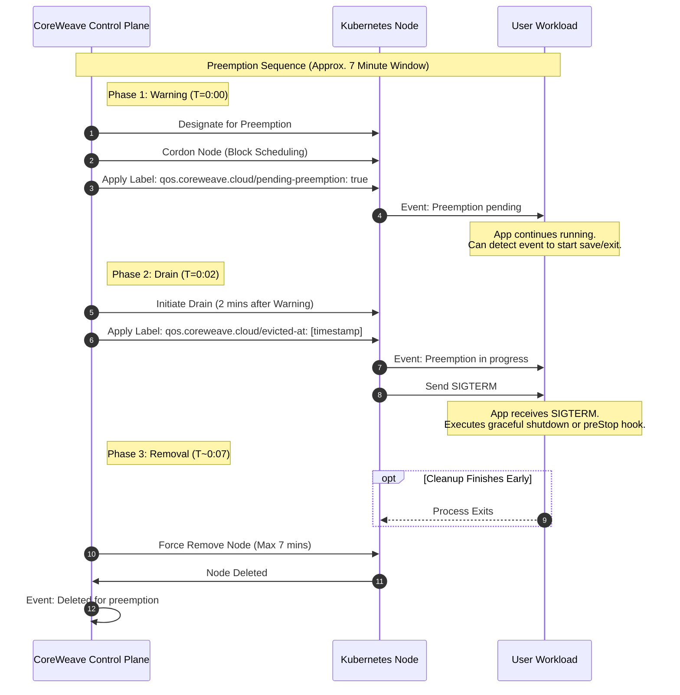

# Spot Node Pools

Source: https://docs.coreweave.com/platform/capacity-plans/spot-node-pools

# Spot Node Pools

> Preemptible, pay-as-you-go bare-metal compute resources in CKS with no long-term commitments

Spot Node Pools provide pay-as-you-go access to high-performance bare-metal compute resources without long-term commitments or reservations. They are suited for fault-tolerant, interruptible workloads where flexibility on capacity matters more than guaranteed availability. Instances in a Spot Node Pool are identical to instances in standard Node Pools.

The key difference is that instances in Spot Node Pools operate on a preemptible basis, meaning CoreWeave can reclaim them when capacity is needed elsewhere.

You can manage Spot Node Pools using the [same tools and methods](https://docs.coreweave.com/products/cks/nodes/manage.md) as standard Node Pools.

The instances themselves have no special configuration. An instance becomes a Spot instance by being part of a Node Pool created with `computeClass: spot`.

## Key characteristics

* **Availability**: Capacity for Spot Node Pools is not guaranteed and depends on current availability in the region.
* **Preemptible**: Unlike instances in on-demand Node Pools, CoreWeave can reclaim instances in Spot Node Pools at any time if the capacity is required elsewhere.
* **Automatic scaling**: When all instances are preempted, the Spot Node Pool remains active and automatically scales back up when capacity becomes available again.

## Availability

Spot Node Pools are supported in all [General Access](https://docs.coreweave.com/platform/regions/about-regions-and-azs.md#general-access) Availability Zones, and for all [instance types](https://docs.coreweave.com/platform/instances/about-instances.md) except Superchip-powered instances (for example, GH200, GB200, GB300).

## Check Spot capacity before you provision

Spot capacity is not guaranteed and varies by Availability Zone. Before you create a Spot Node Pool, use [Capacity Finder](https://docs.coreweave.com/platform/capacity-plans/capacity-finder.md) in the Cloud Console to compare placement availability across Zones for one or more GPU and CPU instance types and your requested size. Capacity Finder can also pre-fill Spot Node Pools from a recommended Zone.

## Create a Spot Node Pool

Create a Spot Node Pool by setting the `computeClass` field to `spot` in your Node Pool configuration in either a Kubernetes manifest or the Cloud Console. See [Create a Node Pool](https://docs.coreweave.com/products/cks/nodes/create.md) for more information.

### Use Kubernetes

To create a Spot Node Pool using Kubernetes, set the `spec.computeClass` field to `spot` in your Node Pool manifest.

```yaml theme={"system"}
apiVersion: v1
kind: NodePool
metadata:
  name: my-spot-pool
spec:
  region: EU-SOUTH-04A
  computeClass: spot
  # ... other configuration ...
```

### Use the Cloud Console

To create a Spot Node Pool using the Cloud Console, set the **Compute Class** to `spot` in the configuration settings.

1. Navigate to the **Node Pools** dashboard.
2. Click **Create Node Pool**.
3. In the configuration settings, enter `spot` as the **Compute Class** string (`spec.computeClass`).

## Instance preemption

Because instances in Spot Node Pools are preemptible, CoreWeave may reclaim them when capacity is needed elsewhere. When this happens, a controlled preemption process removes instances from the pool.

When CoreWeave selects an instance for preemption, the process provides a seven-minute window (maximum) to gracefully stop running jobs and save state before the instance leaves the pool. The following timeline describes each phase of that window and the signals your workloads receive at each stage.

### Detailed timeline

#### Warning and cordon (T=0:00)

When CoreWeave designates an instance for preemption, it immediately [cordons](https://kubernetes.io/docs/reference/kubectl/generated/kubectl_cordon/) the Node to prevent scheduling new jobs. Running jobs continue executing normally at this stage. The system sends a [Kubernetes warning event](https://kubernetes.io/docs/reference/kubectl/generated/kubectl_events/) with the reason `Preemption pending` and applies the label `qos.coreweave.cloud/pending-preemption: true` to the Node. This is your application's initial signal that preemption is imminent.

#### Drain and signal (T=0:02)

Two minutes after the initial warning, CoreWeave automatically initiates a [Node drain](https://kubernetes.io/docs/tasks/administer-cluster/safely-drain-node/) to terminate workloads. The system sends another Kubernetes warning event with the reason `Preemption in progress` and applies the label `qos.coreweave.cloud/evicted-at: [timestamp]` to track when the drain started. At this point the normal [Kubernetes Pod termination process](https://kubernetes.io/docs/concepts/workloads/pods/pod-lifecycle/#pod-termination) starts.

1. Kubernetes triggers any [Pod PreStop lifecycle hooks](https://kubernetes.io/docs/concepts/containers/container-lifecycle-hooks/#container-hooks).
2. Kubernetes sends a Linux [`SIGTERM` signal](https://en.wikipedia.org/wiki/Signal_\(IPC\)#SIGTERM) to all running processes to indicate that the Pod is terminating. This gives processes an opportunity to perform graceful shutdown procedures that the PreStop lifecycle hooks didn't trigger.
3. The system waits for 30 seconds, or the length of time specified in the Pod's [`terminationGracePeriodSeconds`](https://kubernetes.io/docs/concepts/containers/container-lifecycle-hooks/#hook-handler-execution).
4. After the grace period, Kubernetes sends a [`SIGKILL` signal](https://en.wikipedia.org/wiki/Signal_\(IPC\)#SIGKILL) to any remaining running processes in the Pod. Processes can't catch or ignore this signal, and the receiving process can't perform any cleanup. The process terminates immediately.

#### Removal from pool (T=0:07)

When the Node fully drains or when the seven-minute window expires (whichever comes first), CoreWeave removes the instance from your cluster and Spot Node Pool. The system sends a final Kubernetes warning event with the reason `Deleted for preemption` to confirm the removal is complete.

### Sequence diagram



## Fully preempted Spot Node Pools

If all instances in a Spot Node Pool are preempted, the pool itself remains active but effectively scales to zero instances.

The Spot Node Pool continues to exist in your cluster configuration and automatically attempts to provision new instances when capacity becomes available again in the region. Your workloads remain in a pending state until instances rejoin the pool.

## Handle preemption events

Your application must handle preemption events gracefully and tolerate preemption without causing data loss or downtime.

If your application doesn't natively handle [`SIGTERM` signals](https://en.wikipedia.org/wiki/Signal_\(IPC\)#SIGTERM) for graceful shutdown, use a [Kubernetes PreStop hook](https://kubernetes.io/docs/concepts/containers/container-lifecycle-hooks/#container-hooks) in your Pod definition to trigger the necessary cleanup steps before the container terminates.

CKS-initiated scale-down doesn't wait for DaemonSets unless they carry `qos.coreweave.com/graceful-interruptible: "true"` and don't tolerate eviction taints. If a DaemonSet on a Spot Node must finish work before the Node leaves, label it accordingly.

## Mix Spot and on-demand capacity

A common pattern runs the resilient majority of a workload on Spot and keeps a smaller on-demand Node Pool for the parts that can't be interrupted. Schedule interruptible replicas onto the Spot pool, and pin critical singletons to an on-demand pool with a `nodeSelector`. To target Pods to a specific pool, see [Workload scheduling on CKS](https://docs.coreweave.com/products/cks/clusters/scheduling/workload-scheduling.md).

## Monitor preemption events

You can watch for preemption warnings using [`kubectl events`](https://kubernetes.io/docs/reference/kubectl/generated/kubectl_events/):

```bash theme={"system"}
kubectl events --types=Warning --watch | grep "Reason: Preemption pending"
```

### Search for preempted Nodes in Grafana

To check whether CoreWeave preempted any of your Nodes, use Grafana Explore with the preconfigured preemption query. The query returns Nodes that CoreWeave removed due to preemption. Preemption logs are retained for 1 week.

[Open preemption query in Grafana Explore](https://grafana.int.coreweave.com/explore?schemaVersion=1\&panes=%7B%223vx%22%3A%7B%22data%22%3A%7B%22datasource%22%3A%22loki%22%2C%22queries%22%3A%5B%7B%22refId%22%3A%22A%22%2C%22expr%22%3A%22%7Bapp%3D%5C%22node-lifecycle%5C%22%7D%20%7C%3D%20%5C%22preempt%5C%22%22%7D%5D%2C%22range%22%3A%7B%22from%22%3A%22now-24h%22%2C%22to%22%3A%22now%22%7D%7D%7D%7D%7D\&orgId=1)

For more information about Pod termination, see [Termination of Pods](https://kubernetes.io/docs/concepts/workloads/pods/pod-lifecycle/#pod-termination) in the Kubernetes documentation.

## Monitor Spot usage

To track Spot instance usage and estimate costs, use Grafana with the `billing:instance:total` metric and filter by `compute_class="spot"`. This example groups Spot usage by instance type:

```text theme={"system"}
sum by (label_node_kubernetes_io_instance_type) (
  billing:instance:total{compute_class="spot"}
)
```

For the full list of labels on this metric, more query examples, and cost-estimation techniques, see [Cost and usage monitoring](https://docs.coreweave.com/observability/usage-monitoring.md).

For a Cloud Console view of Spot usage alongside your other capacity plans, see [Billing insights](https://docs.coreweave.com/billing/billing-insights.md).

## Next steps

* Use [Capacity Finder](https://docs.coreweave.com/platform/capacity-plans/capacity-finder.md) to compare Spot capacity across Availability Zones.
* Configure [workload scheduling on CKS](https://docs.coreweave.com/products/cks/clusters/scheduling/workload-scheduling.md) to target Pods to the appropriate Node Pools.
