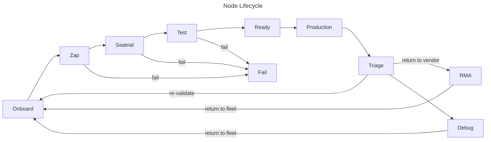

# Node Lifecycle

Source: https://docs.coreweave.com/platform/fleet-management/node-lifecycle/day1

# Day 1

> Automated Day 1 operations that move Nodes through Zap, Seatrial, and Test states to reach production

CoreWeave's automated Day 1 operations move Nodes through a sequence of states to ready them for production deployment. This page describes each state in the Day 1 lifecycle. Use it to understand how CoreWeave validates Node health before workloads run, and to locate a Node when you see it reported in a given state.

## Day 1 Node states

After [Day 0](https://docs.coreweave.com/platform/fleet-management/node-lifecycle.md#day-0-initialization), the Node transitions to the **Onboard** state where a data center technician (DCT) conducts final physical inspections, verifies cabling and power connections, and confirms that the correct GPUs, storage, memory, and other components are installed. After the DCT certifies the Node, CoreWeave automatically initiates Day 1 operations, which move the Node through a sequence of states, starting with **Zap**, to ready it for production deployment.

### Zap

During the Zap state, the Node undergoes a firmware upgrade process that affects the GPU, PCI Retimer, BMC, BIOS, and other components. The upgrades happen in more than one pass, with a short observation window between passes.
This procedure typically spans one to two hours.

* Successful completion of the Zap state advances the Node to the **Seatrial** state.
* If a firmware upgrade fails or exceeds its time limit, the Node moves to the **Fail** state for analysis.

### Seatrial

The Seatrial state is a passive observation period for a live, booted Node. CoreWeave's automated monitoring watches for hardware health alerts, and for backend network alerts that indicate InfiniBand or RoCE connectivity problems. If a qualifying alert fires at any point during the observation window, the Node fails out of Seatrial and moves to the **Fail** state. This observation period weeds out early-life hardware failures before the Node advances.

After a clean Seatrial, the Node progresses to the **Test** state.

### Test

During this 24-hour period, the Node undergoes extensive tests that uncover any underlying hardware or software anomalies.
This includes a set of proprietary testing and Node failure prediction capabilities:

* **Proprietary burn-in testing** stress-tests compute, networking, and storage subsystems to catch early hardware faults before Nodes enter the production fleet.
* **Advanced chip-level testing** performs deep diagnostics on GPU memory, interconnects, and compute performance to identify marginal or latent hardware issues.
* **Predictive failure detection** monitors hardware signals and error trends to forecast and preempt failures before they impact workloads. This capability continues into [Day 2+ operations](https://docs.coreweave.com/platform/fleet-management/node-lifecycle/day2.md#trend-analysis), where CoreWeave analyzes historical test data to identify patterns and fine-tune performance over time.

Because this process runs automatically, CoreWeave provisions Nodes around the clock so the fleet stays in a constant state of readiness.

At the end of the Test period, the Node moves to one of the following states:

* Passing the Test state moves the Node to the **Ready** state.
* Any issues detected during this phase move the Node to the **Fail** state.

### Ready

Nodes that pass the Test state enter the **Ready** state, a pool of fully validated Nodes parked and awaiting delivery. Only Nodes in the Ready state are eligible for delivery to a customer environment, and delivery is what moves a Node to **Production**. The Ready pool is also how replacement Nodes arrive quickly: when a Node leaves production, its replacement comes from the already-validated Ready pool rather than from a new provisioning run.

### Production

Nodes that reach the **Production** state are ready for use.
CoreWeave Kubernetes Service (CKS) manages their allocation and cluster assignments.
In the Production state, the Node remains under continuous monitoring, which triggers further lifecycle events if CoreWeave detects any issues. To learn more, see [Day 2+](https://docs.coreweave.com/platform/fleet-management/node-lifecycle/day2.md).

### Fail

A Node that fails or times out in any Day 1 state moves to the **Fail** state. Automation doesn't act on a Node in the Fail state; the Node stays parked while a CoreWeave operator investigates the failure and returns the Node to the appropriate Day 1 state.

### Triage and RMA

Nodes that develop problems after reaching Production move to the **Triage** state, where CoreWeave temporarily sidelines them from production. After Triage, the Node takes one of the following paths:

* If the issue was transient or repairable, the Node re-enters the Day 1 process for re-validation. A Node never returns directly to the **Ready** pool from Triage; it rejoins the Ready pool only after passing Day 1 testing again.
* For in-depth troubleshooting, CoreWeave moves the Node to the **Debug** state. Nodes that leave Debug return to the **Onboard** state and start a new lifecycle.
* For vendor repairs, CoreWeave moves the Node to the **RMA** state. Refurbished Nodes return to the **Onboard** state and complete the full Day 1 process before they rejoin the **Ready** pool.

Customers don't interact with Nodes in the **Triage** and **RMA** states. CoreWeave's full lifecycle automation, including through these states, gives you reliable, performant fleets without wasted time and effort spent dealing with Nodes when they fail.
