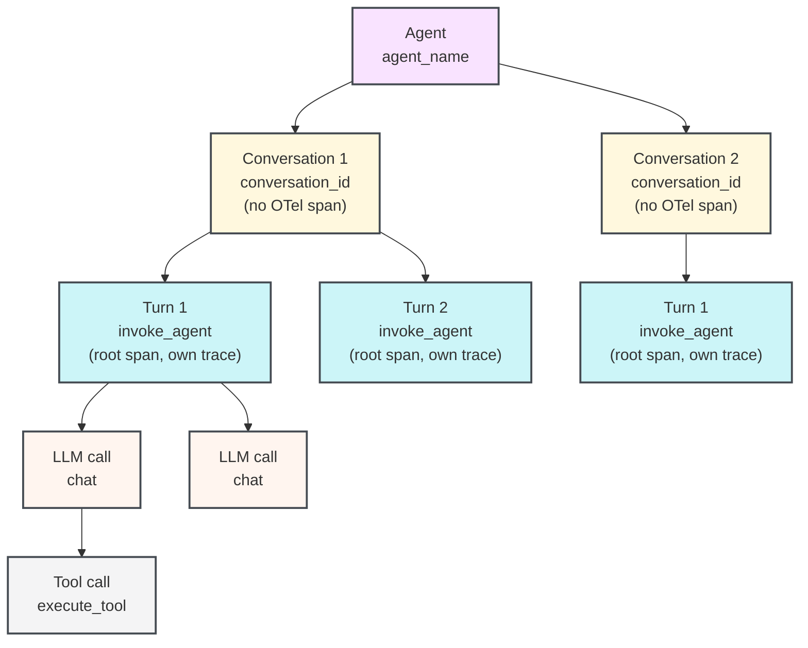

# Trace your agents

Source: https://docs.coreweave.com/products/agent-lens/tracing/instrument

# Trace your agents

> Use the Agent Lens SDK to instrument multi-turn agentic applications and view their activity in the Agent Lens.

Learn how to instrument a multi-turn agentic application using the CoreWeave Forge SDK so that you can view, debug, and evaluate your agent's behavior. This guide is intended for developers who build or integrate agents and want structured visibility into conversations, turns, LLM calls, and tool executions.

The Agent Lens SDK models the full lifecycle of a multi-turn agent conversation: the agent that owns many conversations, the conversation that groups turns together, each user-agent exchange (turn), the LLM calls within a turn, and the tool executions that an LLM triggers. Traces appear in the **Conversations** tab of your CoreWeave Agent Lens project. Each conversation shows a multi-turn timeline with nested tool calls, token usage, and feedback.

Agent Lens is built on [OpenTelemetry (OTel)](https://opentelemetry.io/docs/concepts/), the open standard for distributed tracing. Every turn, LLM call, and tool call emits an OTel *span* (a structured record of one operation). Each span is tagged with [GenAI semantic-convention](https://github.com/open-telemetry/semantic-conventions-genai/blob/main/docs/gen-ai/README.md) attributes like `gen_ai.agent.name` and `gen_ai.conversation.id`.

## Before you begin

To get started, install the Agent Lens SDK and initialize your project. This step registers your entity and project with Agent Lens so that the SDK routes spans to the correct location in the UI. The SDK reads your API key from the `WANDB_API_KEY` environment variable.

> [tab] Python
>
> ```bash lines theme={"system"}
> pip install coreweave
> ```
>
> Replace `[YOUR-TEAM]` with your Forge entity name and `[YOUR-PROJECT]` with your project name. The entity is required.
>
> ```python lines theme={"system"}
> from coreweave.forge.agentlens import tracing
>
> tracing.init("[YOUR-TEAM]/[YOUR-PROJECT]")
> ```
>
> Call `tracing.init()` before any `start_conversation()`, `start_turn()`, `start_llm()`, `start_tool()`, or `start_subagent()` call. Before `init()` runs, or after `shutdown()`, the tracing functions no-op silently, so you can leave instrumentation in production code and control it through configuration. Call `tracing.shutdown()` when your process exits to flush any spans that are still buffered. It's also registered with `atexit`.

> [tab] TypeScript
>
> ```bash lines theme={"system"}
> npm install @coreweave/forge-sdk
> ```
>
> Replace `[YOUR-TEAM]` with your Forge entity name and `[YOUR-PROJECT]` with your project name. The entity is required.
>
> ```typescript lines theme={"system"}
> import { tracing } from '@coreweave/forge-sdk/agentlens';
>
> await tracing.init('[YOUR-TEAM]/[YOUR-PROJECT]');
> ```
>
> Call `tracing.init()` once before any `startConversation()`, `startTurn()`, `startLLM()`, `startTool()`, or `startSubagent()` call. In TypeScript, every request or agent run must also be wrapped in `tracing.runIsolated()`, which keeps that run's tracing state across `await` and prevents concurrent requests from sharing a conversation. Starting a span outside `tracing.runIsolated()` throws an error. Call `tracing.shutdown()` when your process exits to flush any spans that are still buffered.

## The agent data model

Agent Lens models agent behavior as a hierarchy of one-to-many relationships. Each agent can have many conversations, each conversation can have many turns, each turn can have many LLM calls, and each LLM call can trigger many tool calls.

| Concept | Agent Lens SDK class | OTel span type | Description | Reference page |
| - | - | - | - | - |
| Agent | *(no class)* | *(no span, grouped by the `agent_name` attribute)* | An agentic application that contains one or more conversations. | |
| Conversation | `Conversation` | *(no span, turns are grouped by the `conversation_id` attribute)* | A conversation or run that contains one or more turns. | [Python](https://docs.coreweave.com/products/agent-lens/reference/python-sdk/conversation.md)  [TypeScript](https://docs.coreweave.com/products/agent-lens/reference/typescript-sdk/classes/conversation.md) |
| Turn | `Turn` | `invoke_agent` | One user message and the agent's complete response. | [Python](https://docs.coreweave.com/products/agent-lens/reference/python-sdk/turn.md)  [TypeScript](https://docs.coreweave.com/products/agent-lens/reference/typescript-sdk/classes/turn.md) |
| LLM call | `LLM` | `chat` | One call to a language model API. | [Python](https://docs.coreweave.com/products/agent-lens/reference/python-sdk/llm.md)  [TypeScript](https://docs.coreweave.com/products/agent-lens/reference/typescript-sdk/classes/llm.md) |
| Tool call | `Tool` | `execute_tool` | One tool call triggered by an LLM response. | [Python](https://docs.coreweave.com/products/agent-lens/reference/python-sdk/tool.md)  [TypeScript](https://docs.coreweave.com/products/agent-lens/reference/typescript-sdk/classes/tool.md) |
| Sub-agent call | `SubAgent` | `invoke_agent` | A nested agent invocation, typically when one agent delegates to another. | [Python](https://docs.coreweave.com/products/agent-lens/reference/python-sdk/subagent.md)  [TypeScript](https://docs.coreweave.com/products/agent-lens/reference/typescript-sdk/classes/subagent.md) |

The following diagram shows how one agent spans many conversations, one conversation spans many turns, and so on.



A conversation groups turns by a shared `conversation_id` attribute rather than a parent span, so each turn starts its own OTel trace. This design supports distributed tracing and parallel execution. The client sends spans directly to the OTel collector without any server-side aggregation.

> [!TIP]
>
> To integrate Agent Lens with agent SDKs or harnesses such as the Claude Agent SDK or Codex, see [Choose an agent integration](https://docs.coreweave.com/products/agent-lens/get-started/integrations.md). Those integrations set `conversation_id` from the SDK or harness session, so you don't need `start_conversation()` to group their turns. The LLM provider SDK integrations (OpenAI, Anthropic, and Google Gen AI) don't create conversations, and Agent Lens shows only calls that run inside one, so use the APIs on this page to open a conversation and turns around those calls.

## Agent tracing APIs

The following sections describe each top-level tracing function and the arguments it accepts. Use them to instrument the conversation, turn, LLM call, and tool call layers of the data model described in the previous section.

Agent Lens exposes the following top-level functions. Each function returns an object that works as a context manager (using `with` in Python, or `try/finally` in TypeScript) or that you can close manually by calling `.end()`.

### Start a conversation

`start_conversation()` (Python) or `startConversation()` (TypeScript) stamps a `conversation_id` attribute on every child span so that turns are grouped in the **Conversations** tab. If you pass a `conversation_id` / `conversationId`, it must be stable across the lifetime of the conversation. Reuse the same ID to add new turns to an existing conversation. When you omit it, the SDK generates a UUID automatically.

The active conversation is stored in context (a Python `ContextVar` or Node.js `AsyncLocalStorage`), so any code running in the same async context can retrieve it with `tracing.get_current_conversation()` / `tracing.getCurrentConversation()` without passing the conversation object explicitly.

> [tab] Python
>
> ```python lines theme={"system"}
> conversation = tracing.start_conversation(
>     agent_name="my-agent",    # Optional: identifies the agent in the UI. Omit it and the conversation isn't grouped under a named agent.
>     conversation_id="",       # Optional: stable ID to group turns; auto-generated when empty.
>     model="",                 # Optional: default model for turns in this conversation.
>     conversation_name="",     # Optional: human-readable label shown in the UI.
>     include_content=True,     # Optional: set False to omit message bodies from spans.
>     continue_parent_trace=False,  # Optional: attach to an existing OTel trace instead of starting a new one.
> )
> ```

> [tab] TypeScript
>
> ```typescript lines theme={"system"}
> const conversation = tracing.startConversation({
>   agentName: 'my-agent',  // Optional: identifies the agent in the UI. Omit it and the conversation isn't grouped under a named agent.
>   conversationId: '',     // Optional: stable ID to group turns, auto-generated when empty.
>   model: '',              // Optional: default model for turns in this conversation.
> });
> ```

### Start a turn

`start_turn()` (Python) and `startTurn()` (TypeScript) create a new `invoke_agent` span that becomes the root of a new OTel trace. Agent Lens uses this span to represent one complete user-agent exchange in the timeline view.

> [tab] Python
>
> ```python lines theme={"system"}
> turn = tracing.start_turn(
>     user_message="What is the weather in Tokyo?",  # The user's input text.
>     agent_name="my-agent",   # Optional: overrides the conversation-level agent name.
>     model="gpt-4o",          # Optional: model used for this turn.
> )
> ```

> [tab] TypeScript
>
> ```typescript lines theme={"system"}
> const turn = tracing.startTurn({
>   userMessage: 'What is the weather in Tokyo?',  // The user's input text.
>   agentName: 'my-agent',  // Optional: overrides the conversation-level agent name.
>   model: 'gpt-4o',        // Optional: model used for this turn.
> });
> ```

You can call it two ways:

* **As a top-level function** (`tracing.start_turn(...)` / `tracing.startTurn(...)`), shown in the examples below. It resolves the active conversation from context and inherits its conversation ID. If no conversation is active, the turn is created without a `conversation_id` and isn't grouped with other turns.
* **As an instance method** on a conversation you hold a reference to (`conversation.start_turn(...)` / `conversation.startTurn(...)
  `). Useful when you have an explicit conversation object in scope, such as inside a context-manager block. The ["Context manager or
  try-finally pattern"](#context-manager-or-try-finally-pattern) example shown later in this guide uses this form. See the [data-model
  table](#the-agent-data-model) shown previously for direct links to the `Conversation`, `Turn`, `LLM`, `Tool`, and `SubAgent` reference
  pages in both SDKs.

### Start an LLM call

`start_llm()` / `startLLM()` creates a `chat` span nested under the current turn. Agent Lens uses this span to display token usage, model name, input and output messages, and reasoning in the UI.

> [tab] Python
>
> ```python lines theme={"system"}
> llm = tracing.start_llm(
>     model="gpt-4o",             # The model identifier.
>     provider_name="openai",     # Optional: provider name, for example "openai", "anthropic". See note below.
>     system_instructions=["Be concise."],  # Optional: system prompt strings.
> )
> ```

> [tab] TypeScript
>
> ```typescript lines theme={"system"}
> const llm = tracing.startLLM({
>   model: 'gpt-4o',          // The model identifier.
>   providerName: 'openai',   // Optional: provider name, for example "openai", "anthropic". See note below.
> });
> ```

After the LLM call completes, assign the response data to the `llm` object before it closes:

> [tab] Python
>
> ```python lines theme={"system"}
> with tracing.start_llm(model="gpt-4o", provider_name="openai") as llm:
>     response = openai_client.chat.completions.create(...)
>     llm.input_messages = [Message(role="user", content="...")]
>     llm.output_messages = [Message(role="assistant", content=response.choices[0].message.content)]
>     llm.usage = Usage(
>         input_tokens=response.usage.prompt_tokens,
>         output_tokens=response.usage.completion_tokens,
>     )
> ```

> [tab] TypeScript
>
> ```typescript lines theme={"system"}
> const llm = tracing.startLLM({ model: 'gpt-4o', providerName: 'openai' });
> try {
>   const response = await openaiClient.chat.completions.create({ ... });
>   llm.record({
>     inputMessages: [{ role: 'user', content: '...' }],
>     outputMessages: [{ role: 'assistant', content: response.choices[0].message.content ?? '' }],
>     usage: {
>       inputTokens: response.usage?.prompt_tokens,
>       outputTokens: response.usage?.completion_tokens,
>     },
>   });
> } finally {
>   llm.end();
> }
> ```
>
> `llm.record()` is a shortcut for assigning `inputMessages`, `outputMessages`, `usage`, and `reasoning` in one call. You can still set the properties individually if you prefer. The Python SDK exposes the same method as `llm.record(...)` with snake\_case keyword arguments.

Pass `provider_name` / `providerName` explicitly. Agent Lens doesn't infer it from the model string.

### Start a tool call

`start_tool()` / `startTool()` creates an `execute_tool` span. The span becomes a child of whatever OTel span is active in context (typically the `chat` span of the LLM call that produced the tool call).

> [tab] Python
>
> ```python lines theme={"system"}
> tool = tracing.start_tool(
>     name="get_weather",                  # Tool name as declared to the LLM.
>     arguments='{"city": "Tokyo"}',       # JSON string of the tool arguments.
>     tool_call_id="call_abc123",          # Optional: tool call ID from the LLM response.
> )
> ```

> [tab] TypeScript
>
> ```typescript lines theme={"system"}
> const tool = tracing.startTool({
>   name: 'get_weather',            // Tool name as declared to the LLM.
>   args: '{"city": "Tokyo"}',      // Optional: JSON string of the tool arguments.
>   toolCallId: 'call_abc123',      // Optional: tool call ID from the LLM response.
> });
> ```

Assign the tool result before closing:

> [tab] Python
>
> ```python lines theme={"system"}
> with tracing.start_tool(name="get_weather", arguments='{"city": "Tokyo"}') as tool:
>     result = get_weather_api("Tokyo")
>     tool.result = result  # Accepts dict, list, or string. JSON-encoded automatically.
> ```

> [tab] TypeScript
>
> ```typescript lines theme={"system"}
> const tool = tracing.startTool({ name: 'get_weather', args: '{"city": "Tokyo"}' });
> try {
>   tool.result = await getWeatherApi('Tokyo');
> } finally {
>   tool.end();
> }
> ```

## Usage patterns for agent tracing

The following sections describe how to combine these functions depending on how your agent code is structured.

The following examples use two types from the Agent Lens SDK:

* `Message` ([Python](https://docs.coreweave.com/products/agent-lens/reference/python-sdk/message-types.md#message) · [TypeScript](https://docs.coreweave.com/products/agent-lens/reference/typescript-sdk/interfaces/message.md)) represents a single entry in a conversation: a user input, an assistant response, a system prompt, or a tool result. Assign a list of messages to `llm.input_messages` / `llm.inputMessages` to record what the model received, and to `llm.output_messages` / `llm.outputMessages` to record what it produced.
* `Usage` ([Python](https://docs.coreweave.com/products/agent-lens/reference/python-sdk/message-types.md#usage) · [TypeScript](https://docs.coreweave.com/products/agent-lens/reference/typescript-sdk/interfaces/usage.md)) captures token counts from the LLM response and is assigned to `llm.usage`.

Agent Lens uses both to populate the UI with the inputs, outputs, and token usage of each LLM call.

### Context manager or try-finally pattern

For most agents, use a context manager pattern in Python or a try-finally pattern in TypeScript. The span closes and sends at the end of the block, even if an exception occurs.

Agent Lens stores the active conversation, turn, and LLM call in context, so any function called within a block can call `start_llm()` / `startLLM()` or `start_tool()` / `startTool()` without holding an explicit reference to the parent. This works across module boundaries as long as the code runs in the same async context. To retrieve the active objects from anywhere in the call stack, use `tracing.get_current_conversation()` / `tracing.getCurrentConversation()`, `tracing.get_current_turn()` / `tracing.getCurrentTurn()`, and `tracing.get_current_llm()` / `tracing.getCurrentLLM()`.

> [tab] Python
>
> ```python lines highlight="13,14,17,25,29" theme={"system"}
> from coreweave.forge.agentlens import tracing
> from coreweave.forge.agentlens.tracing import Message, Usage
>
> # Placeholder functions: replace with your own implementations.
> def call_openai(*args, **kwargs):
>     pass  # Replace with your LLM client call.
>
> def get_weather_api(city: str) -> str:
>     return "24°C, sunny"  # Replace with your weather API call.
>
> tracing.init("[YOUR-TEAM]/[YOUR-PROJECT]")
>
> with tracing.start_conversation(agent_name="weather-bot") as conversation:
>     with conversation.start_turn(user_message="What is the weather in Tokyo?") as turn:
>
>         # First LLM call: returns a tool call.
>         with tracing.start_llm(model="gpt-4o", provider_name="openai") as llm:
>             response = call_openai(...)
>             llm.input_messages = [Message(role="user", content="What is the weather?")]
>             llm.think("User wants weather data, I should call get_weather.")
>             llm.output("Let me check the weather for you.")
>             llm.usage = Usage(input_tokens=100, output_tokens=20)
>
>             # Tool call: child of the LLM call that requested it.
>             with tracing.start_tool(name="get_weather", arguments='{"city":"Tokyo"}') as tool:
>                 tool.result = get_weather_api("Tokyo")  # Returns "24°C, sunny".
>
>         # Second LLM call: synthesizes the final answer.
>         with tracing.start_llm(model="gpt-4o", provider_name="openai") as llm:
>             llm.input_messages = [Message(role="user", content="What is the weather?")]
>             llm.output("It is 24°C and sunny in Tokyo today.")
>             llm.usage = Usage(input_tokens=150, output_tokens=30)
>
> tracing.shutdown()
> ```

> [tab] TypeScript
>
> Wrap the agent run in `tracing.runIsolated()` so that its conversation, turn, and LLM context survive across `await` and stay separate from other concurrent runs.
>
> ```typescript lines highlight="11,12,14,17,25,36" theme={"system"}
> import { tracing } from '@coreweave/forge-sdk/agentlens';
> import type { Message, Usage } from '@coreweave/forge-sdk/agentlens/tracing';
>
> // Placeholder function: replace with your own implementation.
> async function getWeatherApi(city: string): Promise<string> {
>   return '24°C, sunny';  // Replace with your weather API call.
> }
>
> await tracing.init('[YOUR-TEAM]/[YOUR-PROJECT]');
>
> await tracing.runIsolated(async () => {
>   const conversation = tracing.startConversation({ agentName: 'weather-bot' });
>   try {
>     const turn = conversation.startTurn({ userMessage: 'What is the weather in Tokyo?' });
>     try {
>       // First LLM call: returns a tool call.
>       const llm = tracing.startLLM({ model: 'gpt-4o', providerName: 'openai' });
>       try {
>         llm.inputMessages = [{ role: 'user', content: 'What is the weather?' }];
>         llm.think('User wants weather data, I should call get_weather.');
>         llm.output('Let me check the weather for you.');
>         llm.usage = { inputTokens: 100, outputTokens: 20 };
>
>         // Tool call: child of the LLM call that requested it.
>         const tool = tracing.startTool({ name: 'get_weather', args: '{"city":"Tokyo"}' });
>         try {
>           tool.result = await getWeatherApi('Tokyo');  // Returns "24°C, sunny".
>         } finally {
>           tool.end();
>         }
>       } finally {
>         llm.end();
>       }
>
>       // Second LLM call: synthesizes the final answer.
>       const llm2 = tracing.startLLM({ model: 'gpt-4o', providerName: 'openai' });
>       try {
>         llm2.inputMessages = [{ role: 'user', content: 'What is the weather?' }];
>         llm2.output('It is 24°C and sunny in Tokyo today.');
>         llm2.usage = { inputTokens: 150, outputTokens: 30 };
>       } finally {
>         llm2.end();
>       }
>     } finally {
>       turn.end();
>     }
>   } finally {
>     conversation.end();
>   }
> });
>
> await tracing.shutdown();
> ```

### Manual start and end pattern

Use `.end()` explicitly when you can't use `with` blocks or `try/finally`. For example, when you open and close spans in different function calls, or when you manage async lifecycle outside a coroutine. You're responsible for calling `.end()` on every object you create, so that spans close and flush to the collector. In TypeScript, ending a turn or conversation also closes any of its descendants that are still open.

> [tab] Python
>
> ```python lines highlight="1,2,4,9,15" theme={"system"}
> conversation = tracing.start_conversation(agent_name="weather-bot")
> turn = conversation.start_turn(user_message="What is the weather?")
>
> llm = tracing.start_llm(model="gpt-4o", provider_name="openai")
> llm.input_messages = [Message(role="user", content="What is the weather?")]
> llm.output("Let me check.")
> llm.usage = Usage(input_tokens=100, output_tokens=20)
>
> tool = tracing.start_tool(name="get_weather", arguments='{"city": "Tokyo"}')
> tool.result = "24°C, sunny"
> tool.end()   # end() is idempotent: safe to call more than once.
>
> llm.end()
>
> llm2 = tracing.start_llm(model="gpt-4o", provider_name="openai")
> llm2.output("It is 24°C and sunny in Tokyo.")
> llm2.usage = Usage(input_tokens=150, output_tokens=30)
> llm2.end()
>
> turn.end()
> conversation.end()
> ```

> [tab] TypeScript
>
> ```typescript lines highlight="1,2,3,5,10,16" theme={"system"}
> await tracing.runIsolated(async () => {
>   const conversation = tracing.startConversation({ agentName: 'weather-bot' });
>   const turn = conversation.startTurn({ userMessage: 'What is the weather?' });
>
>   const llm = tracing.startLLM({ model: 'gpt-4o', providerName: 'openai' });
>   llm.inputMessages = [{ role: 'user', content: 'What is the weather?' }];
>   llm.output('Let me check.');
>   llm.usage = { inputTokens: 100, outputTokens: 20 };
>
>   const tool = tracing.startTool({ name: 'get_weather', args: '{"city": "Tokyo"}' });
>   tool.result = '24°C, sunny';
>   tool.end();  // end() is idempotent: safe to call more than once.
>
>   llm.end();
>
>   const llm2 = tracing.startLLM({ model: 'gpt-4o', providerName: 'openai' });
>   llm2.output('It is 24°C and sunny in Tokyo.');
>   llm2.usage = { inputTokens: 150, outputTokens: 30 };
>   llm2.end();
>
>   turn.end();
>   conversation.end();
> });
> ```

## Keep span times consistent

In the UI, Agent Lens orders and displays turns and spans based on their start and end timestamps.

For a turn to show its steps in the right order and report the right duration, its spans must meet two requirements:

* **All timestamps come from one clock.** By default, an OTel span takes its timestamps from the clock of the process that creates it. If a turn's spans come from processes whose clocks disagree, such as a browser and a server, the turn's steps can appear out of order in the Agent Lens UI. For example, a tool call can appear before the LLM call that requested it.
* **The root span encloses its children.** Start the turn before any of its child spans, and end it after all of them. The [context manager and try-finally pattern](#context-manager-or-try-finally-pattern) does this for you.

If part of a turn runs on another host, such as a browser, create all of the turn's spans in one process, or set each span's start and end times explicitly from the same clock as the rest of the turn:

* **TypeScript SDK**: Pass `startTime` when you start a span, and `endTime` when you call `end()`.
* **Python SDK**: Log the turn after it completes with [`tracing.log_turn`](https://docs.coreweave.com/products/agent-lens/tracing/batch-logging#log-a-turn). Pass `started_at` and `ended_at` to `log_turn`, and set them on each child span. If you don't pass them to `log_turn`, the turn starts with its earliest child span and ends with its latest one.
* **OpenTelemetry SDK**: Pass a start time when you start a span, and an end time when you end it: `start_time` and `end_time` in Python, or `startTime` and `endTime` in TypeScript.

The following example records a tool call that runs in the browser. The server reads its own clock before it sends the request and after the result comes back, and uses those times for the tool span. Replace `[TEAM-NAME]` and `[PROJECT-NAME]` with your Forge team and project names.

> [tab] Python
>
> ```python lines highlight="13,15,21,22" theme={"system"}
> from datetime import datetime, timezone
>
> from coreweave.forge.agentlens import tracing
> from coreweave.forge.agentlens.tracing import Tool
>
> # Placeholder function: replace with your own implementation.
> def run_tool_in_browser(name: str, arguments: dict) -> dict:
>     return {"forecast": "24°C, sunny"}  # Replace with the round trip to the browser.
>
> tracing.init("[TEAM-NAME]/[PROJECT-NAME]")
>
> # Read the server's clock before and after the browser runs the tool.
> sent_at = datetime.now(timezone.utc)
> result = run_tool_in_browser("get_weather", {"city": "Tokyo"})
> received_at = datetime.now(timezone.utc)
>
> tool_span = Tool(
>     name="get_weather",
>     arguments={"city": "Tokyo"},
>     result=result,
>     started_at=sent_at,
>     ended_at=received_at,
> )
>
> # Without started_at and ended_at, the turn starts and ends with its spans.
> tracing.log_turn(
>     conversation_id="my-conversation-abc",
>     agent_name="weather-bot",
>     spans=[tool_span],
> )
>
> tracing.shutdown()
> ```

> [tab] TypeScript
>
> ```typescript lines highlight="15,17,20,21" theme={"system"}
> import { tracing } from '@coreweave/forge-sdk/agentlens';
>
> // Placeholder function: replace with your own implementation.
> async function runToolInBrowser(name: string, args: Record<string, string>): Promise<Record<string, string>> {
>   return { forecast: '24°C, sunny' };  // Replace with the round trip to the browser.
> }
>
> await tracing.init('[TEAM-NAME]/[PROJECT-NAME]');
>
> await tracing.runIsolated(async () => {
>   const conversation = tracing.startConversation({ agentName: 'weather-bot' });
>   const turn = conversation.startTurn({ userMessage: 'What is the weather in Tokyo?' });
>   try {
>     // Read the server's clock before and after the browser runs the tool.
>     const sentAt = new Date();
>     const result = await runToolInBrowser('get_weather', { city: 'Tokyo' });
>     const receivedAt = new Date();
>
>     // Record the tool call with the server's timestamps.
>     const tool = turn.startTool({ name: 'get_weather', args: { city: 'Tokyo' }, startTime: sentAt });
>     tool.end({ result, endTime: receivedAt });
>   } finally {
>     turn.end();
>     conversation.end();
>   }
> });
>
> await tracing.shutdown();
> ```

## Semantic conventions

The Agent Lens SDK emits OTel spans that conform to the [GenAI semantic conventions](https://github.com/open-telemetry/semantic-conventions-genai/blob/main/docs/gen-ai/gen-ai-spans.md) and [GenAI agent span conventions](https://github.com/open-telemetry/semantic-conventions-genai/blob/main/docs/gen-ai/gen-ai-agent-spans.md). Agent Lens accepts any OTel span, stores all attributes, and makes them queryable. You can add arbitrary attributes to spans with `set_attributes()` / `setAttributes()` on any Agent Lens tracing object. See [Set attributes on agent spans](https://docs.coreweave.com/products/agent-lens/tracing/attributes.md).

The SDK owns a private OpenTelemetry tracer provider. It exports only the spans created through Agent Lens and doesn't replace your application's global provider or export spans from unrelated instrumentation.

## How data appears in the Agent Lens UI

After you instrument your agent with the preceding patterns and run it, your traces appear in the **Conversations** tab of your Agent Lens project at `https://forge.coreweave.com/agent-lens/[your-team-name]/[your-project-name]/conversations`.

* The **Conversations tab** shows all conversations with a minimap of turn activity.
* The **Conversation detail view** opens when you click a conversation and shows all turns, its LLM calls, tool executions, token counts, and any attached feedback.

For details on viewing captured data in Agent Lens, see [View agent activity](https://docs.coreweave.com/products/agent-lens/conversations/view-activity.md).
