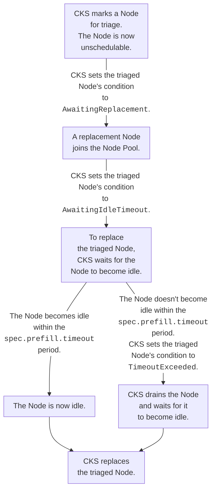

# Node Pools

Source: https://docs.coreweave.com/products/cks/nodes/nodes-and-node-pools

# Node Pools

> Manage groups of Nodes as a single entity with Node Pools

This page explains how CKS uses Node Pools to manage groups of Nodes as a single entity. Read this to understand the relationship between instances, Nodes, and Node Pools before you create or scale a Node Pool, and to learn how CKS handles cordoning, scale-down, image pulls, and reboots.

Instances are specific hardware configurations defined by CoreWeave, and each [GPU](https://docs.coreweave.com/platform/instances/gpu-instances.md) and [CPU](https://docs.coreweave.com/platform/instances/cpu-instances.md) instance type has its own [hourly price](https://www.coreweave.com/pricing).

A Node Pool in CKS represents one or more instances that share a common configuration, such as the same labels, taints, and annotations. To configure a Node Pool, select the instance type to use and how many of that instance type you want to run for your cluster. Deploy a Node Pool either [with a Kubernetes manifest](https://docs.coreweave.com/products/cks/nodes/create.md#create-a-node-pool-using-kubernetes) or [from the Cloud Console](https://docs.coreweave.com/products/cks/nodes/create.md#create-a-node-pool-using-the-cloud-console).

Once a Node Pool is deployed to a cluster, CKS continuously monitors it to ensure that the number of running Nodes matches the number specified in the Node Pool's manifest.

You can deploy multiple Node Pools within a single cluster, where each Node Pool contains any number of Nodes. This lets you run different types of workloads on different types of Nodes, or scale different parts of your application independently.

> [!NOTE]
>
> View pricing for instance types on [CoreWeave's pricing page](https://www.coreweave.com/pricing).

## Availability

Node Pools are available in all [General Access Regions](https://docs.coreweave.com/platform/regions/about-regions-and-azs.md).

## Sizing your Node Pools

Because you can run multiple Node Pools in a single cluster, you decide how to divide your Nodes among them. There is no single correct layout. The right structure depends on how many distinct workloads you run, how you want to scale them, and how much management overhead you can absorb. Use the trade-offs and recommendations in this section to plan a layout, then [create](https://docs.coreweave.com/products/cks/nodes/create.md) and [autoscale](https://docs.coreweave.com/products/cks/nodes/autoscaling.md) your Node Pools to match.

A Node Pool maps to Nodes through its target. For most instance types, `spec.targetNodes` sets the number of Nodes CKS provisions and keeps running. For [rack-based instance types](https://docs.coreweave.com/products/cks/nodes/create.md#rack-based-node-pools) such as GB200 and GB300, `spec.targetRacks` sets the number of racks, and each rack contains 18 Nodes. Every Node in a Node Pool shares that pool's instance type, labels, taints, and annotations, so a Node Pool is the unit where you set Node configuration and capacity together.

### Recommendations by workload type

Use these recommendations as a starting point, then adjust based on how your workloads schedule and scale.

* **A single large training job**: Use one Node Pool sized to the job. Training jobs run across many Nodes of the same instance type, so a single pool matches the workload and keeps management simple. Set the [scaling strategy](#scaling-strategies) to `IdleOnly` so that lowering `targetNodes` doesn't remove Nodes that are still running the job. The Cluster Autoscaler ignores the scaling strategy, so if the pool autoscales, also [prevent Node removal](https://docs.coreweave.com/products/cks/nodes/autoscaling.md#prevent-pod-eviction-or-node-removal) with an annotation. Consider [Node Pool prefill](#node-pool-prefill) to avoid a capacity gap if a Node is replaced mid-run.

* **Multiple independent inference endpoints**: Use a separate Node Pool per endpoint, or per group of endpoints with the same instance type and scaling needs. Separate pools let you scale each endpoint independently in response to its own demand and isolate one endpoint's Nodes from another's. The `PreferIdle` strategy scales these pools down faster when demand drops. See [Autoscale Node Pools](https://docs.coreweave.com/products/cks/nodes/autoscaling.md) for how the autoscaler selects a pool based on a Pod's `nodeSelector` and `affinity`.

* **Mixed instance types**: Use one Node Pool per instance type. Because every Node in a pool shares one instance type, you need a distinct pool for each GPU or CPU type your workloads require.

* **Bursty or intermittent workloads**: Put these workloads in their own Node Pool and configure [scale-to-zero](https://docs.coreweave.com/products/cks/nodes/autoscaling.md#scale-to-zero) so the pool drops to zero Nodes when there's no demand.

### Node Pool sizing considerations

The following table summarizes the trade-offs between consolidating Nodes into fewer, larger Node Pools and splitting them across more, smaller Node Pools.

| Consideration | Fewer, larger pools | More, smaller pools |
| - | - | - |
| **Management** | Simpler. Fewer manifests to maintain and fewer pools to monitor and scale. | More overhead. Each pool is a separate manifest with its own labels, taints, and scaling settings to maintain and monitor. |
| **Workload matching** | Harder to match heterogeneous workloads, because every Node in a pool shares the same instance type and configuration. | Easier. Each pool can target a different instance type and configuration for a specific workload. |
| **Scaling control** | Coarser. [Autoscaling](https://docs.coreweave.com/products/cks/nodes/autoscaling.md) is available at any pool size, but a single pool scales as a unit between `minNodes` and `maxNodes`. | Finer. You can set independent `minNodes`, `maxNodes`, and [scaling strategy](#scaling-strategies) per workload. |
| **Isolation** | Lower. Workloads share Nodes and the pool's configuration, so a configuration change or a disruptive Node affects more workloads. | Higher. A change or a disruptive Node is contained within one pool, isolating its effect on other workloads. |

In short, fewer large Node Pools reduce management overhead at the cost of increased impact scope and less flexibility, while more smaller Node Pools give you workload isolation and finer scaling control at the cost of more pools to manage.

## Node cordoning

CKS sometimes cordons Nodes to ensure that workloads are only scheduled to healthy Nodes. In most cases, CKS eventually removes the cordon, which makes the Node schedulable again. CoreWeave manages this kind of Node cordoning entirely, though you can also manually cordon Nodes for your own reasons.

CoreWeave cordons Nodes for health, maintenance, and lifecycle operations. See [Reasons CoreWeave cordons Nodes](https://docs.coreweave.com/products/cks/nodes/cordon.md#reasons-coreweave-cordons-nodes).

> [!WARNING]
>
> Don't assume that cordoned Nodes have serious or permanent issues. If a cordoned Node has a fault that can't be resolved quickly, CKS moves it out of production and into triage.

Cordoning Nodes in these cases lets CKS prevent disruptions. To manually cordon a Node, see [Cordon a Node yourself](https://docs.coreweave.com/products/cks/nodes/cordon.md#cordon-a-node-yourself). If you have questions about Node cordoning, [contact Support](https://docs.coreweave.com/support.md).

## CoreWeave-managed Node metadata

CoreWeave-managed Node conditions, labels, states, and events can change without notice. Examples include:

| Type | Examples |
| - | - |
| [Node conditions](https://docs.coreweave.com/products/cks/reference/node-pool.md#node-conditions) | `CWActive`, `CWRegistered`, `CWNodeRemoval` |
| [Node labels](https://docs.coreweave.com/platform/fleet-management/node-lifecycle/state-transitions.md#node-states-in-a-cks-cluster) | `node.coreweave.cloud/state`, `node.coreweave.cloud/pending-state` |
| [Lifecycle state values](https://docs.coreweave.com/platform/fleet-management/node-lifecycle/state-transitions.md#node-states-in-a-cks-cluster) | `production`, `production-reboot`, `triage` |
| [Node event reasons](https://docs.coreweave.com/products/cks/reference/node-pool.md#node-lifecycle-events) | `CWNCPhaseNccPendingChange`, `CWNCPhasePendingTenantWorkloadRunning` |

Don't use these for your own automation or change them except through documented procedures. These include [cordoning a Node yourself](https://docs.coreweave.com/products/cks/nodes/cordon.md#cordon-a-node-yourself), [requesting a Node reboot](https://docs.coreweave.com/products/cks/nodes/reboot.md#request-a-node-reboot), and [canceling a pending reboot](https://docs.coreweave.com/products/cks/nodes/reboot.md#cancel-a-pending-reboot). You can still add your own custom Node conditions and labels.

For reboot automation, we recommend using the [CoreWeave Intelligent CLI](https://docs.coreweave.com/products/cks/nodes/reboot.md#request-a-node-reboot).

## Node Pool prefill

Node Pool prefill helps maintain capacity while individual Nodes are replaced. For Nodes selected for prefill, CKS provisions replacement capacity before draining and removing the existing Node. Replacement capacity depends on [availability](#prefill-availability). You aren't billed for both Nodes during the prefill overlap.

Prefill is enabled by default for supported new Node Pools.

> [!NOTE]
>
> Node Pools created before October 8, 2026, retain their existing prefill settings. See the [prefill changelog entry](https://docs.coreweave.com/changelog.md#october-8-2026).

When you omit the `spec.prefill` field, CKS uses [prefill default values](https://docs.coreweave.com/products/cks/nodes/manage.md#enable-node-pool-prefill).

### When to use prefill

Use prefill for Node Pools whose workloads are sensitive to capacity loss during Node replacement, such as long-running training jobs or latency-sensitive inference.

* **Without prefill enabled**: CKS replaces a Node only after the old Node is removed, so the Node Pool is below its target Node count until the replacement is delivered and ready. This leaves a capacity gap that can last 20 to 40 minutes.

* **With prefill enabled**: CKS provisions a replacement Node before draining and removing the old Node, reducing the risk of a capacity gap. Workloads can continue on the existing Node while CKS provisions its replacement.

### Prefill availability

Prefill provisions replacement Nodes from [on-demand capacity](https://docs.coreweave.com/platform/capacity-plans.md#on-demand), so a replacement Node is not guaranteed. If on-demand capacity is unavailable, prefill keeps retrying, and the Node stays in the prefill flow until a replacement can be provisioned. Account for this when you rely on prefill for time-sensitive replacements.

**Prefill requirements**

| Setting | Requirement |
| - | - |
| Instance type | Use a non-rack-based instance type. Rack-based instances, such as GB200 and GB300, don't support prefill. |
| Autoscaling | Set `autoscaling: false`. With autoscaling enabled, CKS doesn't start new prefill operations. Operations already in progress continue. |
| Compute class | Use `computeClass: default`. Spot Node Pools don't support prefill. |

If prefill is enabled on an unsupported Node Pool, CKS turns off prefill automatically and doesn't mark new Nodes for prefill. This also applies when prefill is enabled by default. CKS sets `PrefillEnabled` to `False` with a reason that starts with `Unsupported`. No action is needed. See [Prefill status](https://docs.coreweave.com/products/cks/reference/node-pool.md#condition-prefillenabled).

### How prefill works

A Node is marked unschedulable as soon as it enters triage, so no new workloads are scheduled onto it. If a replacement Node can't be provisioned, CKS keeps retrying until one is available or the Node is no longer marked for prefill.

After the replacement joins the Node Pool, CKS waits up to the idle timeout (`spec.prefill.timeout`) for the old Node to become idle, then removes it. If the Node hasn't become idle when the timeout expires, CKS starts draining it. CKS removes the Node once it becomes idle.

> [!WARNING]
>
> Draining can interrupt running workloads. Monitor Nodes approaching the prefill idle timeout and plan for workload interruption when draining starts. The timeout starts draining, rather than setting a deadline for Node removal.

### Prefill Node conditions

When prefill is enabled, CKS sets a `Prefill` condition on Nodes that are in the prefill flow. The condition's `reason` field indicates the current state. You can use `LastTransitionTime` on the condition to see when the reason last changed.

For each reason and its meaning, see [Prefill condition reasons](https://docs.coreweave.com/products/cks/reference/node-pool.md#prefill-condition-reasons) in the Node Pool reference.

### Prefill flow

The following diagram shows how a Node moves through the prefill flow, including the two paths CKS can take depending on whether the Node becomes idle within the default 24 hour idle timeout (`spec.prefill.timeout`) period.



For details on configuring or disabling prefill, see [Configure Node Pool prefill](https://docs.coreweave.com/products/cks/nodes/manage.md#enable-node-pool-prefill). For the prefill reference specification, see [Prefill reference](https://docs.coreweave.com/products/cks/reference/node-pool.md#prefill).

## Scaling strategies

A Node Pool has two scale-down strategies, which control how CKS chooses Nodes to remove when you lower `targetNodes`. The Cluster Autoscaler doesn't use them. To protect active Nodes from the autoscaler, see [Prevent Pod eviction or Node removal](https://docs.coreweave.com/products/cks/nodes/autoscaling.md#prevent-pod-eviction-or-node-removal). Set `spec.lifecycle.scaleDownStrategy` to one of the following values:

| Strategy | Description |
| - | - |
| `IdleOnly` | Default strategy. CKS only selects [idle Nodes](#idle-nodes) for removal. When you lower `targetNodes`, CKS removes only Nodes that aren't actively running workloads. |
| `PreferIdle` | CKS prioritizes idle Nodes for removal, but if there aren't enough idle Nodes to meet the desired scale, CKS can also select non-idle Nodes. This allows faster scale-down when necessary. |

## Idle Nodes

The `CWActive` Node condition reports whether CKS counts any Pods as active. CKS ordinarily counts Pods in the `Running` or `Pending` phase, with the following rules:

| Pod or condition | Activity behavior |
| - | - |
| The Pod is part of a `DaemonSet` | CKS ignores DaemonSet Pods, including those with an interruption label. |
| `qos.coreweave.com/graceful-interruptible` is set to `true` on a non-DaemonSet Pod | The label doesn't make the Pod exempt. The Pod can remain counted while its object is present in the Kubernetes API, even after its termination grace period expires. |
| The Pod uses only the `qos.coreweave.cloud/interruptable: "true"` eviction label | CKS ignores the Pod. |
| The Pod's namespace has `ns.coreweave.cloud/org` set to `control-plane`, and the Pod has no eviction labels overriding this exemption | CKS ignores the control plane Pod. |

Choose one interruption strategy per Pod; don't combine eviction labels. For non-DaemonSet Pods, the gracefully interruptible label takes precedence over the interruptible and control plane exemptions.

CKS initially sets a new `CWActive` condition to `True` before evaluating workloads. After evaluation, `CWActive = True` means at least one Pod counts as active, and `CWActive = False` means the Node is idle. Dashboard activity indicators that reflect `CWActive` follow the same rules. A Node running only gracefully interruptible Pods can therefore show Active, even if its GPUs are unused. Check `CWActive` to confirm idleness; expiry of a Pod's termination grace period alone doesn't establish it.

To inspect `CWActive` and identify the Pods keeping a Node active, see the [Node Pool health check commands](https://docs.coreweave.com/products/cks/nodes/nodepool-status.md#run-a-node-pool-health-check).

### Node idle status and maintenance

Deferred maintenance uses a [separate workload check](https://docs.coreweave.com/platform/fleet-management/node-lifecycle/state-transitions.md#active-nodes-and-stalled-transitions) and can proceed while `CWActive` is `True`.

This maintenance rule differs from `IdleOnly` scale-down. When choosing a new Node to drain, `IdleOnly` requires `CWActive = False`. A counted gracefully interruptible Pod can prevent its Node from being selected. Nodes already marked for removal or already draining follow their existing removal workflow, and the Cluster Autoscaler uses its own removal rules. See [Pod interruption and eviction policies](https://docs.coreweave.com/products/cks/clusters/scheduling/workload-scheduling.md#pod-interruption-and-eviction-policies) and [Node state transitions in CKS](https://docs.coreweave.com/platform/fleet-management/node-lifecycle/state-transitions.md).

Once CKS selects a Node for removal, CKS removes the Node by first cordoning it to prevent any new Pods from being scheduled onto it. Then, CKS drains the Node to perform a graceful cleanup. Once the Node is fully drained, CKS removes it from the Node Pool.

> [!WARNING]
>
> During the drain process, to prevent being stopped by Pods stuck in a `Terminating` state, CKS waits up to 5 minutes before more forcibly removing a draining Node.

## Scale down a Node Pool

To scale down a Node Pool:

1. Set `spec.targetNodes` to the desired number of Nodes, or `spec.targetRacks`, depending on the target type set on the Node Pool. For instructions on doing this with Cloud Console or the Kubernetes CLI, see [Manage Node Pools](https://docs.coreweave.com/products/cks/nodes/manage.md).
2. Set `spec.lifecycle.scaleDownStrategy` to the preferred [scaling strategy](#scaling-strategies).

### How CKS selects Nodes to remove

When a Node Pool scales down, CKS picks which Nodes to remove based on the configured [scale-down strategy](#scaling-strategies) and Node [idleness](#idle-nodes). There is no Node Pool field or Node label that lets you single out a specific Node for removal during scale-down. CKS chooses among eligible Nodes automatically.

If you need a particular Node to be the one removed during the next scale-down, do one of the following before lowering `targetNodes`:

* **Drain the Node yourself.** Use standard Kubernetes tooling (`kubectl cordon` and `kubectl drain`) to evict workloads from the target Node. With the default `IdleOnly` strategy, an empty Node becomes eligible for removal first.
* **Reschedule workloads off the Node.** Delete or move the Pods keeping the Node active, accounting for the [idle Node rules](#idle-nodes). Gracefully interruptible Pods can remain counted during termination. Confirm `CWActive = False` before relying on the Node's eligibility for `IdleOnly` selection.

If the Node you want to remove is unhealthy and you can't drain it, [contact Support](https://docs.coreweave.com/support.md) to request manual removal.

If a scale-down stalls and the Node Pool's events repeat `No nodes eligible for removal right now`, see [Current is above target](https://docs.coreweave.com/products/cks/nodes/nodepool-status.md#current-is-above-target) for how to find the Pods blocking it.

## Node Pool types

CKS uses the `default` Node Pool type to manage Reserved and On-Demand instances. The following section describes when to use the default type and how to configure it.

### Default Node Pools

CKS uses the default Node Pool type (`spec.computeClass: default`) for Reserved and On-Demand instances. Billing for default Node Pools depends on Reservation and utilization.

> [!NOTE]
>
> You don't need to specify default Node Pools.
>
> If you don't specify a `computeClass`, the Node Pool defaults to the `default` type.

```yaml title="Example default Node Pool manifest" theme={"system"}
apiVersion: compute.coreweave.com/v1alpha1
kind: NodePool
metadata:
  name: default
spec:
  computeClass: default
  # ...
```

For more information on Node Pool manifests, see [Node Pool reference](https://docs.coreweave.com/products/cks/reference/node-pool.md#node-pool), or learn how to [Create a Node Pool](https://docs.coreweave.com/products/cks/nodes/create.md).

## Manage Node Pools with Terraform

The [CoreWeave Terraform provider](https://docs.coreweave.com/platform/terraform.md) manages clusters, VPCs, and Object Storage, but it doesn't include a Node Pool resource. Deploy Node Pools through the [Cloud Console or the Kubernetes API](https://docs.coreweave.com/products/cks/nodes/create.md) instead. A Terraform-only workflow typically combines the CoreWeave provider for the cluster and VPC with a separate mechanism, such as the Kubernetes provider, to apply Node Pool manifests. See [How do I use Terraform to manage clusters and Node Pools?](https://docs.coreweave.com/support/cks/articles/how-do-i-use-terraform-to-manage-clusters-and-node-pools).

## Image pull best practices

CoreWeave operates a region-level registry proxy that accelerates container image pulls and reduces exposure to public registry rate limits for your cluster's Nodes. To ensure predictable and fast rollouts when scaling Node Pools, use immutable tags, or pin by digest, for production workloads. This ensures every Node pulls the same artifact and avoids stale results from proxy metadata caching.

Avoid mutable tags like `:latest`. With metadata caching enabled, the proxy can continue serving a cached manifest until the cache expires, which can lead to inconsistent versions across Nodes. For more information, see the [region-level image proxy](https://docs.coreweave.com/products/cks/clusters/introduction.md#region-level-image-proxy) documentation.

## Reboot methods

You can manually reboot Nodes in the following two ways:

| Reboot method | When to use | Typical duration |
| - | - | - |
| [Reboot only](https://docs.coreweave.com/products/cks/nodes/reboot.md) | Maintenance, troubleshooting, or applying changes that don't require reconfiguration | Approximately 10 minutes or more |
| [Reconfigure reboot](https://docs.coreweave.com/products/cks/nodes/apply-updates.md) | Applying OS images, GPU driver updates, or other Node Pool modifications that require reconfiguration | Approximately 1 hour or more |

### Node conditions for reboots (deprecated)

CoreWeave's Node conditions are visible when you manage reboots. You previously set these Node conditions with the [Conditioner Kubectl plugin](https://github.com/devbytes-cloud/conditioner). The [CoreWeave Intelligent CLI](https://github.com/coreweave/cwic) doesn't set them. It requests reboots through the `PhaseState` and `PendingPhaseState` lifecycle conditions instead. See the [Reboot Nodes](https://docs.coreweave.com/products/cks/nodes/reboot.md#reboot-request-reference) and [Apply Node Pool updates](https://docs.coreweave.com/products/cks/nodes/apply-updates.md) guides for more information.

| Condition | Description | Deprecated equivalent |
| - | - | - |
| `AdminSafePowerCycle` | Marks the Node to reboot when it is idle, only after all running jobs are complete. | `AdminSafeReboot` |
| `AdminImmediatePowerCycle` | Marks the Node to reboot immediately, without waiting for running jobs to complete. | `AdminImmediateReboot` |

Use only documented procedures to change [CoreWeave-managed Node metadata](#coreweave-managed-node-metadata).

## Control Plane Node Pool (deprecated)

CoreWeave provisioned clusters created before July 7, 2025 with a `cpu-control-plane` Node Pool for CKS-managed components. Clusters created after this date don't have this Node Pool. The CKS Control Plane now manages the components out-of-band. See the [Control Plane Node Pool release notes](https://docs.coreweave.com/release-notes/control-plane-node-pools.md) for more information.

#### Do not install the NVIDIA GPU Operator on CKS clusters

> [!WARNING]
>
> CoreWeave manages the [NVIDIA GPU Operator](https://docs.nvidia.com/datacenter/cloud-native/gpu-operator/latest/getting-started.html) on your behalf. Do not install the NVIDIA GPU Operator on CKS clusters. Doing so conflicts with the platform-managed deployment and is not supported.
