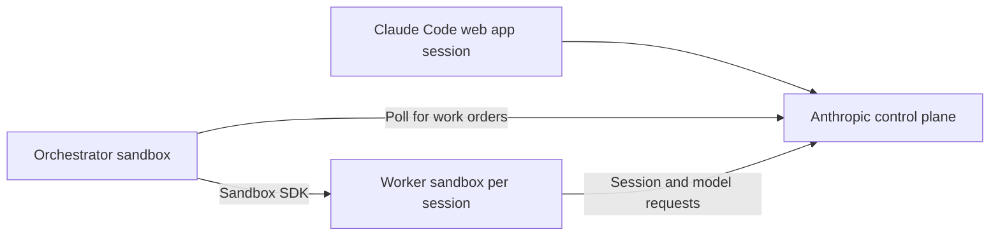

# Run Claude Code cloud sessions

Source: https://docs.coreweave.com/products/sandboxes/agents/claude-code-cloud

# Run Claude Code cloud sessions

> Deploy a Claude Code orchestrator that creates a CoreWeave sandbox for each cloud session.

Run Claude Code cloud sessions on CoreWeave sandboxes. Give Claude a task in the [Claude Code web app](https://claude.ai/code) (claude.ai/code), and a sandbox-hosted orchestrator provisions a worker sandbox for the session. After deployment, your local computer can disconnect.

This guide uses Anthropic's [self-hosted environments](https://code.claude.com/docs/en/self-hosted-environments) and a [runnable recipe](https://github.com/coreweave/cwsandbox-recipes/tree/main/recipes/claude-code-cloud). The recipe uses the Sandboxes software development kit (SDK) directly. For an interactive terminal or Remote Control, see [Claude Code](https://docs.coreweave.com/products/sandboxes/agents/claude-code.md). For API-managed agent loops, see [Claude Managed Agents](https://docs.coreweave.com/products/sandboxes/agents/claude-managed-agents.md).

In this recipe, an Anthropic *runner* executes one Claude Code cloud session. A *worker* is the sandbox that hosts it. Anthropic runners are separate from [CoreWeave managed runners](https://docs.coreweave.com/products/sandboxes/operations/managed-runners.md), which run sandboxes in CoreWeave Kubernetes Service (CKS) clusters.

## Prerequisites

Before you begin, make sure you have the following:

* A Claude Team or Enterprise organization with self-hosted environments enabled by an Owner. See [Anthropic's prerequisites](https://code.claude.com/docs/en/self-hosted-environments-quickstart#prerequisites).
* A GitHub repository connected to Claude and accessible from your account. Start with a test repository. Follow the [Claude Code web app documentation](https://code.claude.com/docs/en/claude-code-on-the-web) to connect GitHub.
* A [CoreWeave API access token](https://docs.coreweave.com/products/sandboxes/placement.md#coreweave-api-access-token) with the `sandbox_user` Identity and Access Management (IAM) action, and serverless capacity for the resources described in this section. The recipe explicitly uses CoreWeave authentication.
* A Linux or macOS computer with Git, Python 3.11 or later, and [`uv`](https://docs.astral.sh/uv/getting-started/installation/)

The recipe doesn't require a GPU. It requests 1 CPU and 2 GiB of memory for the orchestrator, plus 2 CPUs and 4 GiB for each worker. It allows up to four active workers by default.

The orchestrator remains billable while idle, and Claude usage is billed separately. For budgeting, 24 hours of orchestration alone uses 24 CPU-hours and 48 GiB-hours. Add worker runtime at its requested resources and apply your account's rates.

## Quick start with the recipe

Create a Claude environment, deploy the orchestrator, and verify a worker's output before stopping the deployment.

### Create the Claude environment

Follow [Anthropic's environment setup](https://code.claude.com/docs/en/self-hosted-environments-quickstart). On the **Cloud environments** admin page, an Owner enables **Allow self-hosted environments** and creates an environment under **Self-hosted environments**.

An Owner creates this Claude Code cloud environment in the claude.ai admin settings. Claude Managed Agents uses a separate environment and key created in the Claude Console.

Keep the environment key and its `ccpool_...` ID. If you can't access the admin page, ask an Owner to provide them. The ID identifies the environment, and the key authenticates the orchestrator. The recipe deploys the orchestrator and worker infrastructure in the following steps.

### Install the recipe

Install the recipe locally and configure the credentials the orchestrator requires.

```bash theme={"system"}
git clone https://github.com/coreweave/cwsandbox-recipes.git
cd cwsandbox-recipes/recipes/claude-code-cloud
uv sync --locked
cp .env.example .env
chmod 600 .env
```

Edit the `.env` file and set both variables:

| Variable | Value |
| - | - |
| `CWSANDBOX_API_KEY` | Your CoreWeave API access token. |
| `SELF_HOSTED_RUNNER_ENVIRONMENT_SECRET` | The environment key from Claude. |

Keep the `.env` file private and out of version control. You can instead inject these variables from a secret manager. Existing environment variables take precedence over the `.env` file.

### Deploy the orchestrator

Replace `[ENVIRONMENT-ID]` with your `ccpool_...` ID:

```bash theme={"system"}
uv run cloud.py deploy --environment '[ENVIRONMENT-ID]'
```

The command prints the orchestrator sandbox ID, waits for setup, and prints `Connected` after it connects to Anthropic. Setup can take several minutes. A timeout doesn't imply cleanup. Inspect `status` and `logs` before retrying.

Keep the local `.deployment.json` file. It records the IDs and settings needed to manage the deployment and contains no credentials. Run subsequent commands from the recipe directory.

### Send a task

In the Claude Code web app, select your organization, connected repository, and self-hosted environment. To create the file used in the verification step, send exactly this prompt:

```text theme={"system"}
Use Bash to write exactly CWS_CLOUD_OK followed by a newline to
/tmp/claude-cloud-proof.txt, then read it back and report the current
directory. Do not modify repository files, commit, or push.
```

Sending the task queues a session and triggers worker creation.

### Verify the result

From your terminal, list the deployment:

```bash theme={"system"}
uv run cloud.py status
```

Expect `Connected: True` and a `Worker:` line containing a sandbox ID. After Claude finishes, replace `[WORKER-ID]` in the following command with that ID:

```bash theme={"system"}
uv run cloud.py read --worker '[WORKER-ID]' --path /tmp/claude-cloud-proof.txt
```

The expected output is `CWS_CLOUD_OK`. This checks the sandbox's file through the Sandboxes SDK, independently of Claude's response. Read it before the worker becomes idle and stops. If you sent a different task, read a file that task created instead.

### Clean up

After saving your results, stop the deployment:

```bash theme={"system"}
uv run cloud.py stop
```

The command stops the orchestrator, stops its workers, verifies that none remain active, and removes the `.deployment.json` file. It interrupts running tasks and discards files stored only in those sandboxes. The Claude environment remains available for a later deployment.

## How the integration works



The recipe deploys two roles:

| Role | Responsibility | Credentials provided by the recipe |
| - | - | - |
| Orchestrator | Poll Anthropic and submit workers through a `spawn-runner` hook. | CoreWeave API access token and Claude environment key. |
| Worker | Run one Claude Code session, its tools, and its repository checkout. | A single-use work order issued for the Anthropic runner. |

The worker uses the [Anthropic git proxy](https://code.claude.com/docs/en/self-hosted-environments-deploy#use-the-anthropic-git-proxy) for repository access. The recipe doesn't copy your local Claude login or GitHub token into the worker. Model requests, prompts, responses, and tool results still pass through Anthropic.

The hook follows the [Anthropic on-demand runner contract](https://code.claude.com/docs/en/self-hosted-environments-configuration#on-demand-runners): submit the workload asynchronously and use a single-use work order to register it. The recipe records order IDs on the orchestrator's disk to avoid duplicate submissions after an orchestrator process restart. An uncertain create fails closed and requires inspection before retrying.

Workers run under a process wrapper that records the exit code and completes the sandbox without retrying the process. Check the logs after a startup failure. Sandbox completion alone doesn't prove task success.

The recipe pins Claude Code to `2.1.284` and the Sandboxes SDK to `1.14.2`. Each sandbox starts from `python:3.12-bookworm` and installs Git and Claude during bootstrap. Worker startup includes scheduling, installation, registration, and repository checkout.

## Configure the deployment

Set options when you run `deploy`:

| Option | Default | Purpose |
| - | - | - |
| `--orchestrator-hours` | `24` | Hard lifetime of the orchestrator, including setup and idle time. |
| `--worker-hours` | `8` | Hard lifetime of each worker. |
| `--idle-minutes` | `15` | Release sessions after user inactivity when the Anthropic runner classifies them as idle. |
| `--max-workers` | `4` | Limit active workers created by this deployment. |

Both lifetime options accept 1 to 720 hours. The idle timeout must be at most 10,080 minutes (7 days) and shorter than the worker lifetime minus 5 minutes. For a 30-day orchestrator, add `--orchestrator-hours 720` at deployment. Lifetimes can't be extended after creation.

Run only one recipe deployment per Claude environment. The recipe does not replace orchestrator sandboxes automatically. Its supervisor restarts the Claude Code orchestrator process within the same sandbox, preserving the local order ledger. A failed or expired sandbox loses that ledger. Monitor the deployment, save session results, and plan replacement before expiration. For a planned replacement, finish active work, run `stop`, and redeploy. Inspect pending sessions and existing resources before recovering from an uncertain submission or host failure.

To add a toolchain, edit the worker branch in the recipe's `bootstrap.sh` script and test it with your repository. For lifecycle hooks and session configuration, see [Customize sessions in self-hosted environments](https://code.claude.com/docs/en/self-hosted-environments-configuration).

## Monitor sessions

Inspect the connection, workers, and recent logs:

```bash theme={"system"}
uv run cloud.py status
uv run cloud.py logs
uv run cloud.py logs --bootstrap
uv run cloud.py logs --worker '[WORKER-ID]'
```

`status` reports the orchestrator's connection and approximate expiration time. After all sessions become idle and the idle timeout elapses, expect zero workers if no new sessions are queued. When capacity is available, a new session creates a worker. Follow-ups can continue on the current worker while it remains attached.

The orchestrator's health listener stays inside its sandbox. These commands use the Sandboxes SDK and require no public endpoint.

For a worker's installation output, add `--bootstrap` to its log command. That log also contains Anthropic runner output after setup.

## Save results before a worker stops

The Anthropic runner releases idle sessions and exits. It also starts retiring 5 minutes before its sandbox lifetime ends. A long-running turn can still reach the hard lifetime cutoff and be interrupted.

Ask Claude to commit and push work you want to keep, then verify the branch in GitHub. For a text artifact, use the recipe's `read` command and redirect its output to a local file. The recipe configures no automatic pushes or snapshots. A follow-up after release can run in a fresh worker, so don't rely on unpushed files surviving.

For persistence options in other workflows, see [File system snapshots](https://docs.coreweave.com/products/sandboxes/file-system-snapshots.md). For Anthropic runner release behavior, see [Anthropic's runner reference](https://code.claude.com/docs/en/self-hosted-environments-reference).

## Troubleshoot

| Symptom | Action |
| - | - |
| Self-hosted controls are missing | Select the Team or Enterprise organization and ask its Owner to enable the feature. |
| A repository is missing or checkout fails | Verify the GitHub connection and repository access in the selected Claude organization. |
| Waiting for a runner | Confirm that you sent a task, run `status`, and inspect orchestrator logs. Check the environment ID/key pairing and your [concurrent sandbox quota](https://docs.coreweave.com/products/sandboxes/reference/limits-and-quotas.md#concurrent-sandbox-quota). |
| Worker startup is slow | Read its bootstrap log to distinguish scheduling and package installation from Anthropic runner or checkout failures. |
| Worker limit reached | Finish or release an existing session. To change the limit, save work, stop the deployment, and redeploy. |
| Worker submission is uncertain | Inspect active resources and the environment's **Activity** tab. An Owner can retry the failed session after reconciliation. |
| Deployment record already exists | Inspect the recorded deployment with `status`. Save results and use `stop` before redeploying. |
| A file can't be read | Check its path and worker ID while the worker is active. Files are unavailable after the worker stops. |

If you restrict outbound traffic, account for both Anthropic runner traffic and bootstrap downloads from Debian, PyPI, and Claude's download services. This recipe doesn't configure an egress allowlist. For network requirements and hardening, review [Anthropic's production deployment guidance](https://code.claude.com/docs/en/self-hosted-environments-deploy).

## Next steps

Use the following resources to validate changes or explore other integrations:

* Run the recipe's [offline and live checks](https://github.com/coreweave/cwsandbox-recipes/tree/main/recipes/claude-code-cloud#validate-changes) after modifying it.
* Use [Anthropic's end-to-end tests](https://code.claude.com/docs/en/self-hosted-environments-testing) for additional diagnostics.
* Explore [other agent integrations](https://docs.coreweave.com/products/sandboxes/agents.md).
