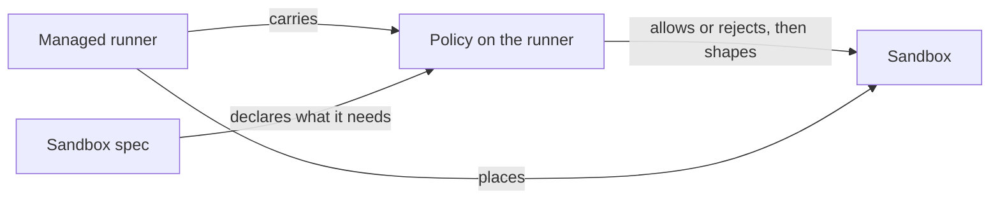
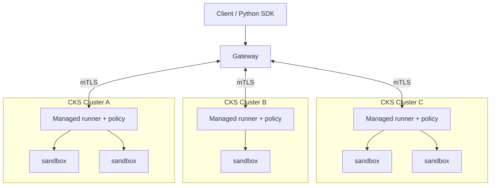
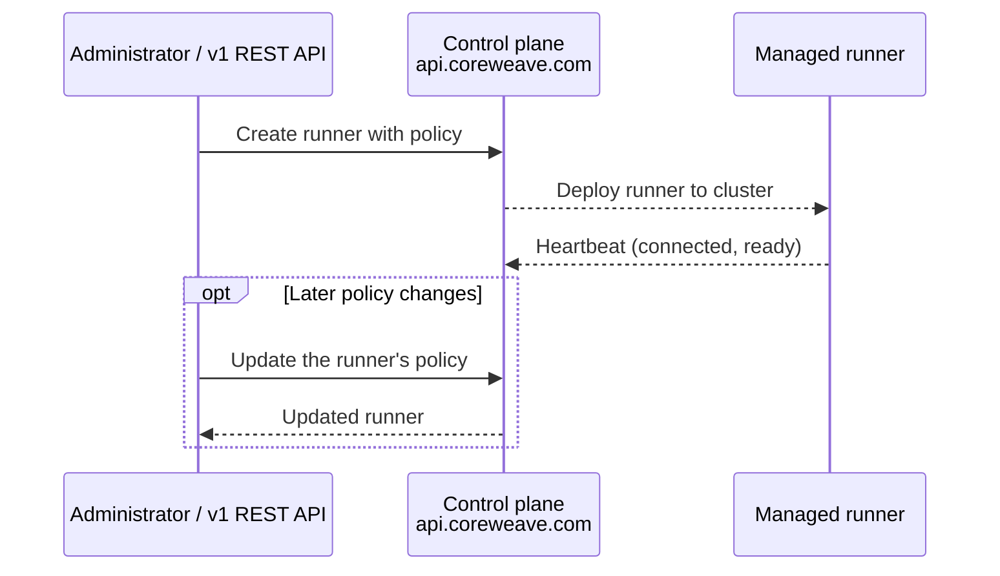
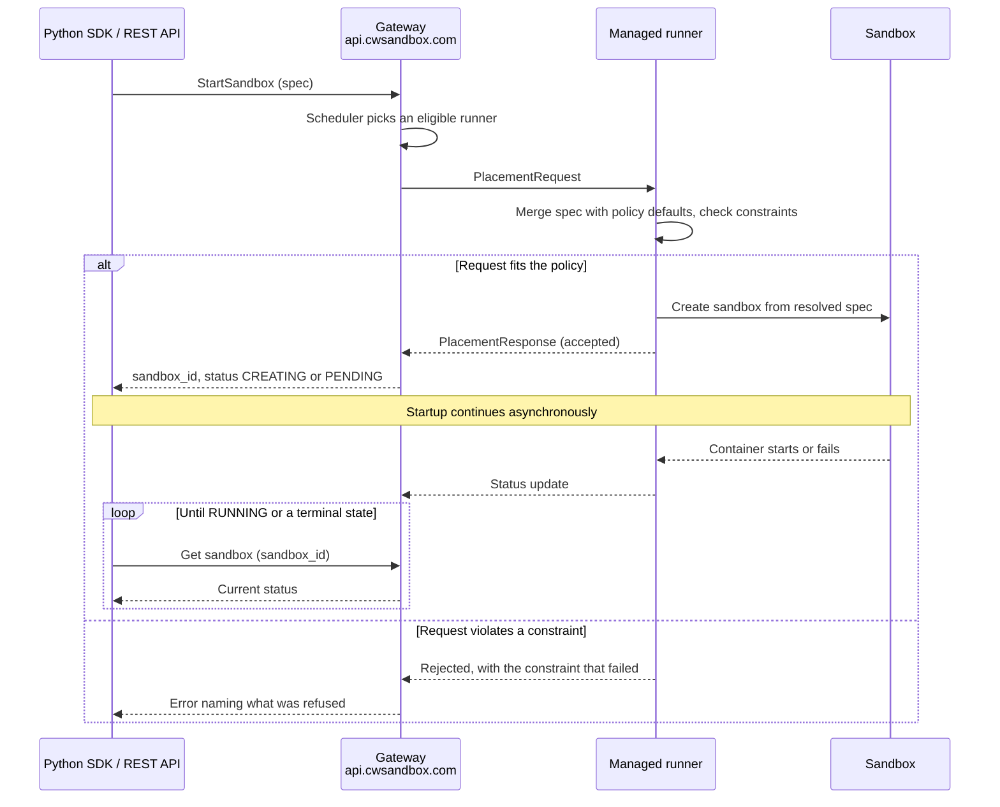
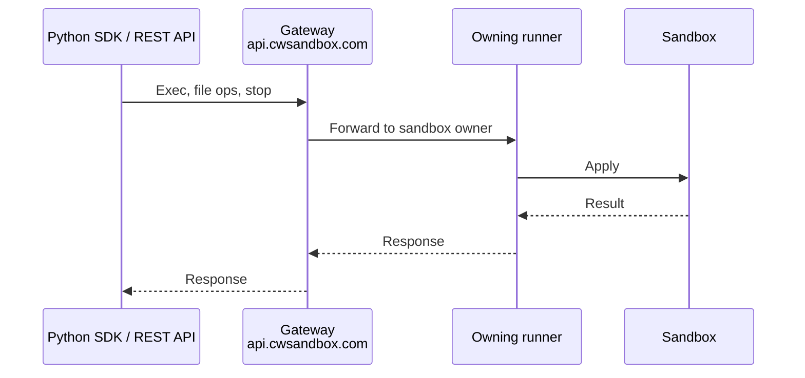

# Sandboxes architecture

Source: https://docs.coreweave.com/products/sandboxes/architecture

# Sandboxes architecture

> How runners, policies, and the gateway fit together across one or more CoreWeave Kubernetes Service (CKS) clusters.

This page describes how CoreWeave Sandboxes fit together, for administrators deploying runners, authoring a policy, or planning a multi-cluster rollout.

CoreWeave sandboxes are built from two resources you manage (managed runner and sandbox) and the policy each runner carries. One piece of CoreWeave-operated infrastructure, the gateway, brokers sandbox lifecycle and management requests. The pieces use separate service surfaces for managed-runner administration and sandbox operations. They span as many CKS clusters as you choose to enable.

## Sandbox resources

Sandboxes use the following resources and policy:

* **Managed runner**: a CoreWeave-operated component that runs inside one of your CKS clusters. The runner places, supervises, and removes sandboxes on that cluster. Each cluster hosts at most one managed runner, which CoreWeave keeps up to date on the `RELEASE_CHANNEL_STABLE` or `RELEASE_CHANNEL_RAPID` channel you select.
* **Policy**: what sandboxes on a cluster may request, and what they get by default. A policy isn't a standalone resource and has no endpoint of its own. It's a field on the runner that governs the sandboxes placed on that runner's cluster.
* **Sandbox**: an isolated workload that runs on your cluster. A sandbox describes itself completely, declaring the image, compute, network access, and lifetime it needs. Sandboxes are created on demand through the [Python client](https://docs.coreweave.com/products/sandboxes/client.md).

The gateway isn't a resource you create or own. It's a CoreWeave service at `api.cwsandbox.com` that authenticates requests sent to it and picks an eligible runner to host the sandbox. It forwards traffic between the client and the runner that owns each sandbox. Once a sandbox is running, its data operations can also travel over a direct mutual Transport Layer Security (mTLS) connection that bypasses the gateway.

### Key constraints

* A cluster hosts at most one managed runner. Once configured, the runner's policy governs sandboxes placed on that cluster. To run sandboxes under a different posture, deploy a runner on another cluster and give it its own policy.
* A stored policy is required for v1 sandbox placement. An administrator can supply it, or the gateway can save a [deployment-configured default](https://docs.coreweave.com/products/sandboxes/profiles/configure.md#set-a-default-policy-for-new-runners) for a runner without one. Existing policies are preserved. An empty policy is valid and supplies no base defaults or explicit constraints. Platform safety gates still apply, and an absent runtime-class allowlist permits no concrete `runtime_class` pin. See [`SecurityConstraints`](https://docs.coreweave.com/products/sandboxes/reference/profile#securityconstraints).
* A policy can supply a default sandbox lifetime; the platform enforces the 30-day maximum.
* Policy defaults and constraints resolve when a sandbox is created. Running sandboxes keep their resolved specification. Source IP access controls also apply to new operations on existing sandboxes after policy-cache propagation. See [Source IP access controls](https://docs.coreweave.com/products/sandboxes/profiles/profiles.md#source-ip-access-controls).
* A cluster has no per-user or per-team scoping. A policy applies to every sandbox placed there, whoever created it.

## Resource relationships

The runner carries the policy that governs its cluster, and it places every sandbox on that cluster. A sandbox declares its requirements, and the policy determines whether that request is permitted.

The runner merges the sandbox spec over the policy's defaults, then validates the result against the constraints. A violation is rejected rather than quietly narrowed, and the error names what was refused. See [Policies overview](https://docs.coreweave.com/products/sandboxes/profiles/profiles.md#how-a-sandbox-resolves-against-a-policy).

## Multi-cluster scope

Each cluster has its own runner and its own policy. Users don't need to know that topology. They request a sandbox with their required configuration through the software development kit (SDK). The gateway routes the request to a cluster whose policy accepts it.

For CKS placement, the gateway selects compute across clusters in your organization. Without a runner ID restriction, it selects a cluster with available capacity whose runner policy permits the sandbox request.

Because posture is per cluster, a team that needs both a permissive environment and a restricted one runs two clusters rather than two configurations on one.

## How sandboxes launch

The managed-runner control plane at api.coreweave.com is where you define runners and the policy each one carries. The gateway at api.cwsandbox.com serves sandbox launch and runtime operations, the flows shown in the following diagrams.

The gateway also serves organization-scoped configuration through `SettingsService`, including object storage Workload Identity Federation (WIF) settings at `/v1/settings/objectStorageWifConfig`. These settings govern object storage access across sandboxes in your organization. For configuration steps, see [Grant sandboxes access to AI Object Storage](https://docs.coreweave.com/products/sandboxes/operations/object-storage-access.md#step-3-configure-wif-for-your-sandboxes-organization).

### Control plane: one-time setup

An administrator uses the CoreWeave Intelligent CLI or the REST API to configure a runner and its policy on a CKS cluster. The v1 create request includes the policy. The control plane then deploys the runner into the cluster, and the runner reports back over its heartbeat.

Create the runner once per cluster. Update its policy when requirements change. For the corresponding workflows, see [Configure a sandbox policy](https://docs.coreweave.com/products/sandboxes/profiles/configure.md) and [Deploy and manage a runner](https://docs.coreweave.com/products/sandboxes/operations/managed-runners.md).

### Sandbox launch

When a client starts a sandbox, the gateway picks an eligible runner and sends it a placement request. The runner resolves the sandbox spec against its policy and creates the sandbox from the result. The runner accepts the placement as soon as it creates the sandbox, without waiting for it to start. The client receives the sandbox ID while the sandbox is still starting.

A successful start response means the runner accepted the sandbox, not that the sandbox can run commands yet. Before you use the sandbox, wait or poll until it reaches `RUNNING`. If startup fails, the sandbox moves to `FAILED` instead. It can also reach `COMPLETED` before `RUNNING` if its main command exits quickly with status 0. Handle both terminal states. The Python SDK's `wait()` polls for you, and operations such as `exec()` wait for `RUNNING` before they run. See [Sandbox lifecycle](https://docs.coreweave.com/products/sandboxes/client/guides/sandbox-lifecycle.md#wait-for-a-sandbox).

For a rejected request, the error names the constraint that failed. Users can determine what to change or ask an administrator for, rather than having to discover the posture in advance.

### Operations on a running sandbox

In the gateway path, client calls (`exec()`, file operations, stop) flow through the gateway to the runner that owns the sandbox. The calls then flow from the runner to the sandbox itself.

Exec, log, and file operations can also bypass the gateway entirely. By default, the Python SDK prefers a direct mTLS connection from the client to the logical runner's data-plane endpoint. When direct connection setup is unavailable, it can fall back to the gateway path shown in the previous diagram. Lifecycle and management calls always use the gateway. See [Direct sandbox connections](https://docs.coreweave.com/products/sandboxes/client/guides/direct-connections.md).

## Control plane resources

The control plane includes the following managed-runner administration endpoints. Sandbox templates are also served on the control plane. See [Protobuf](https://docs.coreweave.com/products/sandboxes/reference/protos.md#endpoints) for the service and host mapping. A policy is reached through the runner that carries it, not through an endpoint of its own.

| Resource | Endpoints | Purpose |
| - | - | - |
| Managed runners | `POST/GET/PATCH/DELETE /v1/sandbox/managedRunners`, `POST .../applyAvailableUpdate` | Deploy, query, update, and decommission runners. Set the policy a runner carries. Trigger on-demand runner updates. |

## See also

For related guidance, see the following pages:

* [Use your own compute](https://docs.coreweave.com/products/sandboxes/get-started-cks.md): enable a runner and launch a sandbox.
* [Policies overview](https://docs.coreweave.com/products/sandboxes/profiles/profiles.md): how a sandbox resolves against a policy.
* [Configure a sandbox policy](https://docs.coreweave.com/products/sandboxes/profiles/configure.md): every constraint group, with worked examples.
* [Deploy and manage a runner](https://docs.coreweave.com/products/sandboxes/operations/managed-runners.md): the lifecycle for managed runners.
* [Control plane API overview](https://docs.coreweave.com/products/sandboxes/reference/control-plane-api.md): authentication, field masks, heartbeats, and the request and response shapes for managed-runner endpoints.
* [Protobuf](https://docs.coreweave.com/products/sandboxes/reference/protos.md): which host serves each service, and how to generate a client from the published Protobuf module.
