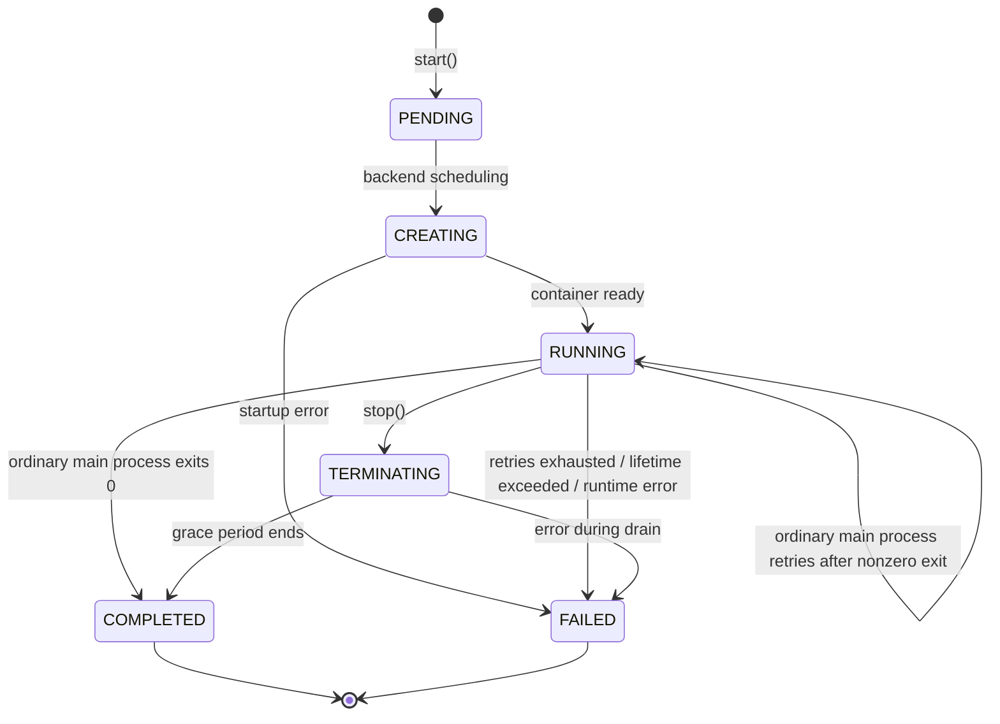

# Sandbox lifecycle

Source: https://docs.coreweave.com/products/sandboxes/client/guides/sandbox-lifecycle

# Sandbox lifecycle

> Understand sandbox states, creation patterns, waiting, and shutdown behavior.

This guide explains how a sandbox progresses from creation to shutdown, including the states it passes through, how to start and wait for it, and how to stop it cleanly. Use this guide when you need to choose between creation patterns, control startup timing, or handle shutdown reliably in your SDK code.

## Choose authentication

Choose the credential for the account that owns your sandboxes. To obtain a Forge API key or CoreWeave API access token, see [Choose and get credentials](https://docs.coreweave.com/products/sandboxes/placement.md#choose-and-get-credentials).

Run the installation commands in an [active Python virtual environment](https://docs.coreweave.com/products/sandboxes/client.md#prepare-your-python-environment).

Save the Python code from your credential tab as a `sandbox_auth.py` file beside the Python script that uses it. This file stores only the authentication choice. Import `AUTH` from that file. When you create a sandbox or session, pass `AUTH` explicitly or set it in `SandboxDefaults`.

> [tab] Forge API key
>
> Use your Forge API key with the `wandb` integration in the software development kit (SDK). Replace `[WANDB-API-KEY]` with your API key:
>
> ```bash theme={"system"}
> uv pip install 'cwsandbox[wandb]>=1.14.2'
> export WANDB_API_KEY="[WANDB-API-KEY]"
> ```
>
> ```python title="sandbox_auth.py" theme={"system"}
> from cwsandbox import AuthStrategy
>
> AUTH = AuthStrategy.WANDB
> ```

> [tab] CoreWeave API access token
>
> Use the CoreWeave API access token for your organization. Replace `[API-ACCESS-TOKEN]` with your token:
>
> ```bash theme={"system"}
> uv pip install 'cwsandbox>=1.14.2'
> export CWSANDBOX_API_KEY="[API-ACCESS-TOKEN]"
> ```
>
> ```python title="sandbox_auth.py" theme={"system"}
> from cwsandbox import AuthStrategy
>
> AUTH = AuthStrategy.COREWEAVE_API_KEY
> ```

The examples use serverless capacity unless a section specifies CoreWeave Kubernetes Service (CKS). For CKS placement, choose a CoreWeave API access token and [enable a runner](https://docs.coreweave.com/products/sandboxes/get-started-cks.md). Set `placement_mode="cks"` when you create a sandbox or in `SandboxDefaults`.

To authenticate a session and the sandboxes it owns, create the session with `auth=AUTH`. When you reconnect, list, or clean up sandboxes, keep the same credential.

## Lifecycle states

Every sandbox passes through a series of states as it starts, runs, and shuts down. The SDK represents these as `SandboxStatus` values.

The main-process exit and restart paths apply to ordinary command-based sandboxes and platform-controlled Compose sandboxes. For the Compose engine-mode exception, see [Main command lifetime](#main-command-lifetime).



| State | Meaning | Terminal? | How `wait()` handles it |
| - | - | - | - |
| `PENDING` | Start accepted, waiting for backend scheduling | No | Polls through |
| `CREATING` | Backend is provisioning the container | No | Polls through |
| `RUNNING` | Container is up and accepting operations | No | Returns normally |
| `TERMINATING` | Sandbox is draining through its grace period before exit | No | Returns |
| `COMPLETED` | Ordinary main process exited with status 0, or the sandbox was stopped | Yes | Returns normally |
| `FAILED` | Startup or runtime error, exhausted retries, or maximum lifetime reached | Yes | Raises `SandboxFailedError` |
| `UNSPECIFIED` | Backend no longer tracking this sandbox | Yes | Treated as completed, returns normally |

`PENDING` and `CREATING` are transient. The SDK polls through them automatically.
`TERMINATING` is a transient backend state that `wait_until_complete()` and `stop().result()`
drive through to a terminal state. `RUNNING` is the stable operational state.
`COMPLETED` and `FAILED` are terminal. `UNSPECIFIED` is mapped to `COMPLETED` by the SDK at
poll time.

You can start a workflow when a sandbox is created, completes, or fails. Create a [sandbox status change automation](https://docs.coreweave.com/products/wandb/automations/automation-events.md#sandbox-status-change) in the sandbox's Weights & Biases project. For example, post to a Slack channel or call a webhook.

## Creation patterns

You can create a sandbox in two ways, differing in when the start RPC fires. The following sections describe each pattern and when to choose it.

### Sandbox.run(): immediate start

`Sandbox.run()` creates a sandbox and calls `start().result()` internally, blocking until the
backend accepts the request:

```python theme={"system"}
from sandbox_auth import AUTH
from cwsandbox import Sandbox

# Returns after backend accepts the start request
sandbox = Sandbox.run(
    "echo", "hello",
    resources={"cpu": "1", "memory": "1Gi"},
    auth=AUTH,
)

# sandbox_id is set immediately
print(sandbox.sandbox_id)  # "sandbox-abc123"

# But status may still be PENDING, not necessarily RUNNING yet
```

The first positional argument is the command, the rest are its arguments:

```python theme={"system"}
from sandbox_auth import AUTH
from cwsandbox import Sandbox

Sandbox.run(
    "echo",
    "hello",
    "world",
    resources={"cpu": "1", "memory": "1Gi"},
    auth=AUTH,
)
```

`Sandbox.run()` takes the command and its arguments as variadic positional strings. It does not accept `command` or `args` as keyword arguments.

### session.sandbox(): deferred start

`session.sandbox()` creates a sandbox object without making any network call. The start RPC
fires on first use:

```python theme={"system"}
from sandbox_auth import AUTH
import cwsandbox
from cwsandbox import SandboxDefaults

with cwsandbox.Session(SandboxDefaults(
    resources={"cpu": "1", "memory": "1Gi"},
), auth=AUTH) as session:
    sandbox = session.sandbox()

    # No network call yet, sandbox_id is None
    print(sandbox.sandbox_id)  # None

    # First operation triggers start automatically
    result = sandbox.exec(["echo", "hello"]).result()
```

### Main command lifetime

For an ordinary sandbox created with `Sandbox.run()` or `session.sandbox()`, the command is
the sandbox's main process. What happens when it exits depends on its exit status:

* Exit status 0: The sandbox transitions to `COMPLETED`.
* Nonzero exit status: The platform can restart the main process's container. A sandbox
  that has already reached `RUNNING` stays `RUNNING` during retries, and one that hasn't
  stays `CREATING`. `wait_until_complete()` keeps waiting through retries, up to its `timeout`.
* Retries exhausted: The sandbox transitions to `FAILED` when the backend exhausts its
  allowed retries. A runtime error or maximum-lifetime expiry can fail the sandbox sooner.

Compose engine-mode sandboxes (`CONTROL_CONTAINER_ENGINE`) have a different lifecycle. The
platform doesn't restart the engine or retry the sandbox after an engine failure. The sandbox
transitions to `FAILED`. When a Compose service exits, that alone doesn't end the sandbox.

Platform-controlled Compose sandboxes (`CONTROL_PLATFORM`, the default) follow the ordinary
main-command behavior for their primary container. See [Compose support](https://docs.coreweave.com/products/sandboxes/create-from-file.md#compose-support).

For an ordinary sandbox, a main process that exits successfully ends the sandbox:

```python theme={"system"}
from sandbox_auth import AUTH
# This sandbox completes almost immediately because echo exits right away
sandbox = Sandbox.run("echo", "hi", resources={"cpu": "1", "memory": "1Gi"}, auth=AUTH)
sandbox.wait()  # May already be COMPLETED

# For exec-based workflows, use a long-running main command
sandbox = Sandbox.run(
    "sleep", "infinity",
    resources={"cpu": "1", "memory": "1Gi"},
    auth=AUTH,
)
# Or omit the command to use the default long-running command
sandbox = Sandbox.run(resources={"cpu": "1", "memory": "1Gi"}, auth=AUTH)
```

If you need to run a short command and capture its output, use `exec()` on a long-running
sandbox rather than making the short command the main process.

## Start a sandbox

After a sandbox object exists, you can start it explicitly or rely on the SDK to start it on first use. The following sections describe both approaches and how context managers interact with them.

### Explicit start

`start()` sends the start RPC and returns an `OperationRef[None]`:

```python theme={"system"}
sandbox = session.sandbox()

# Explicit start for error control
sandbox.start().result()  # Blocks until backend accepts
print(sandbox.sandbox_id)  # Now set
```

This is useful when you want to control timing or handle start errors separately from
operation errors.

### Auto-start

Most operations auto-start the sandbox if it hasn't been started yet. In the common
case, you create a sandbox and start using it.

| Method | Auto-starts? | Notes |
| - | - | - |
| `exec()` | Yes | Also waits for RUNNING before executing |
| `read_file()` | Yes | Also waits for RUNNING before reading |
| `write_file()` | Yes | Also waits for RUNNING before writing |
| `wait()` | Yes | Starts, then waits for startup status. Check `status` before operations |
| `wait_until_complete()` | Yes | Starts, then polls until terminal |
| `await sandbox` | Yes | Same startup wait as `wait()`. Check `status` before operations |
| `get_status()` | No | Requires sandbox\_id. Call `start()` first |
| `stop()` | No | Nothing to stop if not started |

### Context managers and start

Context managers (`with`/`async with`) call `start()` on entry but do **not** call `wait()`.
To inspect the startup status before your first operation, call `wait()` and check `status`:

```python theme={"system"}
from sandbox_auth import AUTH
from cwsandbox import Sandbox, SandboxStatus

with Sandbox.run(resources={"cpu": "1", "memory": "1Gi"}, auth=AUTH) as sandbox:
    # start() has been called, but the sandbox may still be PENDING/CREATING
    sandbox.wait()
    if sandbox.status == SandboxStatus.RUNNING:
        result = sandbox.exec(["echo", "ready"]).result()
```

In practice, this rarely matters because `exec()` waits for RUNNING internally. Explicit
`wait()` is useful when you want to separate startup failures from operation failures.

## Wait for a sandbox

The SDK provides waiting methods to inspect startup status or wait for the main command to finish. The following sections describe each method and how startup and operation timeouts relate.

### wait(): wait for startup status

`wait()` polls through startup states such as `PENDING` and `CREATING`. For example, it can return when the sandbox is
`RUNNING` or `TERMINATING`, or after it completes successfully:

```python theme={"system"}
from sandbox_auth import AUTH
from cwsandbox import Sandbox, SandboxStatus

sandbox = Sandbox.run(resources={"cpu": "1", "memory": "1Gi"}, auth=AUTH)
sandbox.wait()  # Wait for startup status, then check status

# Check status before attempting an operation
if sandbox.status == SandboxStatus.RUNNING:
    result = sandbox.exec(["echo", "hello"]).result()
```

The polling uses exponential backoff: starting at 0.2s intervals, scaling by 1.5x, capping
at 2.0s.

`wait()` returns the sandbox object. Check its `status` before calling an operation that
requires a running sandbox. A normal return doesn't guarantee `RUNNING`.

If the sandbox reaches a terminal state during startup, `wait()` handles it:

| Terminal state | wait() behavior |
| - | - |
| `COMPLETED` | Returns normally (sandbox finished before RUNNING) |
| `UNSPECIFIED` | Returns normally (treated as completed) |
| `FAILED` | Raises `SandboxFailedError` |

### wait\_until\_complete(): block until terminal

`wait_until_complete()` blocks until the sandbox reaches a terminal state, polling through
`TERMINATING` automatically. Use this for sandboxes where the main command does the work:

```python theme={"system"}
from sandbox_auth import AUTH
sandbox = Sandbox.run(
    "python", "train.py",
    resources={"cpu": "1", "memory": "1Gi"},
    auth=AUTH,
)
sandbox.wait_until_complete(timeout=3600.0).result()
print(sandbox.returncode)  # 0 if training succeeded
```

The `raise_on_termination` parameter, `True` by default, controls whether
`wait_until_complete()` raises `SandboxTerminatedError` after this client called `stop()`
or a legacy backend reports `TERMINATED`. External stops reported as `COMPLETED`
do not raise this error, because the response does not distinguish them from normal completion. A sandbox that reaches its maximum lifetime ends
`FAILED` instead, so `wait_until_complete()` raises `SandboxFailedError`.

```python theme={"system"}
from cwsandbox import SandboxTerminatedError

# Default: raises after this client called stop()
try:
    sandbox.wait_until_complete().result()
except SandboxTerminatedError:
    print("This client stopped the sandbox")

# Suppress for graceful handling
sandbox.wait_until_complete(raise_on_termination=False).result()
print(f"Exit code: {sandbox.returncode}")
```

### Timeout phases

Startup wait time and operation timeouts are separate phases, and the sandbox's maximum lifetime
bounds both:

```text theme={"system"}
|<--------------------- max_lifetime_seconds --------------------->|
start() --> [startup wait] --> RUNNING --> exec() --> [operation timeout]
```

* **Startup wait**: Time spent waiting for startup or an early terminal state. Controlled by the
  `timeout` parameter on `wait()`.
* **Completion wait**: Time spent waiting for a terminal state, including any remaining startup,
  execution, restarts, and termination. Controlled by the `timeout` parameter on
  `wait_until_complete()`.
* **Operation timeout**: Time for an individual exec, read, or write. Controlled by `timeout_seconds`
  on `exec()`, or `request_timeout_seconds` in `SandboxDefaults`. Doesn't include startup wait.
* **Maximum lifetime**: Total wall-clock time the sandbox can exist, counted from start and
  including the startup wait. Controlled by `max_lifetime_seconds`. If you don't set it, the
  runner-policy default applies, with a 10-minute platform fallback when no positive default is set.

Startup, completion, and operation timeouts bound how long the client waits, and leave the sandbox
running when they expire. The maximum lifetime bounds the sandbox itself: when it expires, the
platform terminates the sandbox and any in-flight operation fails with it. Set
`max_lifetime_seconds` to comfortably exceed the total work you expect. You can't change it
after the sandbox starts. For the timeout settings and how they interact, see
[Timeouts](https://docs.coreweave.com/products/sandboxes/client/guides/sandbox-configuration.md#timeouts). For the 30-day limit and
configuration examples for Serverless and CKS, see [Run long-running sandboxes](https://docs.coreweave.com/products/sandboxes/long-running-sandboxes.md).

## Operations and lifecycle

Operations like `exec()`, `read_file()`, and `write_file()` auto-start the sandbox if needed,
then wait for RUNNING before proceeding:

```python theme={"system"}
# Session sandbox, not started yet
sandbox = session.sandbox()

# exec() handles everything: start, wait for RUNNING, then execute command
result = sandbox.exec(["echo", "hello"]).result()
```

The operation timeout (`timeout_seconds`) applies only after the sandbox is RUNNING. Startup
time is not counted against it.

## Stop a sandbox and end of life

This section covers how to shut down a sandbox, what happens after a stop, and when to use `stop()` versus `delete()`.

### stop()

`stop()` sends a stop request and returns `OperationRef[None]`. The sandbox transitions through
`TERMINATING` (grace period draining) before reaching a terminal state. The returned
`OperationRef` resolves when the backend confirms the terminal state, not only when the stop
RPC succeeds:

```python theme={"system"}
sandbox.stop().result()  # Blocks until terminal
```

Parameters:

| Parameter | Default | Purpose |
| - | - | - |
| `graceful_shutdown_seconds` | 10.0 | Grace period for processes to exit before force-stop |
| `snapshot_on_stop` | `False` | Capture the configured file-system snapshot mount before shutdown |
| `missing_ok` | `False` | Return normally if sandbox already gone (instead of raising) |

Snapshot-on-stop requires a sandbox started with a `file_system_snapshot` mount and an
organization enabled for File System Snapshots (FSS). It captures that mount, not the entire
sandbox filesystem. See [File system snapshots](https://docs.coreweave.com/products/sandboxes/file-system-snapshots.md)
for setup.

Choose one stop option for a fresh running sandbox. These options are alternatives, and each
ends that sandbox. For complete examples that create separate sandboxes, see
[Manual cleanup](https://docs.coreweave.com/products/sandboxes/client/guides/cleanup-patterns.md#sandbox-stop).

> [tab] Plain stop
>
> Set a longer grace period and tolerate a sandbox that is already gone:
>
> ```python theme={"system"}
> sandbox.stop(graceful_shutdown_seconds=30.0, missing_ok=True).result()
> ```

> [tab] Snapshot on stop
>
> Capture the configured snapshot mount before shutdown:
>
> ```python theme={"system"}
> sandbox.stop(snapshot_on_stop=True).result()
> print(sandbox.file_system_snapshot_id)
> ```

Before stopping a sandbox whose creation is in progress, wait for `start().result()` to finish.
Don't rely on `stop()` to wait for a pending creation request. If the client hasn't received a
sandbox ID, stopping can return before that request finishes. If a creation response is lost
or a stop fails, a sandbox can remain running. See
[Cleanup patterns](https://docs.coreweave.com/products/sandboxes/client/guides/cleanup-patterns.md) for recovery options.

Concurrent plain `stop()` calls share one stop operation; repeated
plain stops do not issue duplicate stop RPCs. A `snapshot_on_stop=True` call raises
`SnapshotOnStopConflictError` if it would join or observe a stop that is not capturing a
snapshot. Request snapshot-on-stop before a plain stop begins.

### Post-stop behavior

When the SDK observes completion through polling, a stopped sandbox can report its main process's
real exit code through `returncode`. Typical signal exit codes are `143` for `SIGTERM` and `137` for
`SIGKILL`. A process that handles `SIGTERM` can exit with its own code, including `0`.

`returncode` can still be `None` with older backends that lack exit-code support.
It can also be `None` if the container never started or if the SDK observed terminal status
before the runner's exit-code report arrived.
Status-only lookups through `get_status()`, `list()`, or `from_id()` don't populate `returncode`.

After `stop()` is called, the sandbox transitions through `TERMINATING` (the grace period
draining state) and then reaches a terminal state (`COMPLETED` or `FAILED`). After `stop()` has
been called, the sandbox is unusable. Further operations raise `SandboxNotRunningError`:

```python theme={"system"}
sandbox.stop().result()

# These will raise SandboxNotRunningError
sandbox.exec(["echo", "hello"])  # Raises
sandbox.read_file("/path")       # Raises
```

The `status` property is cached from the last API call. For fresh data before stopping, use
`get_status()`:

```python theme={"system"}
fresh_status = sandbox.get_status()
if fresh_status == SandboxStatus.RUNNING:
    sandbox.stop().result()
```

### Context manager exit

Context managers call `stop()` automatically on exit:

```python theme={"system"}
from sandbox_auth import AUTH
with Sandbox.run(resources={"cpu": "1", "memory": "1Gi"}, auth=AUTH) as sandbox:
    result = sandbox.exec(["echo", "hello"]).result()
# stop() called here, even if an exception occurred inside the block
```

If an exception is in-flight, the context manager suppresses stop errors to avoid masking the
original exception.

### stop() compared to delete()

| | `stop()` | `delete()` |
| - | - | - |
| Target | Live sandbox instance | Sandbox by ID (class method) |
| Purpose | Graceful shutdown | Permanent removal or orphan cleanup |
| Requires instance? | Yes | No. Use `Sandbox.delete(sandbox_id)` |
| `missing_ok` | Yes | Yes |

Use `stop()` for a running sandbox, including one reconnected with `Sandbox.from_id()`.
Use `Sandbox.delete()` for orphan cleanup by ID:

```python theme={"system"}
from sandbox_auth import AUTH
# Stop a sandbox you created
sandbox.stop().result()

# Delete an orphan by ID
Sandbox.delete("sandbox-abc123", missing_ok=True, auth=AUTH).result()
```

See the [Cleanup patterns guide](https://docs.coreweave.com/products/sandboxes/client/guides/cleanup-patterns.md) for orphan management and batch cleanup
strategies.

## Under the hood

The SDK runs all gRPC operations on a background daemon thread with its own asyncio event loop.
This design means:

* The sync API (`.result()`) blocks the calling thread while the background loop handles the
  network call.
* The async API (`await`) bridges to the same background loop, so both patterns use the same
  underlying implementation.
* The background loop starts lazily on first use. gRPC channels are also created lazily.
* Auto-start works by checking if `sandbox_id` is None before each operation and triggering
  `start()` if so.
* On process exit, cleanup handlers (atexit + signal handlers) stop all sandboxes in registered
  sessions. A second Ctrl+C during cleanup forces immediate exit.

This architecture avoids cross-event-loop issues and works in Jupyter notebooks without
`nest_asyncio`. See the [Sync compared to async patterns guide](https://docs.coreweave.com/products/sandboxes/client/guides/sync-vs-async.md) for usage patterns.

## Common patterns

The following examples show end-to-end patterns that combine the lifecycle steps described above.

### Quick one-off

Run a command and get the result. Context manager handles cleanup:

```python theme={"system"}
from sandbox_auth import AUTH
from cwsandbox import Sandbox

with Sandbox.run(resources={"cpu": "1", "memory": "1Gi"}, auth=AUTH) as sandbox:
    result = sandbox.exec(["echo", "hello"]).result()
    print(result.stdout)
```

### Controlled startup

Separate start errors from operation errors:

```python theme={"system"}
from sandbox_auth import AUTH
from cwsandbox import Sandbox, SandboxFailedError, SandboxStatus

sandbox = Sandbox.run(resources={"cpu": "1", "memory": "1Gi"}, auth=AUTH)
try:
    sandbox.wait()
except SandboxFailedError:
    print("Failed to start. Check container image and resources")
    raise

if sandbox.status == SandboxStatus.RUNNING:
    result = sandbox.exec(["echo", "ready"]).result()
sandbox.stop().result()
```

### Long-running sandbox

Run training with `exec()` in a keep-alive sandbox so you can retrieve the output before stopping the sandbox. Completing the training command doesn't complete the sandbox.

Replace `[TRAINING-IMAGE]` with a container image that includes Python, `/app/train.py`, and its dependencies. The training script must write its model to `/output/model.pt`. Adjust the resources and timeouts for your workload.

```python theme={"system"}
from pathlib import Path

from sandbox_auth import AUTH
from cwsandbox import Sandbox

with Sandbox.run(
    container_image="[TRAINING-IMAGE]",
    max_lifetime_seconds=7200,
    resources={"cpu": "1", "memory": "1Gi"},
    auth=AUTH,
) as sandbox:
    result = sandbox.exec(
        ["python", "/app/train.py"],
        timeout_seconds=3600,
        check=True,
    ).result()
    print(f"Training exited with code {result.returncode}")

    data = sandbox.read_file("/output/model.pt").result()
    Path("model.pt").write_bytes(data)
```

`Sandbox.run()` without a command uses a keep-alive main process. The `exec().result()` call waits for training to finish, and `check=True` raises an exception if training exits with a nonzero code. The example saves the artifact to `model.pt` on your local machine while the sandbox remains running.

When the block exits, the context manager calls `stop()` unless the sandbox is already terminal. This cleanup also runs when training or artifact retrieval raises an exception.

Retrieve files before the sandbox's main command exits. For more execution patterns, see [Run commands](https://docs.coreweave.com/products/sandboxes/client/guides/execution.md).

### Reconnection

Reattach to a sandbox from a previous session or process:

```python theme={"system"}
from sandbox_auth import AUTH
from cwsandbox import Sandbox, SandboxStatus

sandbox = Sandbox.from_id("sandbox-abc123", auth=AUTH).result()

# from_id() fetches current status but does not start or verify the sandbox
if sandbox.status == SandboxStatus.RUNNING:
    result = sandbox.exec(["echo", "reconnected"]).result()
else:
    print(f"Sandbox is {sandbox.status}, not RUNNING")
```

### Parallel batch with session

Create multiple sandboxes and wait for results:

```python theme={"system"}
from sandbox_auth import AUTH
import cwsandbox
from cwsandbox import SandboxDefaults

with cwsandbox.Session(SandboxDefaults(
    tags=("batch-job",),
    resources={"cpu": "1", "memory": "1Gi"},
), auth=AUTH) as session:
    sandboxes = [session.sandbox() for _ in range(5)]

    processes = [
        sb.exec(["python", "-c", f"print({i} ** 2)"])
        for i, sb in enumerate(sandboxes)
    ]

    done, pending = cwsandbox.wait(processes)
    for p in done:
        print(p.result().stdout)
```
