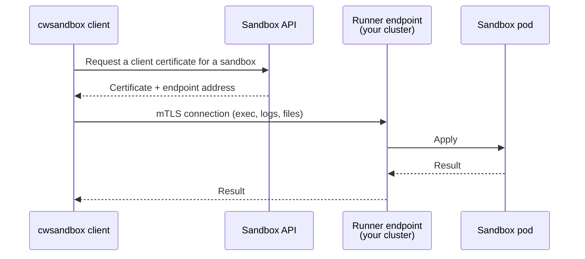

# Configure the direct data plane for a runner

Source: https://docs.coreweave.com/products/sandboxes/operations/direct-data-plane

# Configure the direct data plane for a runner

> Expose a runner endpoint so sandbox exec, log, and file operations bypass the gateway.

A direct data plane endpoint lets the `cwsandbox` client carry exec, log, and file operations straight to the runner. These operations use mutual Transport Layer Security (mTLS) instead of passing through the CoreWeave Sandboxes gateway. Lifecycle and management calls still go through the gateway.

This page is for administrators who operate a managed runner on a CoreWeave Kubernetes Service (CKS) cluster. Use this page to learn about the following topics:

* How the direct path reaches the runner.
* How to choose and configure an exposure mode.
* How to route the endpoint through your own ingress controller.
* How to confirm the endpoint is ready.

## Direct connection path to the runner

Each managed runner can serve one stable data-plane endpoint that fronts all of its replicas. The platform resolves the endpoint's address from the runner's `dataPlane` configuration and issues the runner a server certificate for that address. The CoreWeave Sandboxes gateway returns the address to clients together with a sandbox-scoped client certificate.



The following properties of this path shape the configuration choices on this page:

* **The TLS session terminates at the runner**: The runner authenticates every connection by client certificate. Intermediaries must forward the Transmission Control Protocol (TCP) stream unchanged. These include load balancers, ingress controllers, and virtual private networks (VPNs). A proxy that terminates TLS and re-encrypts, or that replaces the client identity with a header, breaks the direct path.
* **The server certificate is issued for the advertised address**: The platform derives the certificate's subject alternative names from the address you configure. Clients verify the runner against that name, so the address must be stable and must resolve to the endpoint.
* **The data-plane Service exposes one port**: Every enabled exposure mode creates a Service for only the data-plane listener, TCP port `9443`. A custom ingress can publish a different port, such as `443`, and forward it to this Service. The data-plane Service doesn't expose health, metrics, or control ports.

Clients that use the default `AUTO` transport policy can fall back to the gateway if direct connection setup is unavailable. A `PERMISSION_DENIED` or `UNAUTHENTICATED` error from credential issuance still fails. If a direct certificate lacks permission for an operation, `AUTO` can use the gateway. Fallback isn't a guarantee that an operation already sent to the runner can be retried safely.

## Prerequisites

Before you configure the direct data plane, complete the following prerequisites:

* Deploy a managed runner and confirm that `installStatus` is `RUNNER_INSTALL_STATUS_READY`. In the examples, replace `RUNNER_ID` with your runner ID. For deployment instructions, see [Deploy and manage a runner](https://docs.coreweave.com/products/sandboxes/operations/managed-runners.md).
* Authenticate the CoreWeave Intelligent CLI or export a CoreWeave API access token for `curl`, as described in [Before you begin](https://docs.coreweave.com/products/sandboxes/operations/managed-runners.md#before-you-begin) on the runner page. The examples on this page use the same `$TOKEN` variable.
* Use a token with the `sandbox_admin` permission to read or update the runner.
* Have `kubectl` access to the CKS cluster that hosts the runner. Runner resources live in the `cw-sandbox-system` Namespace. For the custom exposure examples, also install Helm and have permission to manage cluster-scoped resources such as CustomResourceDefinitions (CRDs) and `GatewayClass`.

## Choose an exposure mode

The `spec.data_plane` field selects exactly one exposure mode. When you leave the field unset, the runner inherits the platform default for its release channel. Set `disabled` explicitly to opt out of an enabled default.

In the following addresses, replace `SERVICE_NAME` with the runner Service name and `HOSTNAME` with the configured hostname.

| Mode | What the platform creates in your cluster | Advertised address | Use it when |
| - | - | - | - |
| `disabled` | Nothing | None. Clients must use the gateway for new data operations. | The cluster can't accept inbound connections, or you want a deterministic gateway-only posture. |
| `cluster_ip` | A `ClusterIP` Service | `https://SERVICE_NAME.cw-sandbox-system.svc:9443` | Clients can route to cluster Services and resolve the cluster Service DNS name. |
| `load_balancer` | A `LoadBalancer` Service | `https://HOSTNAME:9443` | You want a dedicated public or private address for the endpoint with no other ingress in the path. |
| `custom` | A `ClusterIP` Service | The `advertised_uri` you supply | You route through your own ingress controller, VPN, service mesh, or overlay network. |

The platform names the Service after its internal identifier for the runner, so read the name from the cluster rather than deriving it. The Service carries the label `sandbox.coreweave.com/component=data-plane`:

```bash theme={"system"}
kubectl get svc -n cw-sandbox-system -l sandbox.coreweave.com/component=data-plane
```

The following constraints apply to changes:

* After a nonempty `load_balancer.load_balancer_class` is set, you can't change or clear it in place, including by switching to another enabled exposure mode. Set `disabled` first, wait for the Service to be removed, then apply the new configuration.
* A change in exposure mode can change the advertised address and interrupt active direct operations. Verify connectivity again after the change.

## Expose the endpoint with a LoadBalancer Service

The `load_balancer` mode creates a `LoadBalancer` Service that forwards TCP port `9443` to the runner without terminating TLS. Set the intended reachability with `scope` and configure the provider's address selection through `annotations` or `load_balancer_class`. Pass client network ranges in classless inter-domain routing (CIDR) notation through `source_ranges`. The provider must support and enforce those source ranges.

`hostname` is required. The platform includes it in the server certificate, advertises `https://HOSTNAME:9443` to clients, and sets the `external-dns.alpha.kubernetes.io/hostname` annotation on the Service for clusters that run ExternalDNS. On CKS, publish the name through the External Hostname Controller instead. Add the `service.beta.kubernetes.io/external-hostname` annotation and set `hostname` to the fully qualified name that CKS allocates. The short annotation value `runner-a` produces `runner-a.ORG_ID-CLUSTER_NAME.coreweave.app`. Follow only the DNS allocation instructions in [Create a public DNS name](https://docs.coreweave.com/products/networking/ingress-service/create-public-dns-name.md). The runner provides its TLS certificate, so don't configure ingress TLS termination for this endpoint.

For a public address on CKS, also add `service.beta.kubernetes.io/coreweave-load-balancer-type: public`. With the default CKS address configuration, omitting this annotation assigns a private address. For address selection details, see [Expose a Service](https://docs.coreweave.com/products/networking/ingress-service/expose-service-dns.md). A `PRIVATE` scope requires either a `load_balancer_class` or a provider annotation, because the platform can't infer how your provider selects a private address.

Replace `ORG_ID` and `CLUSTER_NAME` with your organization ID and the cluster name, and replace `CLIENT_CIDR` in `source_ranges` with the CIDR of a network your clients connect from.

> [tab] CLI
>
> ```yaml title="data-plane.yaml" theme={"system"}
> spec:
>   data_plane:
>     load_balancer:
>       scope: RUNNER_DATA_PLANE_SERVICE_SCOPE_PUBLIC
>       hostname: runner-a.ORG_ID-CLUSTER_NAME.coreweave.app
>       external_traffic_policy: RUNNER_DATA_PLANE_EXTERNAL_TRAFFIC_POLICY_CLUSTER
>       source_ranges:
>         - CLIENT_CIDR
>       annotations:
>         service.beta.kubernetes.io/coreweave-load-balancer-type: public
>         service.beta.kubernetes.io/external-hostname: runner-a
> ```
>
> ```bash theme={"system"}
> cwic sandbox runner edit RUNNER_ID -f data-plane.yaml
> ```

> [tab] curl
>
> ```bash title="Expose the runner endpoint through a public LoadBalancer" theme={"system"}
> curl --fail-with-body -X PATCH \
>   'https://api.coreweave.com/v1/sandbox/managedRunners/RUNNER_ID?updateMask=spec.dataPlane' \
>   -H "Authorization: Bearer $TOKEN" \
>   -H "Content-Type: application/json" \
>   -d '{
>     "spec": {
>       "dataPlane": {
>         "loadBalancer": {
>           "scope": "RUNNER_DATA_PLANE_SERVICE_SCOPE_PUBLIC",
>           "hostname": "runner-a.ORG_ID-CLUSTER_NAME.coreweave.app",
>           "externalTrafficPolicy": "RUNNER_DATA_PLANE_EXTERNAL_TRAFFIC_POLICY_CLUSTER",
>           "sourceRanges": [
>             "CLIENT_CIDR"
>           ],
>           "annotations": {
>             "service.beta.kubernetes.io/coreweave-load-balancer-type": "public",
>             "service.beta.kubernetes.io/external-hostname": "runner-a"
>           }
>         }
>       }
>     }
>   }'
> ```

After the update, the runner rolls out with the new configuration and the Service appears in the `cw-sandbox-system` Namespace. Check the Service address and DNS, then verify from a client. A successful configuration update doesn't confirm network reachability.

## Route the endpoint through your own ingress controller

If your cluster already terminates inbound traffic at an ingress controller, use `custom` mode for an endpoint behind the same address. The platform creates a `ClusterIP` Service on port `9443`, and you supply the address that clients should dial as `advertised_uri`.

The requirements are the same as for any path in front of the runner:

* Use **TLS passthrough** for the route, matched on the TLS server name indication (SNI) of the connection. Don't terminate TLS at the ingress controller.
* Set `advertised_uri` to an absolute `https://` origin with no path, query, or credentials, such as `https://runner-a.ORG_ID-CLUSTER_NAME.coreweave.app:443`. The host must resolve to the ingress controller, and the port must be the port the controller listens on.
* Install Gateway API CRDs compatible with your controller. The CoreWeave Traefik chart and the Envoy Gateway `v1.9.1` example both support `TLSRoute` version `v1`. Don't replace a CRD bundle owned by another component without coordinating with its owner.

Both examples use a hostname under your cluster's `.coreweave.app` domain. Traefik uses the cluster wildcard record. The Envoy example creates a specific record through the `external-hostname` annotation. Replace `ORG_ID` and `CLUSTER_NAME` with your values.

### Prepare the ingress controller

Choose the controller you run. Both configurations publish a TLS passthrough listener for the runner hostname on a public `LoadBalancer` Service with a `.coreweave.app` DNS name.

> [tab] Traefik (CoreWeave chart)
>
> The CoreWeave [Traefik](https://docs.coreweave.com/products/cks/clusters/coreweave-charts/traefik.md) chart can serve Gateway API routes on the same Pods and the same `LoadBalancer` Service as its Ingress routes. The chart's Service already carries `service.beta.kubernetes.io/coreweave-load-balancer-type: public` and `service.beta.kubernetes.io/external-hostname: '*'`. The wildcard resolves hostnames under `*.ORG_ID-CLUSTER_NAME.coreweave.app` to Traefik unless a specific DNS record takes precedence. Before using the runner hostname, confirm that it resolves to Traefik's address. If an existing record points elsewhere, choose an unused hostname or update that record. See [Gateway API](https://docs.coreweave.com/products/cks/clusters/coreweave-charts/traefik.md#gateway-api) for the chart's prerequisites and CRD ownership guidance.
>
> 1. Follow [Install the Gateway API CRDs](https://docs.coreweave.com/products/cks/clusters/coreweave-charts/traefik.md#install-the-gateway-api-crds) for the standard-channel bundle supported by the chart. If a compatible bundle is already installed, reuse it.
>
> 2. Enable the Gateway API provider and add a TLS passthrough listener on the `websecure` entrypoint. The listener `port` is Traefik's container port (`8443`), not the port the `LoadBalancer` publishes (`443`):
>
>    ```yaml title="traefik-values.yaml" theme={"system"}
>    traefik:
>      providers:
>        kubernetesGateway:
>          enabled: true
>      gateway:
>        enabled: true
>        listeners:
>          web:
>            port: 8000
>            protocol: HTTP
>          sandbox-data-plane:
>            port: 8443
>            protocol: TLS
>            hostname: "runner-a.ORG_ID-CLUSTER_NAME.coreweave.app"
>            mode: Passthrough
>            namespacePolicy:
>              from: All
>    ```
>
>    ```bash theme={"system"}
>    helm repo add coreweave https://charts.core-services.ingress.coreweave.com
>    helm upgrade --install traefik coreweave/traefik \
>      --namespace traefik --create-namespace \
>      -f traefik-values.yaml
>    ```
>
>    If Traefik is already installed from this chart, merge these values into your existing values file and upgrade the release.
>
> The resulting Gateway is named `traefik-gateway` in the `traefik` Namespace. Use those values for `GATEWAY_NAME` and `GATEWAY_NAMESPACE` in the following route.

> [tab] Envoy Gateway
>
> [Envoy Gateway](https://gateway.envoyproxy.io/) has built-in support for the Gateway API. The `v1.9.1` Helm chart used here includes Gateway API CRDs that serve `TLSRoute` as `v1`. By default, Envoy Gateway creates a `LoadBalancer` Service for each `Gateway`. The CoreWeave annotations make the address public and allocate a DNS name. Add them to an `EnvoyProxy` resource that the `Gateway` references.
>
> 1. Install Envoy Gateway:
>
>    ```bash theme={"system"}
>    helm upgrade --install eg oci://docker.io/envoyproxy/gateway-helm --version v1.9.1 \
>      --namespace envoy-gateway-system --create-namespace
>    ```
>
>    If another component manages the Gateway API CRDs, confirm that its bundle is compatible with Envoy Gateway `v1.9.1` and serves the route version used here. Install the Envoy Gateway CRDs separately before adding `--set crds.enabled=false`. That flag skips both CRD sets. Follow the [chart's existing-CRD installation procedure](https://github.com/envoyproxy/gateway/tree/v1.9.1/charts/gateway-helm#skip-install-crds).
>
> 2. Create a `GatewayClass`, an `EnvoyProxy` that carries the CoreWeave Service annotations, and a `Gateway` with a TLS passthrough listener on port `443`. The short `external-hostname` value `runner-a` allocates `runner-a.ORG_ID-CLUSTER_NAME.coreweave.app`, which must match the listener hostname:
>
>    ```yaml title="envoy-gateway.yaml" theme={"system"}
>    apiVersion: gateway.networking.k8s.io/v1
>    kind: GatewayClass
>    metadata:
>      name: envoy
>    spec:
>      controllerName: gateway.envoyproxy.io/gatewayclass-controller
>    ---
>    apiVersion: gateway.envoyproxy.io/v1alpha1
>    kind: EnvoyProxy
>    metadata:
>      name: sandbox-data-plane
>      namespace: envoy-gateway-system
>    spec:
>      provider:
>        type: Kubernetes
>        kubernetes:
>          envoyService:
>            annotations:
>              service.beta.kubernetes.io/coreweave-load-balancer-type: public
>              service.beta.kubernetes.io/external-hostname: runner-a
>    ---
>    apiVersion: gateway.networking.k8s.io/v1
>    kind: Gateway
>    metadata:
>      name: sandbox-data-plane
>      namespace: envoy-gateway-system
>    spec:
>      gatewayClassName: envoy
>      infrastructure:
>        parametersRef:
>          group: gateway.envoyproxy.io
>          kind: EnvoyProxy
>          name: sandbox-data-plane
>      listeners:
>        - name: sandbox-data-plane
>          protocol: TLS
>          port: 443
>          hostname: "runner-a.ORG_ID-CLUSTER_NAME.coreweave.app"
>          tls:
>            mode: Passthrough
>          allowedRoutes:
>            namespaces:
>              from: All
>    ```
>
>    ```bash theme={"system"}
>    kubectl apply -f envoy-gateway.yaml
>    ```
>
> The Gateway is named `sandbox-data-plane` in the `envoy-gateway-system` Namespace. Use those values for `GATEWAY_NAME` and `GATEWAY_NAMESPACE` in the following route.

### Point the runner at the ingress address

The `custom.advertised_uri` value is what clients dial, so it names the ingress hostname and port, not the `ClusterIP` Service.

1. Set `custom.advertised_uri` to the address your ingress controller serves. This configuration also creates the data-plane Service that the route targets in the next step.

   > [tab] CLI
   >
   > ```yaml title="data-plane.yaml" theme={"system"}
   > spec:
   >   data_plane:
   >     custom:
   >       advertised_uri: https://runner-a.ORG_ID-CLUSTER_NAME.coreweave.app:443
   > ```
   >
   > ```bash theme={"system"}
   > cwic sandbox runner edit RUNNER_ID -f data-plane.yaml
   > ```

   > [tab] curl
   >
   > ```bash title="Advertise the runner endpoint through your ingress controller" theme={"system"}
   > curl --fail-with-body -X PATCH \
   >   'https://api.coreweave.com/v1/sandbox/managedRunners/RUNNER_ID?updateMask=spec.dataPlane' \
   >   -H "Authorization: Bearer $TOKEN" \
   >   -H "Content-Type: application/json" \
   >   -d '{
   >     "spec": {
   >       "dataPlane": {
   >         "custom": {
   >           "advertisedUri": "https://runner-a.ORG_ID-CLUSTER_NAME.coreweave.app:443"
   >         }
   >       }
   >     }
   >   }'
   > ```

2. Wait for the runner to roll out.

3. Read the name of the Service it created:

   ```bash theme={"system"}
   kubectl get svc -n cw-sandbox-system -l sandbox.coreweave.com/component=data-plane
   ```

### Bind the route to the runner Service

Create a `TLSRoute` in the runner's Namespace that binds the passthrough listener to the data-plane Service.

1. Replace `GATEWAY_NAME` and `GATEWAY_NAMESPACE` with the values from the controller you prepared, and `SERVICE_NAME` with the Service name from the previous step:

   ```yaml title="runner-tlsroute.yaml" theme={"system"}
   apiVersion: gateway.networking.k8s.io/v1
   kind: TLSRoute
   metadata:
     name: runner-data-plane
     namespace: cw-sandbox-system
   spec:
     parentRefs:
       - name: GATEWAY_NAME
         namespace: GATEWAY_NAMESPACE
         sectionName: sandbox-data-plane
     hostnames:
       - "runner-a.ORG_ID-CLUSTER_NAME.coreweave.app"
     rules:
       - backendRefs:
           - name: SERVICE_NAME
             port: 9443
   ```

   ```bash theme={"system"}
   kubectl apply -f runner-tlsroute.yaml
   kubectl get tlsroute -n cw-sandbox-system runner-data-plane -o yaml
   ```

2. Look for `Accepted: True` and `ResolvedRefs: True` in `status.parents[].conditions`.

3. [Verify from a client](#verify-from-a-client) on the network that uses the endpoint.

## Check the endpoint status

Inspect the runner after any configuration change.

1. Check `installStatus`, `connectionStatus`, and whether `activeRevision` has reached `targetRevision`.

   > [tab] CLI
   >
   > ```bash theme={"system"}
   > cwic sandbox runner describe RUNNER_ID
   > ```

   > [tab] curl
   >
   > ```bash title="Fetch the runner configuration and status" theme={"system"}
   > curl -H "Authorization: Bearer $TOKEN" \
   >   https://api.coreweave.com/v1/sandbox/managedRunners/RUNNER_ID
   > ```

2. Check the data-plane Service:

   ```bash theme={"system"}
   kubectl get svc -n cw-sandbox-system -l sandbox.coreweave.com/component=data-plane
   ```

   For `load_balancer`, confirm that the Service has an address and that the configured hostname resolves to it. For `custom`, check the ingress controller's address and the `TLSRoute` conditions.

These checks don't prove the client can complete mTLS. Run the client check next.

## Verify from a client

The Python client needs its own token environment variable, even if you used `cwic auth login` for the management commands. In the following command, replace `API_ACCESS_TOKEN` with your CoreWeave API access token secret.

1. Install the client in an active Python virtual environment, as described in [Prepare your Python environment](https://docs.coreweave.com/products/sandboxes/client.md#prepare-your-python-environment):

   ```bash theme={"system"}
   uv pip install 'cwsandbox>=1.14.2'
   export CWSANDBOX_API_KEY="API_ACCESS_TOKEN"
   ```

2. Run an operation on the configured CKS runner with the client's transport policy set to `DIRECT`. That mode never falls back to the gateway, so a successful call proves the direct path works from that network:

   ```python theme={"system"}
   from cwsandbox import AuthStrategy, DataPlaneMode, Sandbox

   with Sandbox.run(
       auth=AuthStrategy.COREWEAVE_API_KEY,
       placement_mode="cks",
       runner_ids=["RUNNER_ID"],
       data_plane_mode=DataPlaneMode.DIRECT,
   ) as sandbox:
       print(sandbox.exec(["echo", "direct"]).result().stdout)
   ```

If the call raises an error while the same call under `DataPlaneMode.GATEWAY` succeeds, follow [Troubleshooting](#troubleshooting). For the full set of client options, see [Direct sandbox connections](https://docs.coreweave.com/products/sandboxes/client/guides/direct-connections.md).

## Disable the endpoint

Set `disabled` to remove the Service the platform created. New operations on `AUTO` can use the gateway when direct setup is unavailable. Operations pinned to `DIRECT` fail when they can't establish a direct connection. Existing direct operations can be interrupted.

> [tab] CLI
>
> ```bash theme={"system"}
> echo 'spec: {data_plane: {disabled: {}}}' \
>   | cwic sandbox runner edit RUNNER_ID -f -
> ```

> [tab] curl
>
> ```bash title="Disable the direct data plane" theme={"system"}
> curl --fail-with-body -X PATCH \
>   'https://api.coreweave.com/v1/sandbox/managedRunners/RUNNER_ID?updateMask=spec.dataPlane' \
>   -H "Authorization: Bearer $TOKEN" \
>   -H "Content-Type: application/json" \
>   -d '{
>     "spec": {
>       "dataPlane": {
>         "disabled": {}
>       }
>     }
>   }'
> ```

## Troubleshooting

| Symptom | Likely cause | Fix |
| - | - | - |
| Update rejected with `load_balancer.hostname must be a stable DNS name` | `hostname` is empty or isn't a valid DNS name. | Supply the fully qualified name the endpoint resolves to. |
| Update rejected with `private scope requires a load_balancer_class or provider annotation` | `PRIVATE` scope with no way to select a private address. | Add the provider's class or annotation. With the default CKS address configuration, omit `coreweave-load-balancer-type` to get a private address and pass any other required annotation. |
| Update rejected with `advertised_uri must be an absolute https origin` | The uniform resource identifier (URI) has a path, query, credentials, or a non-`https` scheme. | Use the form `https://HOSTNAME:PORT`. |
| Update rejected with `load_balancer_class cannot change in place` | Kubernetes doesn't allow the Service field to change. | Set `disabled`, wait for the data-plane Service to be removed, then apply the new configuration. |
| The endpoint is unreachable in `load_balancer` mode | The Service has no address yet, or DNS for `hostname` doesn't resolve to it. | Check `kubectl get svc -n cw-sandbox-system` for a pending `LoadBalancer` and confirm the DNS record. On CKS, confirm the `external-hostname` annotation produced the name you configured. |
| `TLSRoute` reports `ResolvedRefs: False` | The route names a Service that doesn't exist yet. | Apply the runner update first, then copy the Service name into `backendRefs`. |
| `DIRECT` fails while `GATEWAY` works | The client network can't reach the advertised address, or an intermediary terminates TLS. | Test TCP reachability to the advertised host and port from the client network. For `custom` mode, confirm the route is passthrough and matches the SNI hostname. |
| TLS handshake fails with a certificate name mismatch | Clients dial a name the server certificate doesn't cover. | Make `advertised_uri` or `hostname` match the name clients use, then wait for the runner to use the new certificate. |

## See also

For an overview of where the gateway and runners sit, see [Sandboxes architecture](https://docs.coreweave.com/products/sandboxes/architecture.md).
