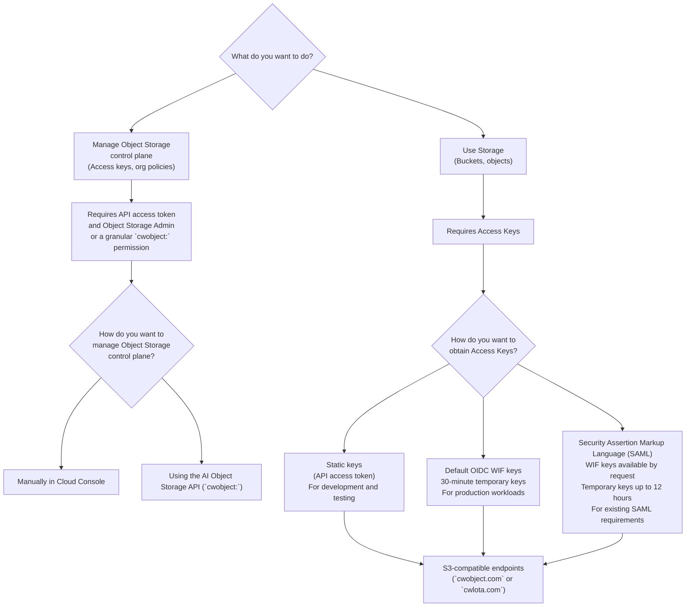

# About authentication and access control

Source: https://docs.coreweave.com/products/storage/object-storage/auth-access/about

# About authentication and access control

> Authentication and authorization for CoreWeave AI Object Storage

Before you start using CoreWeave AI Object Storage, you must set up access tokens, access keys, and organization access policies. Organization access policies authorize principals in your organization. Add a [bucket access policy](https://docs.coreweave.com/products/storage/object-storage/auth-access/bucket-access/bucket-policies.md) when you need to control a specific resource, including access from other organizations. For more information, see [Policy evaluation](https://docs.coreweave.com/products/storage/object-storage/auth-access/policies.md#policy-evaluation). The [Object Storage API](https://docs.coreweave.com/products/storage/object-storage/reference/object-storage-api-ref.md) lets you manage access keys and policies programmatically, while the [Object Storage S3 endpoint](https://docs.coreweave.com/products/storage/object-storage/reference/object-storage-s3.md) lets you create and manage buckets and objects.

Object Storage combines several layers of the [CoreWeave authorization model](https://docs.coreweave.com/security/iam.md#authorization-model): CoreWeave identities and API access tokens, platform IAM roles, Object Storage credentials, and organization or bucket access policies.

For production workloads, CoreWeave recommends [Workload Identity Federation (WIF)](https://docs.coreweave.com/products/storage/object-storage/auth-access/workload-identity-federation/about.md) to obtain Access Keys. It exchanges short-lived OpenID Connect (OIDC) tokens for temporary credentials, which eliminates the need to store or rotate long-lived static keys.

If a principal already authenticates with a [CoreWeave API access token](https://docs.coreweave.com/products/storage/object-storage/auth-access/create-access-tokens.md), CoreWeave recommends exchanging that token directly for temporary credentials instead of creating a separate static Access Key. This method also carries the principal's SCIM group memberships, which you can use for [group-based and attribute-based access control](https://docs.coreweave.com/products/storage/object-storage/auth-access/bucket-access/bucket-policies.md#attribute-based-access-control). See [Direct access token exchange](https://docs.coreweave.com/products/storage/object-storage/auth-access/manage-access-keys/api-access-token.md).

The following diagram outlines how to choose an authentication and management approach for Object Storage:

Use OIDC WIF by default for production workloads. If your organization must use SAML for workload authentication, contact your CoreWeave account team.

## Authentication summary table

This table summarizes the authentication required to use each Object Storage API and interface:

| API/Interface | Purpose | Authentication required |
| - | - | - |
| Object Storage API `api.coreweave.com` | Object Storage control plane Create access keys, org policies | API access token for a principal with the **Object Storage Admin** role or the required `cwobject:` permission granted through an [organization access policy](https://docs.coreweave.com/products/storage/object-storage/auth-access/organization-policies/about.md). |
| Object Storage S3-compatible endpoints `cwobject.com` or `cwlota.com` | Storage operations Manage buckets, upload objects | [Access Keys](https://docs.coreweave.com/products/storage/object-storage/auth-access/manage-access-keys/about.md): obtained directly from a [CoreWeave API access token](https://docs.coreweave.com/products/storage/object-storage/auth-access/manage-access-keys/api-access-token.md) for temporary credentials, by [creating a static key](https://docs.coreweave.com/products/storage/object-storage/auth-access/manage-access-keys/create-keys.md) with an API access token, or through [Workload Identity Federation](https://docs.coreweave.com/products/storage/object-storage/auth-access/workload-identity-federation/about.md) (recommended for production) |
| Cloud Console | Both control plane and storage operations | CoreWeave sign-in and applicable IAM role or `cwobject:` permission for control-plane actions Access Keys and applicable organization or bucket access policies for S3-compatible bucket and object operations |
