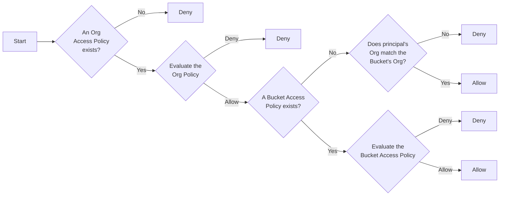

# Manage bucket policies

Source: https://docs.coreweave.com/products/storage/object-storage/auth-access/bucket-access/manage-bucket-policies

# Manage bucket policies

> How to manage bucket policies in CoreWeave AI Object Storage

This page shows bucket owners and administrators how to create and update bucket access policies for CoreWeave AI Object Storage buckets. Use these policies to control which principals can perform which actions on a specific bucket and its objects.

An Object Storage [bucket access policy](https://docs.coreweave.com/products/storage/object-storage/auth-access/bucket-access/bucket-policies.md) is a JSON object that defines access to operations and the objects for the bucket it's assigned to. Each bucket access policy applies to an individual bucket and controls access to the resources inside the bucket. The requesting principal's [organization access policies](https://docs.coreweave.com/products/storage/object-storage/auth-access/organization-policies/manage.md) also affect access to the bucket. For more information, see [Policy evaluation](https://docs.coreweave.com/products/storage/object-storage/auth-access/policies.md#policy-evaluation).

Before you set a bucket access policy, you must create an [organization access policy](https://docs.coreweave.com/products/storage/object-storage/auth-access/organization-policies/manage.md) that allows a principal in your organization to manage the bucket.

You can set bucket access policies programmatically with the [S3-compatible API](https://docs.coreweave.com/products/storage/object-storage/reference/object-storage-s3.md) using standard S3 tools like `aws s3api` or `s3cmd`, or with the [CoreWeave Terraform provider](https://registry.terraform.io/providers/coreweave/coreweave/latest/docs/resources/object_storage_bucket_policy).

## Prerequisites

* You are a member of the CoreWeave organization that owns the bucket (the "bucket owner").
* Your [organization access policy](https://docs.coreweave.com/products/storage/object-storage/auth-access/organization-policies/manage.md) allows `s3:PutBucketPolicy` on the target bucket (or `s3:*` on all buckets).
* You have an [AI Object Storage Access Key](https://docs.coreweave.com/products/storage/object-storage/auth-access/manage-access-keys/create-keys.md).
* You have an S3-compatible client (`aws s3api`, `s3cmd`, or Boto3) [configured for AI Object Storage](https://docs.coreweave.com/products/storage/object-storage/using-object-storage/configure-endpoints.md), or you're using the [CoreWeave Terraform provider](https://registry.terraform.io/providers/coreweave/coreweave/latest/docs/resources/object_storage_bucket_policy).

> [!NOTE]
>
> Only principals from the bucket's owning organization can set or update its bucket access policy. Cross-organization users can't modify bucket policies, even if they have other permissions on the bucket.

### Find your Org ID

You need your Org ID to scope your bucket access policies safely to your organization.

Your **Org ID** is a short hexadecimal string (for example, `ab1cd2`). Find it on the [Settings page](https://console.coreweave.com/account/settings) of your Cloud Console account.

## Policy evaluation

CoreWeave allows or denies access to a bucket by evaluating both the [organization and bucket access policies](https://docs.coreweave.com/products/storage/object-storage/reference/object-storage-api-ref/cwobject/apply-or-update-access-policy.md) as follows:



## Example policies

For sample bucket policies, see [Bucket access policy examples](https://docs.coreweave.com/products/storage/object-storage/auth-access/bucket-access/examples.md).

## Set a policy with CLI tools

The `s3:PutBucketPolicy` API call sets a policy for a bucket. The following tabs describe how to set a bucket access policy with different tools. After you run one of these commands successfully, the new policy applies to the specified bucket, and CoreWeave evaluates access according to it on subsequent requests.

> [tab] AWS CLI
>
> Fill in the following parameters:
>
> * `[BUCKET-NAME]` with the name of the bucket you want to set the policy for.
> * `[FILE-PATH]` with the path to the file containing the policy.
>
> ```bash title="Example command" theme={"system"}
> aws s3api put-bucket-policy --bucket [BUCKET-NAME] --policy [FILE-PATH]
> ```

> [tab] s3cmd
>
> Fill in the following parameters:
>
> * `[BUCKET-NAME]` with the name of the bucket you want to set the policy for.
> * `[FILE-PATH]` with the path to the file containing the policy.
>
> ```bash title="Example command" theme={"system"}
> s3cmd setpolicy [FILE-PATH] s3://[BUCKET-NAME]
> ```

> [tab] Boto3
>
> 1. Set environment variables for your CoreWeave credentials:
>
>    ```bash theme={"system"}
>    export ACCESS_KEY_ID="[ACCESS-KEY-ID]"
>    export SECRET_ACCESS_KEY="[SECRET-ACCESS-KEY]"
>    ```
>
>    Alternatively, configure your CoreWeave credentials to work with the AWS CLI.
>
>    We recommend using a separate profile for CoreWeave AI Object Storage to avoid conflicts with your other AWS profiles and S3-compatible services. If you don't set up this configuration, you might encounter errors when using AI Object Storage. If you have no other [AWS profiles](https://docs.aws.amazon.com/cli/latest/userguide/cli-configure-files.html#cli-configure-files-using-profiles), you can use the [`default`](https://docs.aws.amazon.com/cli/latest/userguide/cli-configure-files.html#cli-configure-files-format-profile) profile instead of the `cw` profile created in the following steps. In that case, omit `--profile cw` from the commands.
>
>    > [!TIP]
>    >
>    > For production workloads, CoreWeave recommends [Workload Identity Federation](https://docs.coreweave.com/products/storage/object-storage/auth-access/workload-identity-federation/about.md) for automated, short-lived credentials instead of static access keys.
>
>    > [accordion] Configure CoreWeave credentials with static access keys
>    >
>    > 1. Create a `cw` profile:
>    >
>    >    ```bash title="Create a new profile" theme={"system"}
>    >    aws configure --profile cw
>    >    ```
>    >
>    > 2. When prompted, provide the following values:
>    >
>    >    * **AWS Access Key ID**: The [Access Key](https://docs.coreweave.com/products/storage/object-storage/auth-access/manage-access-keys/create-keys.md) ID of your CoreWeave AI Object Storage Access Key.
>    >    * **AWS Secret Access Key**: The Secret Key of your CoreWeave AI Object Storage Access Key.
>    >    * **Default region name** (Optional): To set a default region, see [CoreWeave Availability Zones](https://docs.coreweave.com/products/storage/object-storage/buckets/manage-buckets.md#availability-zones).
>    >    * **Default output format**: Use `json` for JSON output.
>    >
>    > 3. Set the default endpoint URL to the appropriate endpoint for your use case:
>    >
>    >    * The primary endpoint, `https://cwobject.com`, for use outside a CoreWeave cluster.
>    >    * The LOTA endpoint, `http://cwlota.com`, for use inside a CoreWeave cluster. The LOTA endpoint routes to the LOTA path for best performance.
>    >
>    >    ```bash title="Set the primary endpoint for local development" theme={"system"}
>    >    aws configure set endpoint_url https://cwobject.com --profile cw
>    >    ```
>    >
>    > 4. Set the S3 `addressing_style` to `virtual`:
>    >
>    >    ```bash title="Set virtual addressing style" theme={"system"}
>    >    aws configure set s3.addressing_style virtual --profile cw
>    >    ```
>    >
>    > To use this profile, pass `--profile cw` to your AWS CLI commands, or set `AWS_PROFILE=cw` in your environment.
>    >
>    > If you set `endpoint_url` and `s3.addressing_style` directly in your code (for example, in a Boto3 `Config` object), you can skip steps 3 and 4. The profile only needs the access key, secret key, and region.
>
>    > [accordion] Configure CoreWeave credentials with Workload Identity Federation (OIDC)
>    >
>    > If you've configured [Workload Identity Federation with OIDC](https://docs.coreweave.com/products/storage/object-storage/auth-access/workload-identity-federation/use-oidc-tokens.md), the AWS SDK automatically discovers temporary credentials. Set the following environment variables instead of configuring static access keys.
>    >
>    > Replace `[ORG-ID]` with your CoreWeave organization ID, `[PATH-TO-JWT-TOKEN-FILE]` with the path to your JWT token file, and `[AVAILABILITY-ZONE]` with your CoreWeave Availability Zone.
>    >
>    > ```bash title="Configure WIF OIDC credentials" theme={"system"}
>    > export AWS_CONTAINER_CREDENTIALS_FULL_URI=https://api.coreweave.com/v1/cwobject/temporary-credentials/oidc/[ORG-ID]
>    > export AWS_CONTAINER_AUTHORIZATION_TOKEN_FILE=[PATH-TO-JWT-TOKEN-FILE]
>    >
>    > aws configure set s3.addressing_style virtual
>    >
>    > export AWS_REGION="[AVAILABILITY-ZONE]"
>    > export AWS_ENDPOINT_URL_S3="https://cwobject.com"
>    > ```
>    >
>    > With WIF configured, your S3-compatible tools and Boto3 code automatically obtain and refresh temporary credentials without passing access keys explicitly.
>    >
>    > Requires `awscli >= 2.33.2` or `boto3 >= 1.42.5`. See [Use Workload Identity Federation with OIDC](https://docs.coreweave.com/products/storage/object-storage/auth-access/workload-identity-federation/use-oidc-tokens.md) for the full setup guide.
>
> 2. Replace `[BUCKET-NAME]` with the name of the bucket, `[ORG-ID]` with your organization's ID, `[USER-ID]` with the console user's ID, `[SAML-GROUP-ID]` with the SAML group ID, and `[AVAILABILITY-ZONE]` with your bucket's Availability Zone.
>
>    ```python title="Set a bucket policy" theme={"system"}
>    import os
>    import json
>    import boto3
>    from botocore.client import Config
>
>    boto_config = Config(
>        region_name='[AVAILABILITY-ZONE]',
>        s3={'addressing_style': 'virtual'}
>    )
>
>    s3 = boto3.client(
>        's3',
>        endpoint_url='https://cwobject.com',
>        aws_access_key_id=os.environ['ACCESS_KEY_ID'],
>        aws_secret_access_key=os.environ['SECRET_ACCESS_KEY'],
>        config=boto_config
>    )
>
>    bucket_name = '[BUCKET-NAME]'
>    org_id = '[ORG-ID]'
>
>    policy = {
>        "Version": "2012-10-17",
>        "Statement": [
>            {
>                "Sid": "AllowPutObject",
>                "Effect": "Allow",
>                "Principal": {
>                    "CW": ["arn:aws:iam::[ORG-ID]:coreweave/[USER-ID]"],
>                    "AWS": ["arn:aws:iam::[ORG-ID]:saml/[SAML-GROUP-ID]"]
>                },
>                "Action": ["s3:PutObject", "s3:PutObjectAcl"],
>                "Resource": [f"arn:aws:s3:::{bucket_name}/*"],
>                "Condition": {
>                    "StringEquals": {
>                        "cw:PrincipalOrgID": [org_id]
>                    }
>                }
>            }
>        ]
>    }
>
>    response = s3.put_bucket_policy(
>        Bucket=bucket_name,
>        Policy=json.dumps(policy)
>    )
>
>    print(response)
>    ```

## Set a policy with Terraform

To use the CoreWeave Terraform provider to set a bucket access policy, use the [`coreweave_object_storage_bucket_policy` resource](https://registry.terraform.io/providers/coreweave/coreweave/latest/docs/resources/object_storage_bucket_policy).

You can set the policy in one of the following ways:

* Pass an encoded JSON string directly to the `policy` attribute.
* Use the `coreweave_object_storage_bucket_policy_document` data source to create the policy.

There is one example below for each approach. Both examples grant a specific console user and a SAML group all S3 actions on the bucket and its objects. Fill in `[ORG-ID]`, `[USER-ID]`, and `[SAML-GROUP-ID]` with your own values.

> [tab] Pass JSON to policy attribute
>
> ```hcl theme={"system"}
> ## Example using jsonencode to pass a raw JSON string to the policy attribute
>
> locals {
>   bucket_policy = {
>     Version = "2012-10-17"
>     Statement = [
>       {
>         Sid    = "AllowUserAndGroup"
>         Effect = "Allow"
>         Principal = {
>           "CW"  = ["arn:aws:iam::[ORG-ID]:coreweave/[USER-ID]"]
>           "AWS" = ["arn:aws:iam::[ORG-ID]:saml/[SAML-GROUP-ID]"]
>         }
>         Action   = ["s3:*"]
>         Resource = [
>           "arn:aws:s3:::${coreweave_object_storage_bucket.raw.name}",
>           "arn:aws:s3:::${coreweave_object_storage_bucket.raw.name}/*",
>         ]
>         Condition = {
>         "StringEquals" = {
>           "cw:PrincipalOrgID" = ["${var.org_id}"]
>           }
>         }
>       },
>     ]
>   }
> }
>
> resource "coreweave_object_storage_bucket" "raw" {
>   name = "bucket-policy-raw-example"
>   zone = "US-EAST-04A"
> }
>
> resource "coreweave_object_storage_bucket_policy" "raw" {
>   bucket = coreweave_object_storage_bucket.raw.name
>   policy = jsonencode(local.bucket_policy)
> }
> ```

> [tab] Use the policy document data source
>
> ```hcl theme={"system"}
> ## Example using the coreweave_object_storage_bucket_policy_document data source
>
> resource "coreweave_object_storage_bucket" "doc" {
>   name = "bucket-policy-doc-example"
>   zone = "US-EAST-04A"
> }
>
> data "coreweave_object_storage_bucket_policy_document" "doc" {
>   version = "2012-10-17"
>
>   statement {
>     sid      = "AllowUserAndGroup"
>     effect   = "Allow"
>     action   = ["s3:*"]
>     resource = [
>       "arn:aws:s3:::${coreweave_object_storage_bucket.doc.name}",
>       "arn:aws:s3:::${coreweave_object_storage_bucket.doc.name}/*",
>     ]
>     principal = {
>       "CW"  = ["arn:aws:iam::[ORG-ID]:coreweave/[USER-ID]"]
>       "AWS" = ["arn:aws:iam::[ORG-ID]:saml/[SAML-GROUP-ID]"]
>     }
>     condition = {
>       "StringEquals" = {
>         "cw:PrincipalOrgID" = var.org_id
>       }
>     }
>   }
> }
>
> resource "coreweave_object_storage_bucket_policy" "doc" {
>   bucket = coreweave_object_storage_bucket.doc.name
>   policy = data.coreweave_object_storage_bucket_policy_document.doc.json
> }
> ```

[This resource is also available in OpenTofu](https://search.opentofu.org/provider/coreweave/coreweave/latest/docs/resources/object_storage_bucket_policy). See [Use Terraform to manage CoreWeave AI Object Storage infrastructure as code](https://docs.coreweave.com/products/storage/object-storage/use-terraform-aws-provider.md) for more information.

## Roles for bucket access policies

You can use roles in bucket access policies to specify a set of permissions for a user or group of users. This lets you grant permissions to identities defined outside of CoreWeave (for example, through SAML) as well as to CoreWeave Cloud Console users. Define roles in the `Principal` field of the policy. The following table describes the fields that define roles in a bucket access policy.

| Value | Description |
| - | - |
| `org-id` | A static identifier for [your organization at CoreWeave](https://docs.coreweave.com/security/authn-authz/orgs-users.md#organization-ids). If you use `Conditions` instead of the `Principal` field, you can substitute a variable like `cw:ResourceOrgId` for the actual value. |
| `principal-provider` | Specifies where the principal came from. For example, the `principal-provider` for a SAML integration is `saml`. Similarly, it's `coreweave` for a user inside CoreWeave's cloud. You can also use this field to specify a `role` targeting principals who have credentials for specific roles. |
| `principal-name` | Identifies the actual actor from the specified provider. For example, if the `principal-provider` is `saml`, then that name is the value of [the `PrincipalName` attribute in the SAML assertion](https://docs.coreweave.com/products/storage/object-storage/auth-access/manage-access-keys/about). For Cloud Console users, this value is the user's `UID`, which appears in that user's **Settings** in Cloud Console. |

## Additional resources

For more information, see:

* [About authentication and access control](https://docs.coreweave.com/products/storage/object-storage/auth-access/about.md).
* [About organization access policies](https://docs.coreweave.com/products/storage/object-storage/auth-access/organization-policies/about.md).
* [About bucket access policies](https://docs.coreweave.com/products/storage/object-storage/auth-access/bucket-access/bucket-policies.md).
* [Use Terraform to manage CoreWeave AI Object Storage infrastructure as code](https://docs.coreweave.com/products/storage/object-storage/use-terraform-aws-provider.md).
