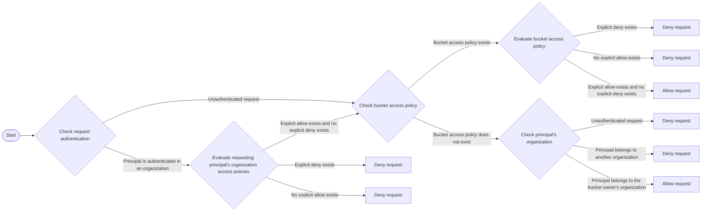

# About policies

Source: https://docs.coreweave.com/products/storage/object-storage/auth-access/policies

# About policies

> How organization-level and bucket-level access policies are evaluated for AI Object Storage requests

Policies in CoreWeave AI Object Storage control access to resources, define permitted actions, and manage data lifecycles. The API authorizes each request against two policies: the requesting principal's organization access policy, and the target bucket's bucket access policy when one exists. Both policies must allow the request. Organization access policies authorize principals in an organization. Bucket access policies authorize access to a specific resource.

This guide covers how policy evaluation works, compares organization and bucket access policies, and outlines key exceptions to consider when designing secure and predictable access controls.

## Policy types

Object Storage uses two types of policies: [organization access policies](https://docs.coreweave.com/products/storage/object-storage/auth-access/organization-policies/about.md) and [bucket access policies](https://docs.coreweave.com/products/storage/object-storage/auth-access/bucket-access/bucket-policies.md).

Organization access policies authorize principals in your organization. They are set in the [Cloud Console](https://console.coreweave.com/object-storage/access-policies) or through the [AI Object Storage API](https://docs.coreweave.com/products/storage/object-storage/reference/object-storage-api-ref/cwobject/apply-or-update-access-policy.md) with HTTP clients like `curl`. An authenticated request must be allowed by the requesting principal's organization access policy. A policy in your organization doesn't apply to principals from another organization, and it can't grant or block unauthenticated access.

Bucket access policies apply to a specific bucket and the objects within it. They are set using the [S3-compatible API](https://docs.coreweave.com/products/storage/object-storage/reference/object-storage-s3.md) with standard S3 tools like `aws s3api` or `s3cmd`. When a bucket has a bucket access policy, the request must also be allowed by that policy. Use a bucket access policy to control the resource, including access from other organizations. Those principals must also have an organization access policy in their own organization that allows the action on the bucket's resource ARN.

## Policy evaluation

The API evaluates each request against the principal's organization access policy and, when applicable, the target bucket's bucket access policy. Both policies must allow the request. The API evaluates them in the following order and rejects the request at the first policy that doesn't allow it.

For an authenticated principal, the API first evaluates that principal's organization access policies:

* If an organization access policy explicitly denies the request, the request is denied.
* If no organization access policy explicitly allows the request, the request is denied.
* If an organization access policy explicitly allows the request and no organization access policy explicitly denies it, the API moves to the next evaluation step.

Next, the API evaluates the bucket access policy. The evaluation follows these rules:

* If the bucket has no bucket access policy and the authenticated principal belongs to the bucket owner's organization, the request is allowed.
* If the bucket has no bucket access policy and the principal belongs to another organization or the request is unauthenticated, the request is denied.
* If the bucket access policy explicitly denies the request, the request is denied.
* If the bucket access policy doesn't explicitly allow the request, the request is denied.
* If the bucket access policy explicitly allows the request and doesn't explicitly deny it, the request is allowed.

The following diagram shows policy evaluation for authenticated and unauthenticated requests:

> [!NOTE]
>
> Unauthenticated requests skip organization access policies, so those policies can't grant or block unauthenticated access. An unauthenticated request is rejected unless a bucket access policy explicitly allows it. For temporary sharing, use [presigned URLs](https://docs.coreweave.com/products/storage/object-storage/reference/object-storage-s3.md#presigned-urls).

## Differences between policy types

Organization and bucket access policies in Object Storage share a similar JSON structure and policy language, but they serve different purposes and have distinct characteristics. The following table compares the two policy types:

| Characteristic | Organization access policies | Bucket access policies |
| - | - | - |
| **Use cases** | Authorize principals in your organization. | Control a specific [bucket](https://docs.coreweave.com/products/storage/object-storage/auth-access/bucket-access/bucket-policies.md), including access from other organizations. |
| **Scope** | Principals in the organization that issued the policy. | A specific bucket and the objects within it. |
| **Role in evaluation** | Must allow the request for an authenticated principal in that organization. Evaluated first in [Policy evaluation](#policy-evaluation). A deny here rejects the request without consulting the bucket policy. | When a bucket policy exists, must also allow the request. Evaluated after the principal's organization access policy. Cross-organization and unauthenticated access are decided here. |
| **Management API** | Managed through the [Cloud Console](https://console.coreweave.com/object-storage/access-policies) or the [Object Storage API](https://docs.coreweave.com/products/storage/object-storage/reference/object-storage-api-ref/cwobject/apply-or-update-access-policy.md). | Managed through the [S3 API](https://docs.coreweave.com/products/storage/object-storage/reference/object-storage-s3.md). |
| **Policy version** | Use `"version": "v1alpha1"`. This is an internal CoreWeave version. | Use `"Version": "2012-10-17"`. (Some older policies may use `"2008-10-17"`.) |
| **API actions** | Includes **both** S3 API and AI Object Storage API actions. | Only includes **S3 API** actions. |
| **`s3:PutBucketPolicy`** | `s3:PutBucketPolicy` **only evaluates organization access policies**. | To prevent lock-out, the `s3:PutBucketPolicy` action is **ignored** in bucket access policy evaluation. You can't set a bucket access policy that prevents you from setting bucket access policies. |
| **Resource format** | Use **short format** `my-bucket`. | Use **ARN format** `arn:aws:s3:::my-bucket`. |
| **Principal format (Cloud Console)** | Use **short format** `coreweave/UserUID`. | Use **ARN format** `arn:aws:iam::123456789012:coreweave/UserUID`. |
| **Principal format (SAML groups)** | Use **short format** `role/Admin`. | Use **ARN format** `arn:aws:iam::123456789012:role/Admin`. |

## Learn more

For more information about organization and bucket access policies, and their associated APIs, see the following guides:

* [Organization access policies](https://docs.coreweave.com/products/storage/object-storage/auth-access/organization-policies/about.md)
* [Bucket access policies](https://docs.coreweave.com/products/storage/object-storage/auth-access/bucket-access/bucket-policies.md)
* [AI Object Storage API](https://docs.coreweave.com/products/storage/object-storage/reference/object-storage-api-ref.md)
* [S3 API](https://docs.coreweave.com/products/storage/object-storage/reference/object-storage-s3.md)
