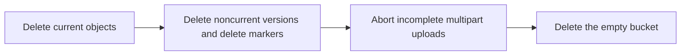

# Empty and delete a bucket

Source: https://docs.coreweave.com/products/storage/object-storage/buckets/empty-and-delete-bucket

# Empty and delete a bucket

> Empty a bucket of objects, versions, delete markers, and incomplete multipart uploads, then delete it.

CoreWeave AI Object Storage only deletes a bucket once it is completely empty. The bucket must contain no current objects, no noncurrent object versions, no delete markers, and no incomplete multipart uploads. If any of these remain, [`s3:DeleteBucket`](https://docs.coreweave.com/products/storage/object-storage/reference/object-storage-s3#s3deletebucket) returns `BucketNotEmpty`.

This guide walks through emptying a bucket of every kind of content it can hold, then deleting the empty bucket. Skip any cleanup step that doesn't apply to your bucket. On a versioned bucket, Step 1 leaves a delete marker for every object it deletes, so run Step 2 after Step 1 finishes. Step 3 is independent of the other cleanup steps. Run Step 4 only after the other steps are complete.



## Prerequisites

Before you start:

* An [Access Key](https://docs.coreweave.com/products/storage/object-storage/auth-access/manage-access-keys/create-keys.md) for the organization that owns the bucket.
* A configured [S3-compatible client](https://docs.coreweave.com/products/storage/object-storage/buckets/manage-buckets.md#manage-buckets-programmatically) (AWS CLI, s3cmd, or Boto3).
* Permission to call [`s3:DeleteObject`](https://docs.coreweave.com/products/storage/object-storage/reference/object-storage-s3#s3deleteobject), [`s3:DeleteObjects`](https://docs.coreweave.com/products/storage/object-storage/reference/object-storage-s3#s3deleteobjects), [`s3:AbortMultipartUpload`](https://docs.coreweave.com/products/storage/object-storage/reference/object-storage-s3#s3abortmultipartupload), and [`s3:DeleteBucket`](https://docs.coreweave.com/products/storage/object-storage/reference/object-storage-s3#s3deletebucket) on the bucket.

> [!WARNING]
>
> Deleting a bucket is permanent. Once a bucket and its contents are deleted, the data cannot be recovered. Confirm the bucket name and contents before you start.

## Step 1: Delete current objects

Delete all current-version objects in the bucket.

> [tab] AWS CLI
>
> `aws s3 rm` with `--recursive` removes every current object in the bucket. Replace `[BUCKET-NAME]` with the name of your bucket.
>
> ```bash title="Delete all current objects with AWS CLI" theme={"system"}
> aws s3 rm s3://[BUCKET-NAME] --recursive
> ```
>
> For very large buckets, see [Bulk deletion performance](#bulk-deletion-performance) for tuning options.

> [tab] s3cmd
>
> `s3cmd rm` with `--recursive` removes every current object in the bucket. Replace `[BUCKET-NAME]` with the name of your bucket.
>
> ```bash title="Delete all current objects with s3cmd" theme={"system"}
> s3cmd rm --recursive s3://[BUCKET-NAME]
> ```

> [tab] Boto3
>
> 1. Set environment variables for your CoreWeave credentials:
>
>    ```bash theme={"system"}
>    export ACCESS_KEY_ID="[ACCESS-KEY-ID]"
>    export SECRET_ACCESS_KEY="[SECRET-ACCESS-KEY]"
>    ```
>
>    Alternatively, configure your CoreWeave credentials to work with the AWS CLI.
>
>    We recommend using a separate profile for CoreWeave AI Object Storage to avoid conflicts with your other AWS profiles and S3-compatible services. If you don't set up this configuration, you might encounter errors when using AI Object Storage. If you have no other [AWS profiles](https://docs.aws.amazon.com/cli/latest/userguide/cli-configure-files.html#cli-configure-files-using-profiles), you can use the [`default`](https://docs.aws.amazon.com/cli/latest/userguide/cli-configure-files.html#cli-configure-files-format-profile) profile instead of the `cw` profile created in the following steps. In that case, omit `--profile cw` from the commands.
>
>    > [!TIP]
>    >
>    > For production workloads, CoreWeave recommends [Workload Identity Federation](https://docs.coreweave.com/products/storage/object-storage/auth-access/workload-identity-federation/about.md) for automated, short-lived credentials instead of static access keys.
>
>    > [accordion] Configure CoreWeave credentials with static access keys
>    >
>    > 1. Create a `cw` profile:
>    >
>    >    ```bash title="Create a new profile" theme={"system"}
>    >    aws configure --profile cw
>    >    ```
>    >
>    > 2. When prompted, provide the following values:
>    >
>    >    * **AWS Access Key ID**: The [Access Key](https://docs.coreweave.com/products/storage/object-storage/auth-access/manage-access-keys/create-keys.md) ID of your CoreWeave AI Object Storage Access Key.
>    >    * **AWS Secret Access Key**: The Secret Key of your CoreWeave AI Object Storage Access Key.
>    >    * **Default region name** (Optional): To set a default region, see [CoreWeave Availability Zones](https://docs.coreweave.com/products/storage/object-storage/buckets/manage-buckets.md#availability-zones).
>    >    * **Default output format**: Use `json` for JSON output.
>    >
>    > 3. Set the default endpoint URL to the appropriate endpoint for your use case:
>    >
>    >    * The primary endpoint, `https://cwobject.com`, for use outside a CoreWeave cluster.
>    >    * The LOTA endpoint, `http://cwlota.com`, for use inside a CoreWeave cluster. The LOTA endpoint routes to the LOTA path for best performance.
>    >
>    >    ```bash title="Set the primary endpoint for local development" theme={"system"}
>    >    aws configure set endpoint_url https://cwobject.com --profile cw
>    >    ```
>    >
>    > 4. Set the S3 `addressing_style` to `virtual`:
>    >
>    >    ```bash title="Set virtual addressing style" theme={"system"}
>    >    aws configure set s3.addressing_style virtual --profile cw
>    >    ```
>    >
>    > To use this profile, pass `--profile cw` to your AWS CLI commands, or set `AWS_PROFILE=cw` in your environment.
>    >
>    > If you set `endpoint_url` and `s3.addressing_style` directly in your code (for example, in a Boto3 `Config` object), you can skip steps 3 and 4. The profile only needs the access key, secret key, and region.
>
>    > [accordion] Configure CoreWeave credentials with Workload Identity Federation (OIDC)
>    >
>    > If you've configured [Workload Identity Federation with OIDC](https://docs.coreweave.com/products/storage/object-storage/auth-access/workload-identity-federation/use-oidc-tokens.md), the AWS SDK automatically discovers temporary credentials. Set the following environment variables instead of configuring static access keys.
>    >
>    > Replace `[ORG-ID]` with your CoreWeave organization ID, `[PATH-TO-JWT-TOKEN-FILE]` with the path to your JWT token file, and `[AVAILABILITY-ZONE]` with your CoreWeave Availability Zone.
>    >
>    > ```bash title="Configure WIF OIDC credentials" theme={"system"}
>    > export AWS_CONTAINER_CREDENTIALS_FULL_URI=https://api.coreweave.com/v1/cwobject/temporary-credentials/oidc/[ORG-ID]
>    > export AWS_CONTAINER_AUTHORIZATION_TOKEN_FILE=[PATH-TO-JWT-TOKEN-FILE]
>    >
>    > aws configure set s3.addressing_style virtual
>    >
>    > export AWS_REGION="[AVAILABILITY-ZONE]"
>    > export AWS_ENDPOINT_URL_S3="https://cwobject.com"
>    > ```
>    >
>    > With WIF configured, your S3-compatible tools and Boto3 code automatically obtain and refresh temporary credentials without passing access keys explicitly.
>    >
>    > Requires `awscli >= 2.33.2` or `boto3 >= 1.42.5`. See [Use Workload Identity Federation with OIDC](https://docs.coreweave.com/products/storage/object-storage/auth-access/workload-identity-federation/use-oidc-tokens.md) for the full setup guide.
>
> 2. This script pages through [`s3:ListObjectsV2`](https://docs.coreweave.com/products/storage/object-storage/reference/object-storage-s3#s3listobjectsv2) and deletes objects in batches of 1000 using [`s3:DeleteObjects`](https://docs.coreweave.com/products/storage/object-storage/reference/object-storage-s3#s3deleteobjects). Replace `[BUCKET-NAME]` with the name of your bucket.
>
>    ```python title="Delete all current objects with Boto3" theme={"system"}
>    import os
>    import boto3
>    from botocore.client import Config
>
>    BUCKET = '[BUCKET-NAME]'
>
>    boto_config = Config(
>        region_name='US-EAST-04A',
>        s3={'addressing_style': 'virtual'}
>    )
>
>    s3 = boto3.client(
>        's3',
>        endpoint_url='https://cwobject.com',
>        aws_access_key_id=os.environ['ACCESS_KEY_ID'],
>        aws_secret_access_key=os.environ['SECRET_ACCESS_KEY'],
>        config=boto_config
>    )
>
>    deleted = 0
>    paginator = s3.get_paginator('list_objects_v2')
>    for page in paginator.paginate(Bucket=BUCKET):
>        contents = page.get('Contents', [])
>        if not contents:
>            continue
>        s3.delete_objects(
>            Bucket=BUCKET,
>            Delete={'Objects': [{'Key': o['Key']} for o in contents]},
>        )
>        deleted += len(contents)
>
>    print(f"Deleted {deleted} current objects from {BUCKET}.")
>    ```

### Bulk deletion performance

For large buckets, choose the deletion approach that matches the scale you need:

* **`s3:DeleteObjects` batches** delete up to 1000 objects per call. The Boto3 example above uses this approach. It is the most efficient way to delete millions of objects from a single client.
* **Parallel `aws s3 rm` workers**: Split deletion across prefixes and run multiple `aws s3 rm s3://[BUCKET-NAME]/[PREFIX] --recursive` commands in parallel. Reasonable for hundreds of thousands of objects when the keys partition cleanly by prefix.
* **`rclone delete`**: Run `rclone delete [REMOTE]:[BUCKET-NAME]` for incremental deletion with progress reporting. Combine with `--transfers` to control concurrency. See [Versioned buckets](https://docs.coreweave.com/products/storage/object-storage/buckets/rclone-versioned-buckets.md) for rclone configuration.

> [!WARNING]
>
> **Mass deletion is a write-heavy workload.** Running thousands of concurrent delete operations against a single bucket can affect other clients reading from or writing to the same bucket. For very large deletions, schedule the work outside peak hours, or stage it across prefixes.

If you do not need immediate deletion, an [`Expiration` lifecycle rule](https://docs.coreweave.com/products/storage/object-storage/buckets/lifecycle-policies#common-configurations) deletes objects on a schedule without consuming client capacity.

## Step 2: Delete noncurrent versions and delete markers

Skip this step if the bucket does not have versioning enabled or suspended. To check:

```bash title="Check the versioning status of a bucket" theme={"system"}
aws s3api get-bucket-versioning --bucket [BUCKET-NAME]
```

If the response includes `"Status": "Enabled"` or `"Status": "Suspended"`, the bucket can hold noncurrent versions and delete markers, both of which must be removed before deletion.

The simplest way to remove every noncurrent version and delete marker is to list them and delete them by `VersionId`.

> [tab] AWS CLI
>
> This shell loop pages through `list-object-versions` and deletes every version and delete marker it finds. Replace `[BUCKET-NAME]` with the name of your bucket.
>
> ```bash title="Delete all versions and delete markers with AWS CLI" theme={"system"}
> BUCKET="[BUCKET-NAME]"
>
> aws s3api list-object-versions --bucket "$BUCKET" \
>     --query '{Objects: Versions[].{Key: Key, VersionId: VersionId}}' \
>     --output json > versions.json
>
> aws s3api delete-objects --bucket "$BUCKET" --delete file://versions.json
>
> aws s3api list-object-versions --bucket "$BUCKET" \
>     --query '{Objects: DeleteMarkers[].{Key: Key, VersionId: VersionId}}' \
>     --output json > markers.json
>
> aws s3api delete-objects --bucket "$BUCKET" --delete file://markers.json
> ```
>
> If the bucket has more than 1000 versions or delete markers, repeat both blocks until both listings return no entries.

> [tab] s3cmd
>
> s3cmd does not delete object versions or delete markers directly. Use the AWS CLI tab or the Boto3 tab.

> [tab] Boto3
>
> ```python title="Delete all versions and delete markers with Boto3" theme={"system"}
> import os
> import boto3
> from botocore.client import Config
>
> BUCKET = '[BUCKET-NAME]'
>
> boto_config = Config(
>     region_name='US-EAST-04A',
>     s3={'addressing_style': 'virtual'}
> )
>
> s3 = boto3.client(
>     's3',
>     endpoint_url='https://cwobject.com',
>     aws_access_key_id=os.environ['ACCESS_KEY_ID'],
>     aws_secret_access_key=os.environ['SECRET_ACCESS_KEY'],
>     config=boto_config
> )
>
> deleted = 0
> paginator = s3.get_paginator('list_object_versions')
> for page in paginator.paginate(Bucket=BUCKET):
>     items = []
>     for v in page.get('Versions', []):
>         items.append({'Key': v['Key'], 'VersionId': v['VersionId']})
>     for m in page.get('DeleteMarkers', []):
>         items.append({'Key': m['Key'], 'VersionId': m['VersionId']})
>     if not items:
>         continue
>     for i in range(0, len(items), 1000):
>         s3.delete_objects(
>             Bucket=BUCKET,
>             Delete={'Objects': items[i:i + 1000]},
>         )
>         deleted += len(items[i:i + 1000])
>
> print(f"Deleted {deleted} versions and delete markers from {BUCKET}.")
> ```

For more on versioned bucket workflows, see [Versioned buckets](https://docs.coreweave.com/products/storage/object-storage/buckets/rclone-versioned-buckets.md).

## Step 3: Abort incomplete multipart uploads

Incomplete multipart uploads do not appear in normal object listings, but they consume storage and prevent bucket deletion. They are the single most common reason `DeleteBucket` returns `BucketNotEmpty` when the bucket appears empty in the Cloud Console or in `aws s3 ls`.

To check whether the bucket has incomplete multipart uploads:

```bash title="List incomplete multipart uploads" theme={"system"}
aws s3api list-multipart-uploads --bucket [BUCKET-NAME]
```

If the response is empty, skip to [Step 4](#step-4-delete-the-empty-bucket).

If it lists any uploads, follow [Abort incomplete multipart uploads](https://docs.coreweave.com/products/storage/object-storage/buckets/abort-multipart-uploads.md) to remove them, then continue.

## Step 4: Delete the empty bucket

Once the bucket has no current objects, no noncurrent versions, no delete markers, and no incomplete multipart uploads, delete it.

> [tab] AWS CLI
>
> Replace `[BUCKET-NAME]` with the name of your bucket.
>
> ```bash title="Delete the empty bucket with AWS CLI" theme={"system"}
> aws s3api delete-bucket --bucket [BUCKET-NAME]
> ```

> [tab] s3cmd
>
> ```bash title="Remove the empty bucket with s3cmd" theme={"system"}
> s3cmd rb s3://[BUCKET-NAME]
> ```

> [tab] Boto3
>
> ```python title="Delete the empty bucket with Boto3" theme={"system"}
> import os
> import boto3
> from botocore.client import Config
>
> boto_config = Config(
>     region_name='US-EAST-04A',
>     s3={'addressing_style': 'virtual'}
> )
>
> s3 = boto3.client(
>     's3',
>     endpoint_url='https://cwobject.com',
>     aws_access_key_id=os.environ['ACCESS_KEY_ID'],
>     aws_secret_access_key=os.environ['SECRET_ACCESS_KEY'],
>     config=boto_config
> )
>
> s3.delete_bucket(Bucket='[BUCKET-NAME]')
> ```

A successful deletion returns no output. If you still get `BucketNotEmpty`, re-run the listings from each step above to find what remains.

## Prevent BucketNotEmpty errors

To keep buckets ready for deletion at any time, apply a [bucket lifecycle policy](https://docs.coreweave.com/products/storage/object-storage/buckets/lifecycle-policies.md) that includes:

* An [`AbortIncompleteMultipartUpload` rule](https://docs.coreweave.com/products/storage/object-storage/buckets/lifecycle-policies#common-configurations). This is the most common cause of bucket-delete failures and the only way to keep abandoned uploads from accumulating without active intervention.
* A [`NoncurrentVersionExpiration` rule](https://docs.coreweave.com/products/storage/object-storage/buckets/lifecycle-policies#common-configurations) on versioned buckets. Without it, every overwrite leaves a noncurrent version that must be cleaned up before deletion.

## Related

* [Bucket lifecycle policies](https://docs.coreweave.com/products/storage/object-storage/buckets/lifecycle-policies.md): Automate the cleanup of versions and incomplete multipart uploads.
* [Abort incomplete multipart uploads](https://docs.coreweave.com/products/storage/object-storage/buckets/abort-multipart-uploads.md): Detailed procedures for listing and aborting MPUs.
* [Versioned buckets](https://docs.coreweave.com/products/storage/object-storage/buckets/rclone-versioned-buckets.md): Manage versioned bucket workflows with rclone and the AWS CLI.
* [Manage buckets](https://docs.coreweave.com/products/storage/object-storage/buckets/manage-buckets.md): Bucket creation and management with S3-compatible clients.
