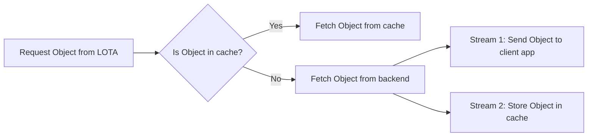

# Local Object Transport Accelerator (LOTA)

Source: https://docs.coreweave.com/products/storage/object-storage/improving-performance/about-lota

# Local Object Transport Accelerator (LOTA)

> Learn about LOTA, an intelligent caching proxy on GPU and CPU Nodes that accelerates AI Object Storage retrieval

CoreWeave's Local Object Transport Accelerator (LOTA) is an intelligent proxy installed on every GPU and CPU Node in a CKS cluster to accelerate data transfer. LOTA achieves this by providing an efficient local gateway to CoreWeave AI Object Storage on each Node in the cluster for faster data transfer rates and lower latency.

LOTA runs on all Node types, including GPU Nodes and CPU Nodes, and is available in clusters with any mix of Node types, including CPU-only clusters. Cache capacity scales with cluster size, with each Node contributing 3 TiB by default.

## Overview

With LOTA, software clients can interact with AI Object Storage through a new API endpoint. Clients only need to point their requests to the LOTA endpoint instead of the primary endpoint, with no other changes required to S3-compatible clients.

* Use the LOTA endpoint, `http://cwlota.com`, when running inside a CoreWeave cluster. The LOTA endpoint routes to the LOTA path for best performance.
* Use the primary endpoint, `https://cwobject.com`, when running outside of a CoreWeave cluster.

LOTA proxies all Object Storage requests to the Object Storage Gateway and storage backend. First, LOTA authenticates each request with the Gateway and verifies proper authorization. Then, when possible, LOTA bypasses the Gateway and accesses the storage backend directly to fetch objects with the greatest possible throughput. LOTA stores the fetched objects in a distributed cache to significantly boost data transfer rates, especially for repeated data requests.

### Data upload and retrieval

In **Step 1** of the following diagram, training data is uploaded to the Object Storage Gateway through the LOTA endpoint for indexing. The Gateway then stores the data in the Object Repository. For data uploads, the LOTA endpoint is used the same way as the primary endpoint.

<video autoPlay muted loop playsInline alt="LOTA animation" src="https://mintcdn.com/coreweave-dbfa0e8d/lW-m410I_gVGZZCw/products/storage/object-storage/improving-performance/_media/coreweave-lotaanimation-V2.mp4?fit=max&auto=format&n=lW-m410I_gVGZZCw&q=85&s=38296fe910f5770e6c025848a1104578" />

In **Step 2**, LOTA forwards the client's request to the Object Storage Gateway, including the local Node's location information. The Gateway processes the request and returns the data, which may include the direct path to the object. When LOTA uses the direct path to bypass the Gateway and access the object directly, data transfer rates improve significantly. By storing the data in a distributed cache, LOTA keeps frequently accessed objects available for quick retrieval.

### Process flow

LOTA caches recently accessed objects on the local disks of GPU and CPU Nodes, reducing latency and boosting read speeds for AI Object Storage. The following diagram illustrates the process flow when fetching an object using LOTA.



When a request is made to LOTA, it first checks if the object is available in the cache. If the object is found, it's fetched directly from the cache, ensuring minimal latency.

If the object isn't in the cache, LOTA fetches it from the storage backend, whether that backend resides in the same Availability Zone as the Node or a different one, and forks it into two pathways:

* **Stream 1** sends the object to the client application.
* **Stream 2** stores the object in the cache, using local storage on one or more GPU or CPU Nodes.

This dual-pathway approach, implemented as two concurrent data streams, ensures that future requests for the same data are served quickly from the cache, enhancing overall performance. LOTA distributes the cache across all GPU and CPU Nodes in a CKS cluster, ensuring efficient data retrieval and management.

## How LOTA manages the cache

When storing an object, LOTA computes which Node should hold the object in its local cache, always considering the object as a whole to avoid the network overhead of accessing multiple Nodes. This computation produces a list of one or more compatible Nodes. LOTA then determines the optimal cache Node placement based on distribution load optimization. See [Performance best practices](https://docs.coreweave.com/products/storage/object-storage/improving-performance/best-practices.md) to learn how different upload patterns affect cache placement.

When a client application requests an object (or part of an object), LOTA determines which Node in the distributed cache should hold the data, then makes an HTTP request to that Node. The Node checks its local cache, and if the data is found, it's delivered to the client.

If the data isn't found, the Node fetches the entire object from the storage backend, whether that backend resides in the same Availability Zone as the Node or a different one, and forks it into two pathways. The first path sends the object (or the requested object byte range) to the client application, while the second path stores the entire object in the local cache of the Node that fetched it. LOTA always caches the entire part of an object that was uploaded when a client application requests any range of the part.

For example, when a file is uploaded to AI Object Storage, it's typically uploaded in parts. A 100 MB object might be uploaded as twenty 5 MB parts (the application uploading the object determines the part size). If a client application requests a byte range on one of those parts, LOTA places the entire 5 MB part into the cache, but not the full 100 MB object.

LOTA manages this distributed cache using the Least Recently Used (LRU) cache algorithm to keep recently accessed objects available for quick retrieval. LOTA's read-after-write consistency guarantees that objects read immediately after writing are always up-to-date without requiring cache invalidation.

> [!NOTE]
>
> LOTA only accelerates HTTP `GET` requests. CoreWeave plans to support other request types in a future release.

## Cross-region reads

Every AI Object Storage bucket resides in a home [Availability Zone](https://docs.coreweave.com/platform/regions/about-regions-and-azs.md). LOTA accelerates reads from a bucket regardless of where the bucket resides, so a workload in one Availability Zone can read a bucket in another Availability Zone or region without keeping a separate copy of the data alongside each workload. On the first read, LOTA fetches the object from the bucket's home Availability Zone and caches it on the local Nodes in the workload's cluster. Later reads of that object are served from the local cache at full speed, the same as reads of a bucket in the local Availability Zone. For more detail on how cross-region reads use the cache, see [Performance best practices](https://docs.coreweave.com/products/storage/object-storage/improving-performance/best-practices.md#minimize-network-contention-with-lota).

Cross-region access is transparent to S3-compatible clients, which use the same LOTA endpoint (`http://cwlota.com`) regardless of where the bucket resides. LOTA accelerates reads only.

The first read of an object fetches the object from the bucket's home Availability Zone. AI Object Storage automatically pre-stages objects into the cache of clusters in that same Availability Zone, but not into clusters in other Availability Zones or regions. To start a workload outside the bucket's home Availability Zone with a warm cache, pre-stage the objects it needs before the workload runs. See [Pre-stage for cross-region workloads](https://docs.coreweave.com/products/storage/object-storage/improving-performance/prestage-cache.md#pre-stage-for-cross-region-workloads).

## Control LOTA cache behavior

By default, all `GET` requests made to the LOTA endpoint are cached. For testing or analysis, it may be desirable to disable the cache for specific requests. To do so, set the `Cache-Control` header to either `no-store` or `no-cache` when performing `GET` operations. These two options have different effects on LOTA's behavior:

* **`no-cache`**: LOTA queries the cache for the object, but the `GET` request isn't cached. This simulates worst-case performance by forcing LOTA to proxy the data without caching it.
* **`no-store`**: LOTA fetches the object directly from the storage backend, bypassing the cache, and the object isn't cached. This lets you test the performance of the storage backend without caching.

For more information, see the [S3 compatibility reference](https://docs.coreweave.com/products/storage/object-storage/reference/object-storage-s3.md#api-calls).

## LOTA security

LOTA benefits from CoreWeave's implementation of industry best practices and standards for security. These practices and standards include:

* **Node isolation**: Every Node is single-tenant and operates in a securely isolated environment.
* **Encryption at rest**: Strengthens data protection and security.
* **VPC networking**: Keeps customer traffic private.
* **Incident response and patching**: Reduces exposure to vulnerabilities.

CoreWeave has developed a [Shared Responsibility Model (SRM)](https://docs.coreweave.com/policies/terms-of-service/shared-responsibility-model.md) to outline the responsibilities of both CoreWeave and customers from a security perspective.

### Encryption support

LOTA supports [server-side encryption with customer keys (SSE-C)](https://docs.coreweave.com/products/storage/object-storage/buckets/server-side-encryption/about-sse-c.md) for enhanced data security. The cached data maintains the same security characteristics as your original encrypted objects.

To further enhance LOTA security posture, customers should take the following additional measures.

### Only run trusted workloads

LOTA runs on Pods in a CKS cluster. Compromised or malicious Kubernetes workloads within the same cluster could download data from AI Object Storage as it's pulled through the LOTA cache. CoreWeave recommends that LOTA only be used within clusters that meet the following criteria:

* Run only trusted workloads.
* Do not grant Node access to users who are not trusted by AI Object Storage access policies.

### Limit access to Nodes running LOTA

LOTA writes data that is encrypted at rest, but decrypted data is accessible to Node administrators. Therefore, customers should never expose administrative access of Nodes running LOTA to untrusted workloads (for example, through privileged workloads). Doing so may grant access to cached data within LOTA in violation of existing AI Object Storage access policies.

### Limit network access to LOTA Pods

LOTA's cache is accessible to other Pods in the cluster. CoreWeave recommends that customers use a Kubernetes NetworkPolicy to prevent unnecessary exposure of internal cache components to the rest of the cluster. Failure to apply a NetworkPolicy may result in data leakage if your cluster runs untrusted workloads. The following example shows a NetworkPolicy:

```yaml theme={"system"}
apiVersion: networking.k8s.io/v1
kind: NetworkPolicy
metadata:
  name: restrict-traffic
  namespace: cw-object-storage

spec:
  podSelector: {} # Apply to all pods in the namespace
  policyTypes:
  - Ingress

  ingress:
  - from:
    ports:
    - protocol: TCP
      port: 80
    - protocol: TCP
      port: 53
    - protocol: UDP
      port: 53

  # Restrict all other traffic to only come from the cw-object-storage namespace
  - from:
    - namespaceSelector:
        matchLabels:
          name: cw-object-storage
    ports:
    - protocol: TCP
      port: 1
      endPort: 65535
```

## More information

The following pages cover related LOTA topics:

* To learn how to configure popular S3-compatible tools to use LOTA, see [Manage buckets](https://docs.coreweave.com/products/storage/object-storage/buckets/manage-buckets.md).
* For performance tuning and best practices, see [Performance best practices](https://docs.coreweave.com/products/storage/object-storage/improving-performance/best-practices.md).
* To pre-stage objects into the LOTA cache before your workload starts, see [Pre-stage the LOTA cache](https://docs.coreweave.com/products/storage/object-storage/improving-performance/prestage-cache.md).
