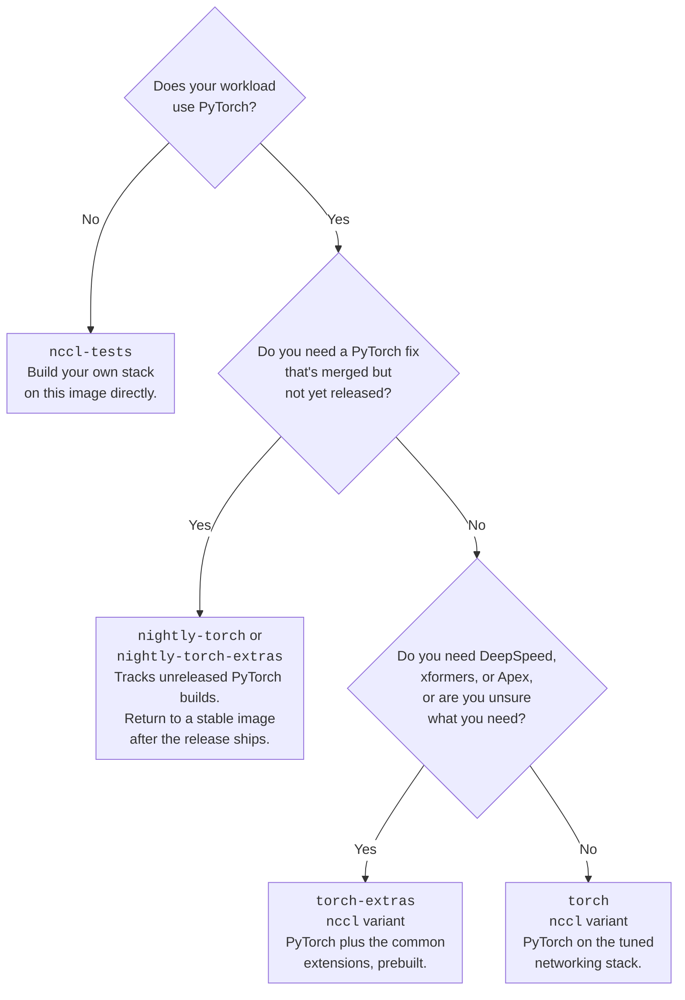

# Choose and troubleshoot a training container image

Source: https://docs.coreweave.com/products/sunk/discover_sunk/choosing-training-images

# Choose and troubleshoot a training container image

> Pick a production-safe ML container tag, match CUDA to your GPU driver, and diagnose image-related failures

[SUNK Standard](https://docs.coreweave.com/products/sunk.md)

[SUNK Self-Service](https://docs.coreweave.com/products/sunk/about-self-service-sunk.md)

This page is for engineers who run training workloads on [CoreWeave Kubernetes Service (CKS)](https://docs.coreweave.com/products/cks.md) and [SUNK](https://docs.coreweave.com/products/sunk.md). It helps you pick a compatible image, read an image tag, and diagnose image-related failures.

For the inventory of published images and what each one contains, see [ML container images](https://docs.coreweave.com/products/sunk/discover_sunk/ml-containers.md).

Choosing the wrong base container image is a common cause of distributed training failures on CoreWeave. The symptoms include `NVIDIA driver on your system is too old`, NCCL initialization failures, crashes that appear only at scale, and throughput changes after an image upgrade.

## Symptoms this page covers

| Symptom | Cause | Section |
| - | - | - |
| `NVIDIA driver on your system is too old (found version NNNNN)` | The image's CUDA version requires a newer driver than the Node runs | [Match CUDA to the Node driver](#match-cuda-to-the-node-driver) |
| `cudaErrorCallRequiresNewerDriver` or `CUDA_ERROR_UNSUPPORTED_PTX_VERSION` at runtime | The image's CUDA minor version is newer than the Node driver fully supports | [Partial compatibility](#partial-compatibility) |
| An unfamiliar tag prefix, or uncertainty about which tag is safe | Branch builds and production builds are published to the same repository | [Choose an image tag](#choose-an-image-tag) |
| `ibv_reg_mr_iova2 failed: Invalid argument` or other `libibverbs` errors | The container's OFED userspace doesn't match the Node's kernel modules | [What not to override](#what-not-to-override) |
| `exec format error` on GH200, GB200, or GB300 | The executable targets an incompatible architecture, such as `x86_64` instead of `aarch64` | [Instances with Grace CPUs need aarch64 images](#instances-with-grace-cpus-need-aarch64-images) |
| `SIGILL`, exit code 132 or -4, on GH200, GB200, or GB300 | A running process attempted an invalid or unsupported CPU instruction | [Instances with Grace CPUs need aarch64 images](#instances-with-grace-cpus-need-aarch64-images) |
| A misleading out-of-memory error on GH200, GB200, or GB300 | An `aarch64` binary in the image assumes 4 KB memory pages | [Instances with Grace CPUs need aarch64 images](#instances-with-grace-cpus-need-aarch64-images) |
| NVIDIA OptiX, EGL rendering, or hardware video decode fails | The driver capability the feature requires isn't enabled | [Driver features that look missing](#driver-features-that-look-missing) |
| Step times or throughput change after an image upgrade | An upgrade changes many components at once | [Throughput changed after an image upgrade](#throughput-changed-after-an-image-upgrade) |

## Image guidance

Every recommended image builds on [`nccl-tests`](https://github.com/coreweave/nccl-tests), which carries the networking libraries tuned for CoreWeave's InfiniBand fabric, including HPC-X. Pick the image that adds only what your workload needs on top of that foundation. Use the following flowchart to help decide what image to use:



`torch` and `torch-extras` also publish a `base` variant. Use it only when image size is a hard constraint and you have time to test the result. It has the following limitations:

* It isn't built on `nccl-tests`, so it lacks networking libraries such as HPC-X.
* Although it keeps `nvcc`, it omits the CUDA development libraries, which can make some workloads fail to build.

Confirm that a `base` image doesn't degrade performance or compatibility.

> [!WARNING]
>
> Installing `torch` from PyPI or another third-party package index into these images replaces the optimized PyTorch stack and removes the benefits of CoreWeave's pinned libraries. Regular PyTorch works on many CoreWeave Nodes, but it doesn't provide the same CoreWeave-specific optimizations.

The following table summarizes the choices:

| Image | Built on | Use it when | Don't use it when |
| - | - | - | - |
| `nccl-tests` | CUDA base | You don't use PyTorch and want the tuned networking stack under your own framework. | You use PyTorch. Start from `torch` instead of installing PyTorch on top. |
| `torch` (`nccl` variant) | `nccl-tests` | You use PyTorch and build your own extensions, or don't need DeepSpeed, xformers, or Apex. | You need any of those three extensions prebuilt. |
| `torch-extras` (`nccl` variant) | `torch` | You need DeepSpeed, xformers, or Apex, or you aren't sure what you need. | You have a hard image-size limit and have verified that a leaner image works for you. |
| `nightly-torch`, `nightly-torch-extras` | `nccl-tests` | You're blocked on a PyTorch fix that's merged but not yet in a stable release. | You're running production workloads that a stable release can serve. |
| `torch` or `torch-extras` (`base` variant) | CUDA base | Image size is a hard constraint and you've tested that performance and compatibility hold. | You need HPC-X or the CUDA development libraries, or you haven't tested the downgrade. |

The `torch`, `torch-extras`, and nightly images are published to `ghcr.io/coreweave/ml-containers`. For what each one contains, see [ML container images](https://docs.coreweave.com/products/sunk/discover_sunk/ml-containers.md). `nccl-tests` is built from a separate repository and published to `ghcr.io/coreweave/nccl-tests`, so it doesn't appear in that inventory and it uses a different tag format.

## Choose an image tag

A tag records the component versions that most often decide compatibility and is usually enough for choosing an image. However, the tag doesn't list everything in the image. Extension versions such as FlashAttention and DeepSpeed, and the HPC-X version inherited from `nccl-tests`, aren't in the tag. The leading commit identifies the exact build, so the full component list is in the [`coreweave/ml-containers`](https://github.com/coreweave/ml-containers) repository at that commit.

The `ghcr.io/coreweave/ml-containers` images use the following tag format, shown here for a production build:

```text theme={"system"}
8a60b2d-nccl-cuda12.9.1-ubuntu22.04-nccl2.28.3-1-torch2.8.0-vision0.23.0-audio2.8.0-abi1
```

Two fields drive the decisions for picking an image:

* **The leading commit**, `8a60b2d`, indicates whether the tag is a production build or a branch build, which the next section covers.
* **The CUDA version**, `cuda12.9.1`, sets the minimum GPU driver the image requires. See [Match CUDA to the Node driver](#match-cuda-to-the-node-driver).

For what every field in the tag means, including the Ubuntu, NCCL, PyTorch, and ABI versions, see [Read an image tag](https://docs.coreweave.com/products/sunk/discover_sunk/ml-containers.md#read-an-image-tag).

### Use unprefixed tags in production

CoreWeave publishes two kinds of tags to the same repository:

* **Production builds** start directly with the commit hash, as in `8a60b2d-nccl-cuda12.9.1-...`. These are built from the default branch.
* **Branch builds** start with a prefix before the rest of the tag, as in `es-sm-10x-...` or `renovate-...`. The build pipeline adds the prefix automatically for any branch other than the default one, so the prefix is the source branch name, whether that branch belongs to an engineer or to an automated dependency bot.

Use the unprefixed builds. Branch builds are development and test artifacts: they may be incomplete, carry experimental patches, or exist only to reproduce a specific issue. Use one only when CoreWeave Support directs you to a specific tag.

The [packages list](https://github.com/orgs/coreweave/packages?repo_name=ml-containers) shows the newest tag first, and that tag is often a branch build or a prerelease CUDA build. Read the tag before you pull it rather than taking the top entry.

### Pick a `nccl-tests` tag

The `nccl-tests` images use a different format that leads with the CUDA version and ends with the commit, as in `12.9.2-devel-ubuntu22.04-nccl2.31.2-1-ee0d4d1`. They don't carry a branch prefix.

To pick a `nccl-tests` image, use the [table of current stable images](https://github.com/coreweave/nccl-tests#docker-images) in the repository README, which CoreWeave keeps up to date. Those are the recommended tags, so you don't need to read the packages list for `nccl-tests`.

## Match CUDA to the Node driver

The container provides the CUDA toolkit. The Node provides the NVIDIA driver. NVIDIA defines two levels of compatibility between them, and most confusion about CUDA versions comes from mixing them up:

* **The minimum driver** is set by the CUDA major version. Any CUDA 12.x toolkit loads on driver `525.60.13` or later, and any CUDA 13.x toolkit loads on driver `580` or later. At this level the CUDA runtime starts, but a given program may or may not run. See [Partial compatibility](#partial-compatibility).
* **The driver for full feature support** is the driver version or branch NVIDIA identifies for that CUDA toolkit release. Use it or a newer driver to support the release's new features. For CUDA 13.x, NVIDIA lists corresponding driver branches, as shown in the following table.

If the Node's driver is older than the minimum for the image's CUDA major version, the container fails at startup:

```text theme={"system"}
NVIDIA driver on your system is too old (found version 12080).
```

The number is the CUDA version the driver supports, computed as 1,000 times the major version plus 10 times the minor version. In this example, `12080` means the driver supports CUDA 12.8.

### Drivers on CoreWeave Nodes

CoreWeave ships driver `580` and `595`, with `595` as the default, and has deprecated `535`. Driver `580` fully supports CUDA toolkits through 13.0, and driver `595` fully supports CUDA toolkits through 13.2. Both run any CUDA 12.x image. For the per-instance driver table, see [About GPU driver management in CKS](https://docs.coreweave.com/products/cks/nodes/gpu-driver-management/gpu-driver-management-cks.md).

### Recommended driver per CUDA version

For an image built with another CUDA toolkit, use the driver version or branch listed for full feature support, or a newer driver:

| CUDA toolkit in the image | Minimum driver | Driver for full feature support |
| - | - | - |
| CUDA 12.0 | 525.60.13 | 525.60.13 |
| CUDA 12.8 | 525.60.13 | 570.26 |
| CUDA 12.9 | 525.60.13 | 575.51.03 |
| CUDA 13.0 | 580 | R580 |
| CUDA 13.1 | 580 | R590 |
| CUDA 13.2 | 580 | R595 |
| CUDA 13.3 | 580 | R610 |
| CUDA 13.4 | 580 | R615 |

Source: [NVIDIA CUDA Toolkit release notes](https://docs.nvidia.com/cuda/cuda-toolkit-release-notes/index.html). CUDA 13.x entries use NVIDIA's corresponding driver branches; update releases within a CUDA minor version use the same branch. CUDA 12.x entries list Linux driver versions for the toolkit's GA release; update releases can require newer versions. Drivers are backward compatible with applications built using older CUDA toolkits.

### Partial compatibility

NVIDIA defines driver `525.60.13` as compatible with any CUDA 12.x release, and driver branch `580` as compatible with any CUDA 13.x release. Under that definition, carefully written software in a CUDA 13.3 container can run on driver `580` or `590`, even though CUDA 13.3 requires driver branch R610 or later for full feature support.

However, many programs don't work like this in practice. Use the drivers listed for full feature support in the preceding table, or newer drivers. If you need a newer CUDA toolkit than your Node's driver fully supports, a given program may or may not crash, depending on how it was written and compiled, and you can't predict the outcome from the image and driver versions alone.

Each CUDA minor version adds driver API calls and raises the PTX ISA version the toolkit emits. That produces two distinct runtime failures on a driver that meets the major-version minimum but lacks support for the toolkit's new features:

* **Precompiled code that calls a newer API.** Code compiled to SASS with the CUDA 13.1 toolkit may call a function that first appeared in driver `590`. On driver `580`, that call fails with `cudaErrorCallRequiresNewerDriver`. Only the code paths that use the newer function are affected, so the program may run for a while before it hits one.
* **PTX that the driver can't compile.** Code compiled to PTX with the CUDA 13.1 toolkit always requires PTX ISA 9.1 or later. Driver `580` can JIT-compile PTX only up to ISA 9.0, so loading that code fails with `CUDA_ERROR_UNSUPPORTED_PTX_VERSION`.

Whether a program hits either failure depends on its dependencies as much as on its own code, so a test run is the only reliable check. Staying on a CUDA toolkit the Node's driver fully supports avoids the question.

### Check the driver on your Nodes

To see which driver each Node runs, list the driver version label:

```bash theme={"system"}
kubectl get nodes -o "custom-columns=NAME:.metadata.name,DRIVER:.metadata.labels.gpu\.coreweave\.cloud/driver-version"
```

The label holds the full version string, such as `580.105.08-0ubuntu1`.

If the image's CUDA toolkit needs a newer driver than your Nodes run, whether for the major-version minimum or for full support of its minor version, you have two options:

* Select an image tag built against an older CUDA toolkit.
* Pin a newer driver on the Node Pool. See [Select GPU driver versions in CKS Node Pools](https://docs.coreweave.com/products/cks/nodes/gpu-driver-management/update-gpu-driver.md).

## Instances with Grace CPUs need aarch64 images

Instances with Grace CPUs, including GH200, GB200, and GB300, run the `aarch64` architecture rather than `x86_64`. An `x86_64` executable fails with `exec format error` when run natively on Grace. A process that starts but later executes an invalid or unsupported instruction can terminate with `SIGILL`, often reported as exit code 132 or -4. Separately, an `aarch64` binary compiled to assume 4 KB memory pages can fail with a misleading out-of-memory error from its own allocator, because Nodes with Grace CPUs use 64 KB pages.

CoreWeave's `nccl-tests` and `ml-containers` images, including `torch`, `torch-extras`, and their nightly channels, publish a manifest list covering both `linux/amd64` and `linux/arm64`, so a single tag runs on x86 instances and instances with Grace CPUs alike.

On instances with Grace CPUs, take the following precautions:

* If you use an image from outside CoreWeave, confirm it publishes an `aarch64` manifest by running `docker manifest inspect [IMAGE]` before you deploy.
* Rebuild custom binaries and compiled extensions for `aarch64`. Don't reuse JIT caches or checkpoints that contain compiled ops from an x86 cluster.

For help interpreting a crash, see [Training job exit-code triage](https://docs.coreweave.com/support/sunk/articles/what-do-training-job-exit-codes-mean).

## What not to override

The maintained images and the CoreWeave platform are tuned to work together, so replacing a component that the platform also provides is a recurring cause of failures.

### System NCCL

You rarely need to replace the NCCL build a maintained image ships. CoreWeave tracks the latest NCCL release in these images, so when you need a newer NCCL, upgrade to a newer base image instead of swapping the library in place. If you do replace NCCL in the `nccl-tests` image or its derivatives, it generally works, because most NCCL components have a stable application binary interface (ABI). To change NCCL behavior rather than its version, use environment variables. See the [NCCL configuration reference](https://docs.coreweave.com/products/networking/hpc-interconnect/nccl-configuration-reference.md).

### libibverbs and OFED userspace

The `libibverbs` and OFED userspace in the container must match the kernel modules on the Node. A mismatch surfaces as `ibv_reg_mr_iova2 failed: Invalid argument` and similar errors. Don't layer a different OFED userspace onto a maintained image. Rebuild against a supported CUDA and OFED base instead.

This isn't a NCCL bug. NCCL reaches InfiniBand through `libibverbs`, so a userspace mismatch surfaces first as a NCCL failure. For the diagnostic steps, see [What do NCCL errors mean?](https://docs.coreweave.com/support/sunk/articles/what-do-nccl-errors-mean).

### GDRCopy kernel components

CoreWeave provides the GDRCopy kernel module on the Node. Don't install a GDRCopy kernel driver inside the container. For the supported path, see [NVSHMEM and GDRCopy support](https://docs.coreweave.com/products/networking/hpc-interconnect/nvshmem-gdrcopy.md).

## Driver features that look missing

NVIDIA OptiX, EGL rendering, and hardware video encode and decode come from the host driver. The NVIDIA Container Toolkit mounts them into the container at runtime based on `NVIDIA_DRIVER_CAPABILITIES`. They aren't built into the image, so a failure here is a capability setting, not a missing package.

CoreWeave's `torch-extras` images ship with `NVIDIA_DRIVER_CAPABILITIES=compute,utility` by default, inherited from the NVIDIA CUDA base image. That value covers CUDA compute and `nvidia-smi` but excludes the following:

| Capability | Required for |
| - | - |
| `graphics` | NVIDIA OptiX, EGL rendering, OpenGL |
| `video` | NVENC and NVDEC hardware encode and decode, including `ffmpeg` cuvid |
| `all` | Everything in the preceding rows, plus CUDA debugging with `cuda-gdb` |

Check the current value inside the container:

```bash theme={"system"}
echo $NVIDIA_DRIVER_CAPABILITIES
```

Set it in a Dockerfile:

```dockerfile theme={"system"}
FROM ghcr.io/coreweave/ml-containers/torch-extras:[TAG]

ENV NVIDIA_DRIVER_CAPABILITIES=all
```

Set it for a Slurm job:

```bash theme={"system"}
srun --container-image=ghcr.io#coreweave/ml-containers/torch-extras:[TAG] \
  --container-env NVIDIA_DRIVER_CAPABILITIES=all \
  python train.py
```

Set it in a Pod spec:

```yaml theme={"system"}
apiVersion: v1
kind: Pod
metadata:
  name: training-pod
spec:
  restartPolicy: Never
  containers:
    - name: trainer
      image: ghcr.io/coreweave/ml-containers/torch-extras:[TAG]
      env:
        - name: NVIDIA_DRIVER_CAPABILITIES
          value: "all"
```

### OptiX denoising weights are not mounted

Even with `NVIDIA_DRIVER_CAPABILITIES=all`, the NVIDIA Container Toolkit can fail to mount `/usr/share/nvidia/nvoptix.bin`, the OptiX denoising weights, while mounting `libnvoptix.so` correctly. The upstream report, [nvidia-container-toolkit issue 127](https://github.com/NVIDIA/nvidia-container-toolkit/issues/127), is closed, but CoreWeave Support has seen the behavior as recently as driver `580`.

To work around it, install the matching userspace GL package in your image, replacing `[DRIVER-MAJOR-VERSION]` with the major version your Nodes run, such as `580`:

```dockerfile theme={"system"}
RUN apt-get update \
  && apt-get install -y --no-install-recommends libnvidia-gl-[DRIVER-MAJOR-VERSION] \
  && rm -rf /var/lib/apt/lists/*
```

Installing the NVIDIA OptiX SDK doesn't fix this. The SDK provides development tools, not the runtime weights.

## Throughput changed after an image upgrade

An image upgrade is rarely a single-variable change. One new tag can move the CUDA, NCCL, PyTorch, torchvision, torchaudio, ABI, and Ubuntu versions at once, along with components the tag doesn't record, and a change of base OS also moves the system Python and glibc versions.

> [!NOTE]
>
> CoreWeave doesn't publish per-tag performance baselines. A large throughput swing across a base image change, in either direction, more often reflects workload or configuration differences than the image itself. Establish your own baseline before you attribute a change to the image.

To isolate a regression, follow these steps:

1. **List the delta.** Compare the two tags field by field, using [Read an image tag](https://docs.coreweave.com/products/sunk/discover_sunk/ml-containers.md#read-an-image-tag) to identify each one, and record every component that changed. Then diff the two commits in the [`coreweave/ml-containers`](https://github.com/coreweave/ml-containers) repository for components the tag doesn't show, such as FlashAttention, DeepSpeed, and HPC-X.
2. **Reproduce on both tags.** Confirm the difference is consistent before you bisect.
3. **Change one field at a time.** Hold the base OS fixed while you isolate a framework or NCCL change, since a base OS change also moves Python and glibc.
4. **Bisect through intermediate tags.** The `ml-containers` repository publishes many builds between releases, which gives you intermediate points to test.
5. **Run at production scale and duration.** Gradual effects, such as step times that erode over hours, don't appear in short runs.

## Collect per-job GPU metrics

Image choice also affects how you collect GPU telemetry because some images ship their own DCGM packages. To interpret the metrics, see [Measure MFU and job performance](https://docs.coreweave.com/products/sunk/optimize_workloads/measuring-mfu-and-job-performance.md).

CoreWeave collects DCGM telemetry through a managed `dcgm-exporter` DaemonSet, so you don't need to run `dcgmi` inside your containers. If your tooling requires DCGM in the container for per-job attribution, package it in your image and scrape its exporter.

If `dcgmi diag` inside a container reports `Detected unsupported Cuda version`, the container has the legacy DCGM 3.x package, which doesn't support CUDA 13 or driver `580` and later. Check which package is installed:

```bash theme={"system"}
apt list --installed | grep datacenter-gpu-manager
```

The legacy package is `datacenter-gpu-manager`. The current packages are named `datacenter-gpu-manager-4-*`. The `nccl-tests` image installs DCGM through `apt`, and builds from before the switch to DCGM 4.x installed the legacy package regardless of their CUDA version. Any image derived from one of those older `nccl-tests` tags carries DCGM 3.x. To resolve it, rebuild on a current `nccl-tests`, `torch`, or `torch-extras` tag.

## Before you open a support ticket

Confirm the following, since each one accounts for a large share of image-related failures:

* The image's CUDA toolkit version is supported by the driver your Nodes run.
* The image architecture matches the instance, which means an `aarch64` manifest for instances with Grace CPUs.
* You haven't replaced the OFED userspace or GDRCopy inside a maintained image.

If the workload still fails, [contact CoreWeave Support](https://docs.coreweave.com/support.md) and include the full image reference and tag, the exact error text, the instance type, and the `gpu.coreweave.cloud/driver-version` label from an affected Node. For a throughput change, include both tags and your measurements at production scale. See [Support ticket templates](https://docs.coreweave.com/support/ticket-templates.md) for the details every ticket needs.

## Additional resources

For more information, see the following resources:

* [ML container images](https://docs.coreweave.com/products/sunk/discover_sunk/ml-containers.md): the published images, variants, and what each contains.
* [Packages list](https://github.com/orgs/coreweave/packages?repo_name=ml-containers): every published image and tag.
* [`coreweave/ml-containers`](https://github.com/coreweave/ml-containers): Dockerfiles and build source.
* [About GPU driver management in CKS](https://docs.coreweave.com/products/cks/nodes/gpu-driver-management/gpu-driver-management-cks.md): supported driver versions per instance type.
* [NCCL configuration reference](https://docs.coreweave.com/products/networking/hpc-interconnect/nccl-configuration-reference.md): NCCL settings for distributed training.
