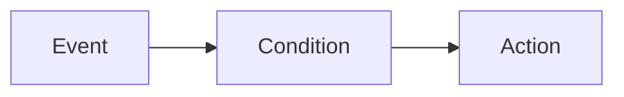

# Automations overview

Source: https://docs.coreweave.com/products/wandb/automations

# Automations overview

> Use W&B Automations for triggering workflows based on events in Weights & Biases

*Automations* send Slack notifications, run webhooks, or send prompts to ARIA in response to specific events in Weights & Biases. You can scope an automation to an organization, a team, project, registry, or collection. An automation observes the event across everything within its scope, including projects, registries, and collections created later. The steps to create an automation and the available events depend on the scope. For event types by scope, see [Automation events and scopes](https://docs.coreweave.com/products/wandb/automations/automation-events.md).

> [!NOTE]
>
> Team-scoped and Organization-scoped automations and the [Automations hub](#automations-hub) are available on W\&B Multi-tenant Cloud and on W\&B Dedicated Cloud (Server v0.83.0 and later).

W\&B Automations follow this pattern: when an **event** occurs and optional **conditions** are met, an **action** runs automatically. For example:

* When a run fails (event), notify a Slack channel (action).
* When the `production` alias is added to an artifact (event), call a webhook to trigger deployment (action).
* When a new model version is linked (event), send a prompt to ARIA to compare it against production (action).

Events and available conditions differ for automations scoped to a [project](https://docs.coreweave.com/products/wandb/automations/automation-events.md#project) or a [registry](https://docs.coreweave.com/products/wandb/automations/automation-events.md#registry). See [Automation events and scopes](https://docs.coreweave.com/products/wandb/automations/automation-events.md).

**Example:** Run fails (event) and optional run name filter (condition) then Slack notification (action). Or: alias `production` added (event) then webhook (action).

## Where to create automations

* **In the Automations hub**: Select **Automations** in the left navigation to see every automation you can access across all scopes: organization, team, project, registry, or collection. You choose the scope when you create an automation. See [Automations hub](https://docs.coreweave.com/products/wandb/automations.md#automations-hub).
* **In a project**: Open the project, then select the **Automations** tab in the project sidebar.
* **In a registry**: Open the registry, then select the **Automations** tab.

## Automations hub

The **Automations** hub is a global surface in the left navigation that aggregates every automation you can access, across all scopes and projects, in a single list. Use it to discover, inspect, and manage automations without navigating to each project or registry.

From the **Automations** hub, you can:

* Create an automation and choose its scope, without needing to know the scoped entry point first.
* View all automations you can access in one list, then filter and sort them (for example, by scope, trigger, or action).
* Click an automation's name to view its full configuration details.
* View an automation's [execution history](https://docs.coreweave.com/products/wandb/automations/view-automation-history.md) to check whether it succeeded or failed.
* Use the quick filter to switch between automations you created and all automations in your organization.
* Select multiple automations and delete them at once.

The **Automations** hub complements the **Automations** tab in each project and registry; those scoped tabs remain available for quick targeted access.

## Use cases

* **Run monitoring and alerting**: Notify the team when a run fails or when a metric crosses a threshold (for example, loss goes to NaN or accuracy drops).
* **Registry CI/CD**: When a new model version is linked or an alias (such as `staging` or `production`) is added, trigger a webhook to run tests or deploy.
* **Project artifact workflows**: When a new artifact version is created or an alias is added in a project, run a downstream job or post to Slack.
* **Automated analysis**: When a run fails or a new model version is linked, send a prompt to [ARIA](https://docs.coreweave.com/products/aria.md) to diagnose the failure or compare the new version against production.

For full event and scope details, see [Automation events and scopes](https://docs.coreweave.com/products/wandb/automations/automation-events.md).

## Automation actions

When an event triggers an automation, it can perform one of these actions:

* **Slack notification**: Sends a message to a Slack channel with details about the triggering event. The message summarizes the event and includes a link to view more details in W\&B.
* **Webhook**: Calls a webhook URL with a JSON payload containing information about the triggering event. Use webhooks to integrate with external systems such as CI/CD pipelines, model deployment services, or custom workflows.
* **Trigger ARIA**: Sends a prompt to [ARIA](https://docs.coreweave.com/products/aria.md), which starts a new conversation and works on the prompt on your behalf. Use ARIA actions to analyze a new model version, diagnose a failed run, or investigate a metric that crossed a threshold. Available on W\&B Multi-tenant Cloud only.

For implementation details, see [Create a Slack automation](https://docs.coreweave.com/products/wandb/automations/create-automations/slack.md), [Create a webhook automation](https://docs.coreweave.com/products/wandb/automations/create-automations/webhook.md), or [Create an ARIA automation](https://docs.coreweave.com/products/wandb/automations/create-automations/aria.md).

## How automations work

To [create an automation](https://docs.coreweave.com/products/wandb/automations/create-automations.md), you:

1. If required, configure [secrets](https://docs.coreweave.com/products/wandb/platform/secrets.md) for sensitive strings the automation requires, such as access tokens, passwords, or sensitive configuration details. Secrets are defined in your **Team Settings**. Secrets are most commonly used in webhook automations to securely pass credentials or tokens to the webhook's external service without exposing it in plain text or hard-coding it in the webhook's payload.
2. Configure team-level webhook or Slack integrations to authorize Weights & Biases to post to Slack or run the webhook on your behalf. A single automation action (webhook or Slack notification) can be used by multiple automations. These actions are defined in your **Team Settings**. An ARIA action requires no integration.
3. In the project or registry, create the automation:
   1. Define the [event](https://docs.coreweave.com/products/wandb/automations/automation-events.md) to watch for, such as when a new artifact version is added.
   2. Define the action to take when the event occurs, such as posting to a Slack channel, running a webhook, or sending a prompt to ARIA. For a webhook, specify a secret to use for the access token and/or a secret to send with the payload, if required.

## Recommendations

* **Start small**: Begin with one or two automations for high-value events (for example, run failures or production alias changes). Validate that they work as expected before adding more.
* **Test before production**: Create automations in a test project or with a test webhook or Slack channel first. Manually trigger the event, then confirm that the action runs and that the payload or message looks correct.
* **Avoid alert fatigue**: Use run filters, metric thresholds, or alias patterns to limit how often an automation fires. If you have multiple severities, route them to different channels.

## Limitations

* [Run metric automations](https://docs.coreweave.com/products/wandb/automations/automation-events.md#run-metrics-change) and [run metrics z-score change automations](https://docs.coreweave.com/products/wandb/automations/automation-events.md#run-metrics-z-score-change) are supported only in [Forge](https://docs.coreweave.com/products/wandb/platform/hosting/hosting-options/multi_tenant_cloud.md) and [Dedicated Cloud](https://docs.coreweave.com/products/wandb/platform/hosting/hosting-options/dedicated-cloud.md).
* At the **Team** and **Organization** scopes, the W\&B App supports only artifact and collection events. Run-based events aren't available in the App at these scopes. See [Automation events and scopes](https://docs.coreweave.com/products/wandb/automations/automation-events.md).

## Next steps

* [Automations tutorial](https://docs.coreweave.com/products/wandb/automations/tutorial.md): Guides you to create a project automation to alert on run failures and a Registry automation to run a webhook when an alias is added. The tutorial uses the W\&B App.
* [Create an automation](https://docs.coreweave.com/products/wandb/automations/create-automations.md).
* [Automation events and scopes](https://docs.coreweave.com/products/wandb/automations/automation-events.md).
* [Create a secret](https://docs.coreweave.com/products/wandb/platform/secrets.md).

> [!NOTE]
>
> Looking for companion tutorials for automations?
>
> * [Learn to automatically trigger a Github Action for model evaluation and deployment](https://forge.coreweave.com/wandb/wandb/wandb-model-cicd/reports/Model-CI-CD-with-W-B--Vmlldzo0OTcwNDQw).
> * [Watch a video demonstrating automatically deploying a model to a Sagemaker endpoint](https://www.youtube.com/watch?v=s5CMj_w3DaQ).
> * [Watch a video series introducing automations](https://youtube.com/playlist?list=PLD80i8An1OEGECFPgY-HPCNjXgGu-qGO6\&feature=shared).
