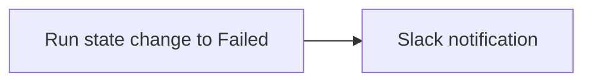

# Tutorial: Project run-failure alert automation

Source: https://docs.coreweave.com/products/wandb/automations/project-automation-tutorial

# Tutorial: Project run-failure alert automation

> Build a run-failure alert that sends a Slack notification when a run in your project fails.

This tutorial walks you through building a **project** automation triggered by run status: when a run in your project transitions to **Failed**, Weights & Biases sends a Slack notification. This automation lets your team learn about failed runs in real time, so you can investigate and remediate them instead of discovering failures later.



> [!TIP]
>
> For guidance creating a Registry automation, see [Tutorial: Registry artifact alias automation](https://docs.coreweave.com/products/wandb/automations/registry-automation-tutorial.md).

## Prerequisites

* A Weights & Biases project.
* A [Slack integration](https://docs.coreweave.com/products/wandb/automations/create-automations/slack.md#add-a-slack-integration) configured in **Team Settings**.

## Create a project automation

Set up a project-scoped automation so that when a run in the project transitions to **Failed**, Weights & Biases sends a Slack notification.

1. Open the project and click the **Automations** tab in the sidebar, then click **Create automation**.
2. Choose the event **Run state change**. Set the state to **Failed**. Optionally add a run name or user filter to limit which runs trigger the automation.
3. Click **Next step**. Set **Action type** to **Slack notification** and select the Slack channel.
4. Click **Next step**. Give the automation a name (for example, "Run failure alert") and an optional description, then click **Create automation**.

Your project now has an active automation that posts to the Slack channel you selected when a run fails. For more detail, see [Create a Slack automation](https://docs.coreweave.com/products/wandb/automations/create-automations/slack.md#create-an-automation) (Project tab).

## Test the automation

To confirm the automation is configured correctly, trigger it with a deliberately failed run. Create a run and log it to the project, explicitly marking it as failed:

```python theme={"system"}
import wandb

with wandb.init(project="my-project") as run:
    run.log({"loss": 1.23})
    run.finish(exit_code=1)
```

Shortly after, you see a Slack message with the run link and status.

## Go further

To learn more about W\&B automations beyond what this tutorial covers, see the following resources:

* [Automation events and scopes](https://docs.coreweave.com/products/wandb/automations/automation-events.md) for all project and registry event types.
* [Create a Slack automation](https://docs.coreweave.com/products/wandb/automations/create-automations/slack.md) and [Create a webhook automation](https://docs.coreweave.com/products/wandb/automations/create-automations/webhook.md) for full UI and payload details.
