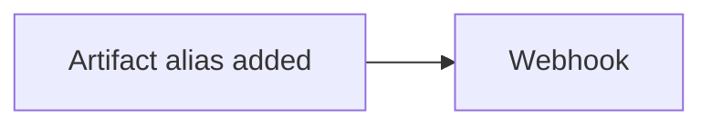

# Tutorial: Registry artifact alias automation

Source: https://docs.coreweave.com/products/wandb/automations/registry-automation-tutorial

# Tutorial: Registry artifact alias automation

> Build an automation that runs a webhook when a Registry artifact gets a specific alias like "production".

This tutorial walks you through building a **registry** automation triggered by artifact metadata: when an artifact in your registry gets a specific alias (for example, **production**), Weights & Biases sends a `POST` request to your webhook. Use this pattern to notify downstream systems like deployment pipelines, paging services, or notification channels, whenever you promote a model to a known stage. This tutorial is intended for ML engineers and MLOps practitioners who manage model lifecycles in Registry.



> [!TIP]
>
> For guidance creating a project automation, see [Tutorial: Project run-failure alert automation](https://docs.coreweave.com/products/wandb/automations/project-automation-tutorial.md).

## Prerequisites

* A [webhook](https://docs.coreweave.com/products/wandb/automations/create-automations/webhook.md#create-a-webhook) configured in **Team Settings**.
* A [Registry](https://docs.coreweave.com/products/registry/create_registry.md) with at least one collection, or reuse an existing registry.

## Create a registry automation

Set up a registry-scoped automation so that when an artifact in any collection in the registry gets a specific alias (for example, **production**), Weights & Biases sends a `POST` request to your webhook.

1. Open the registry and click the **Automations** tab, then click **Create automation**.
2. Choose the event **An artifact alias is added**. Enter an **Alias regex** that matches the alias you care about (for example, **production** or **staging**).
3. Click **Next step**. Set **Action type** to **Webhooks** and select your webhook. If the webhook expects a payload, paste a JSON body and use [payload variables](https://docs.coreweave.com/products/wandb/automations/create-automations/webhook.md#payload-variables) such as `${artifact_collection_name}` and `${artifact_version_string}`.
4. Click **Next step**. Give the automation a name and optional description, then click **Create automation**.

For more information, see [Create a webhook automation](https://docs.coreweave.com/products/wandb/automations/create-automations/webhook.md#create-an-automation) (Registry tab).

## Test the automation

To confirm that the automation fires end-to-end, trigger the configured event by adding the alias to an artifact version. Add the alias (for example, **production**) to an artifact version in the registry, using the W\&B App or the public API. For example:

```python theme={"system"}
import wandb

with wandb.init(project="my-project") as run:
    artifact = wandb.Artifact("my-model", type="model")
    # ... log files or metadata to artifact as needed ...
    run.log_artifact(artifact)
    run.wait()  # Ensure the artifact is logged before proceeding

# Add an alias to the latest version in the collection
api = wandb.Api()
collection = api.artifact_collection(name="my-model", type_name="model")
version = next(collection.versions())  # Get the latest version

version.aliases.append("production")
version.save()
print("Added alias 'production' to", version.name)

```

Within a short time, your webhook endpoint receives a `POST` with the payload you configured. You now have a working registry automation that fires whenever a matching alias is applied to an artifact in this registry.

## Go further

To learn more about W\&B automations beyond what this tutorial covers, see the following resources:

* [Automation events and scopes](https://docs.coreweave.com/products/wandb/automations/automation-events.md) for all project and registry event types.
* [Create a Slack automation](https://docs.coreweave.com/products/wandb/automations/create-automations/slack.md) and [Create a webhook automation](https://docs.coreweave.com/products/wandb/automations/create-automations/webhook.md) for full UI and payload details.
